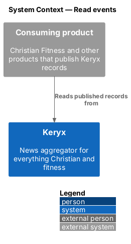
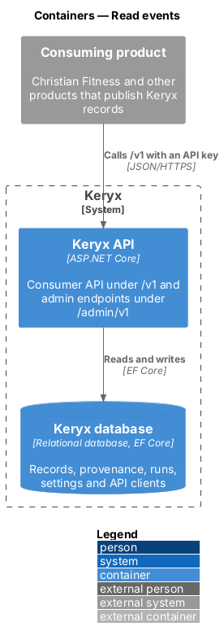
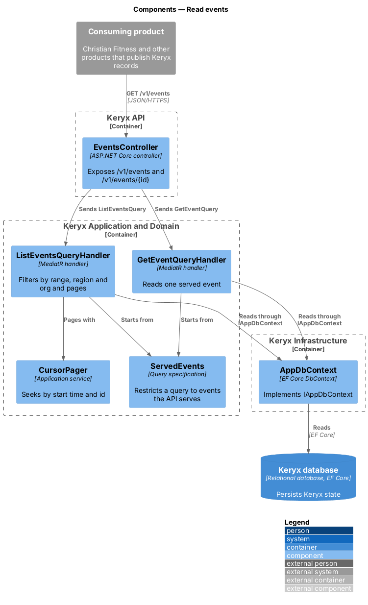
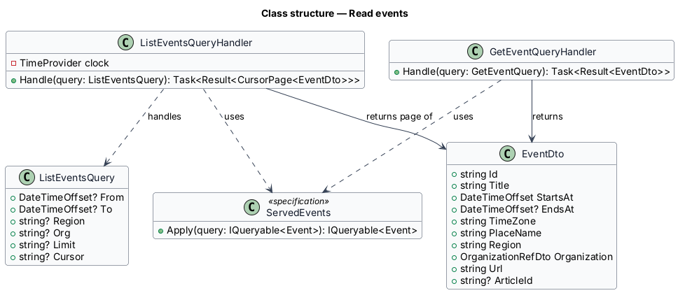
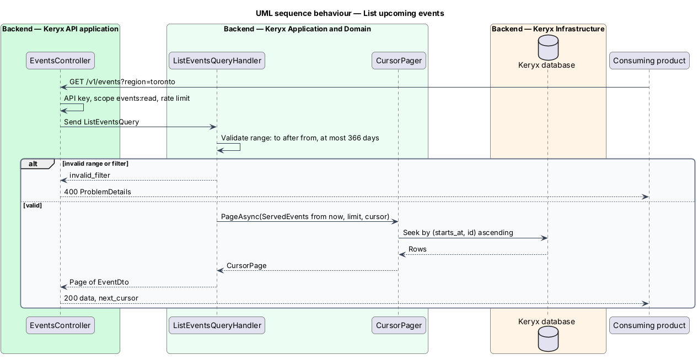

# Read events

## Overview

A consuming product reads upcoming events through `GET /v1/events` and one event through `GET /v1/events/{id}`. The list is ordered by `starts_at` ascending and starts from now, so a product shows what is coming next. Both endpoints need the scope `events:read`.

An event is *served* when the article it is linked to is published, or, with no linked article, when its own score puts it at or above the publish threshold. An event that is not served or does not exist answers `404` with `code` `event_not_found`.

## Description

The slice mirrors the articles slice with a time range in place of `since`. `from` and `to` bound the start time; a range longer than 366 days or a `to` before `from` is refused with `invalid_filter`.

- **`EventsController`** — ASP.NET Core controller in the Keryx API. Exposes /v1/events and /v1/events/{id}.
- **`ListEventsQueryHandler`** — MediatR handler in the Application and Domain layers. Filters by `from`, `to`, `region` and `org`, orders by `starts_at` ascending from `TimeProvider`'s now when `from` is absent, and pages exactly as the articles list.
- **`GetEventQueryHandler`** — MediatR handler in the Application and Domain layers. Reads one served event.
- **`ServedEvents`** — Query specification in the Application and Domain layers. Restricts a query to events the API serves.
- **`CursorPager`** — Application service in the Application and Domain layers. Seeks by start time and id.
- **`AppDbContext`** — EF Core DbContext in the Infrastructure layer. Implements IAppDbContext.
- **`EventDto`** — `id` (prefixed `evt_`), `title`, `starts_at` (UTC), `ends_at` or `null`, `time_zone`, `place_name`, `region`, `organization`, `url` and `article_id` or `null`.

## Requirements

The feature realizes the following level-2 (L2) requirements. Each L2 requirement refines a level-1 (L1) requirement, cited by identifier. The acceptance criteria of each requirement are in [`docs/specs/L2.md`](../../../specs/L2.md).

| L2 ID | Refines (L1) | Requirement |
|-------|--------------|-------------|
| [`L2-028`](../../../specs/L2.md#l2-028-events-endpoints) | `L1-008` | **Events endpoints.** The requirement is defined by its 5 acceptance criteria. |

## Diagrams

### System context

A consuming product reads published records from Keryx.

### Containers

The consuming product calls the Keryx API at `/v1` with an API key. The Keryx API reads and writes the Keryx database.

### Components

`EventsController` sends one query per request; both handlers start from `ServedEvents`.

### Class structure

`ListEventsQuery` carries the range and filters; `ServedEvents` encodes the rule that links an event's visibility to its article.

### Behaviour — list upcoming events

The handler bounds the range, starts from the served set and returns events from now in ascending start order (`L2-028`).

