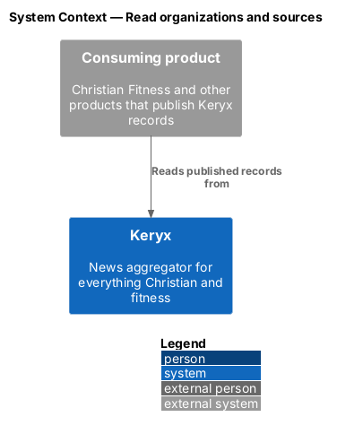
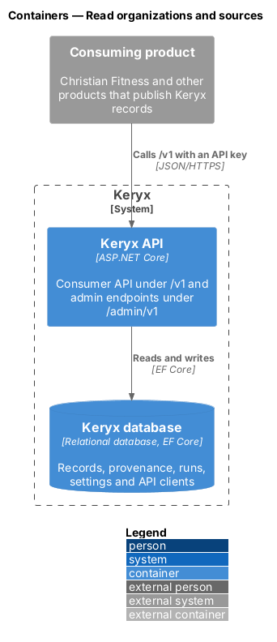
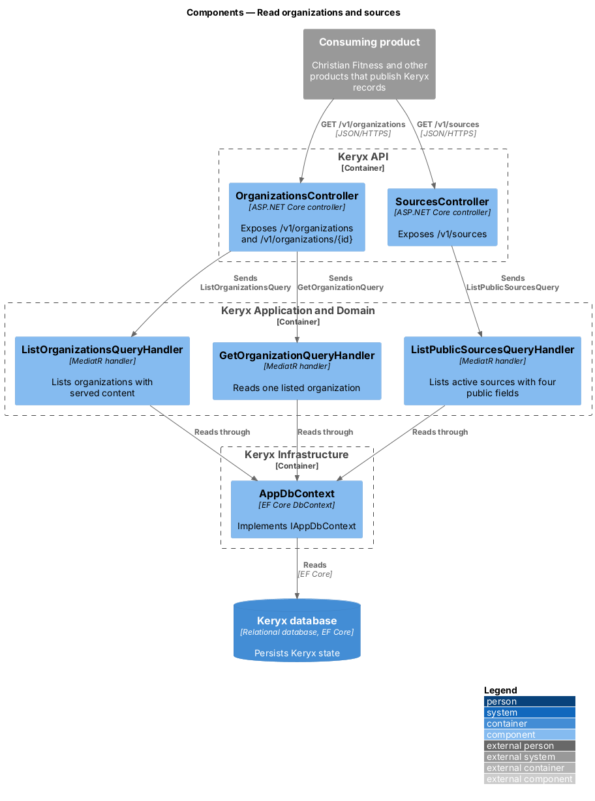
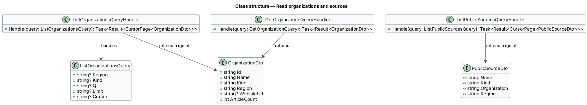
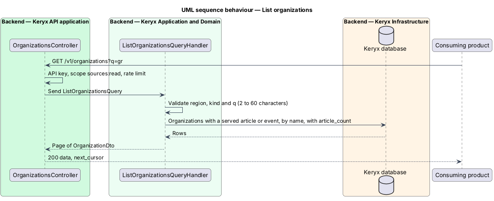

# Read organizations and sources

## Overview

A consuming product lists the organizations behind the news and the sources Keryx collects from. Both lists need the scope `sources:read`. `GET /v1/organizations` returns organizations that have at least one served article or event, ordered by name. `GET /v1/sources` returns the active sources.

The source list is deliberately narrow: `name`, `kind`, `organization` and `region` only. It never returns a source's health, a failure detail or the text of a news query, which are operational facts for staff.

## Description

The slice is two controllers and three query handlers. `region`, `kind` and `q` (a name prefix of 2 to 60 characters) filter the organization list.

- **`OrganizationsController`** — ASP.NET Core controller in the Keryx API. Exposes /v1/organizations and /v1/organizations/{id}.
- **`SourcesController`** — ASP.NET Core controller in the Keryx API. Exposes /v1/sources.
- **`ListOrganizationsQueryHandler`** — MediatR handler in the Application and Domain layers. Lists organizations with at least one served article or event, ordered by name and paged as the articles list. `article_count` counts published articles only.
- **`GetOrganizationQueryHandler`** — MediatR handler in the Application and Domain layers. Reads one listed organization; any other id answers `404` with `code` `organization_not_found`.
- **`ListPublicSourcesQueryHandler`** — MediatR handler in the Application and Domain layers. Projects active sources to `name`, `kind`, `organization` and `region`. The projection has no health, failure or address column, so those cannot leak.
- **`AppDbContext`** — EF Core DbContext in the Infrastructure layer. Implements IAppDbContext.
- **`OrganizationDto`** — `id` (prefixed `org_`), `name`, `kind`, `region`, `website_url` and `article_count` as a number.
- **`PublicSourceDto`** — `name`, `kind`, `organization` and `region`.

## Requirements

The feature realizes the following level-2 (L2) requirements. Each L2 requirement refines a level-1 (L1) requirement, cited by identifier. The acceptance criteria of each requirement are in [`docs/specs/L2.md`](../../../specs/L2.md).

| L2 ID | Refines (L1) | Requirement |
|-------|--------------|-------------|
| [`L2-029`](../../../specs/L2.md#l2-029-organizations-and-sources-endpoints) | `L1-008` | **Organizations and sources endpoints.** The requirement is defined by its 4 acceptance criteria. |

## Diagrams

### System context

A consuming product reads published records from Keryx.

### Containers

The consuming product calls the Keryx API at `/v1` with an API key. The Keryx API reads and writes the Keryx database.

### Components

Each controller sends one query per request, and each handler reads through `IAppDbContext` with a projection of only the served fields.

### Class structure

`OrganizationDto` and `PublicSourceDto` are the two response shapes; `ListOrganizationsQuery` carries the three filters.

### Behaviour — list organizations

The handler returns only organizations with served content and counts published articles for each in the same query (`L2-029`).

