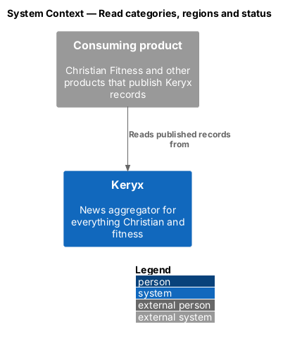
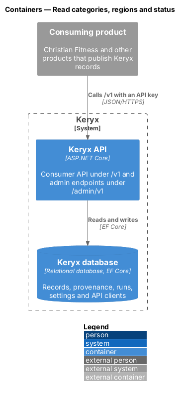
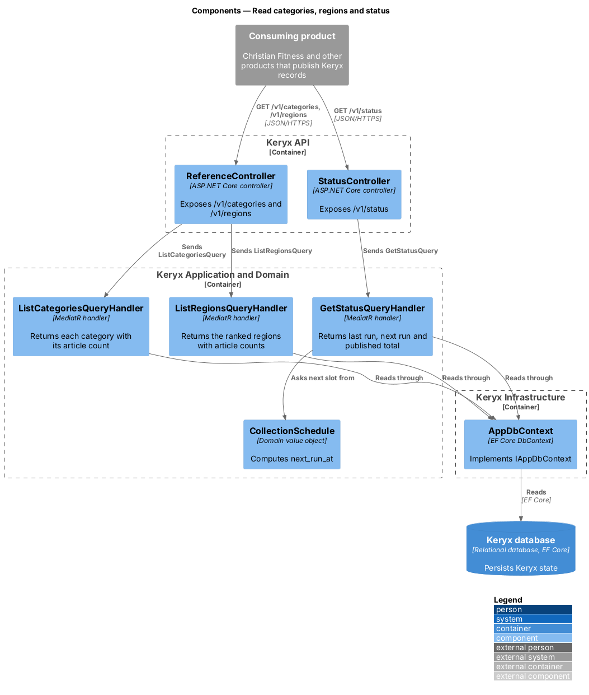
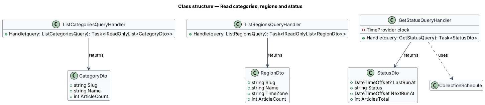
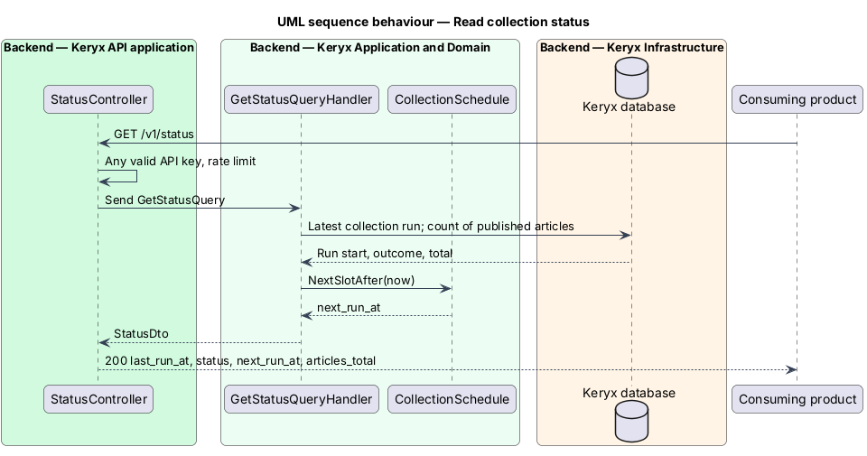

# Read categories, regions and status

## Overview

A consuming product needs the fixed vocabularies to build its filters, and a way to tell how fresh the data is. `GET /v1/categories` returns the six categories, `GET /v1/regions` returns the ranked region list, and `GET /v1/status` returns the freshness of the collection. Any valid key may call them, whatever its scopes.

Status says when the last run started, how it ended and when the next one is due, with the total of published articles. It says nothing about individual sources, issues or errors. When the last run failed, `status` is `failed` and the article endpoints still serve the earlier data.

## Description

The slice is two controllers and three query handlers. Each count is of published articles only and is served as a number.

- **`ReferenceController`** — ASP.NET Core controller in the Keryx API. Exposes /v1/categories and /v1/regions.
- **`StatusController`** — ASP.NET Core controller in the Keryx API. Exposes /v1/status.
- **`ListCategoriesQueryHandler`** — MediatR handler in the Application and Domain layers. Returns each category with its article count.
- **`ListRegionsQueryHandler`** — MediatR handler in the Application and Domain layers. Returns the ranked regions with article counts.
- **`GetStatusQueryHandler`** — MediatR handler in the Application and Domain layers. Returns `last_run_at`, `status` (`succeeded`, `completed_with_issues`, `failed`, `running`), `next_run_at` and `articles_total`. It reads the latest collection run and asks `CollectionSchedule` for the next slot.
- **`CollectionSchedule`** — Domain value object in the Application and Domain layers. Computes next_run_at.
- **`AppDbContext`** — EF Core DbContext in the Infrastructure layer. Implements IAppDbContext.
- **`CategoryDto`** — `slug`, `name` and `article_count`.
- **`RegionDto`** — `slug`, `name`, `time_zone` and `article_count`; Toronto is first and `global` is last.
- **`StatusDto`** — `last_run_at`, `status`, `next_run_at` and `articles_total`.

## Requirements

The feature realizes the following level-2 (L2) requirements. Each L2 requirement refines a level-1 (L1) requirement, cited by identifier. The acceptance criteria of each requirement are in [`docs/specs/L2.md`](../../../specs/L2.md).

| L2 ID | Refines (L1) | Requirement |
|-------|--------------|-------------|
| [`L2-030`](../../../specs/L2.md#l2-030-categories-regions-and-status-endpoints) | `L1-008` | **Categories, regions and status endpoints.** The requirement is defined by its 4 acceptance criteria. |

## Diagrams

### System context

A consuming product reads published records from Keryx.

### Containers

The consuming product calls the Keryx API at `/v1` with an API key. The Keryx API reads and writes the Keryx database.

### Components

`ReferenceController` and `StatusController` each send one query. `GetStatusQueryHandler` combines the latest run with `CollectionSchedule`.

### Class structure

The three DTOs are flat. `GetStatusQueryHandler` depends on `CollectionSchedule` and `TimeProvider` for `next_run_at`.

### Behaviour — read collection status

The handler reads the latest collection run and the published total, and computes the next slot; nothing about a source or an issue leaves the handler (`L2-030`).

