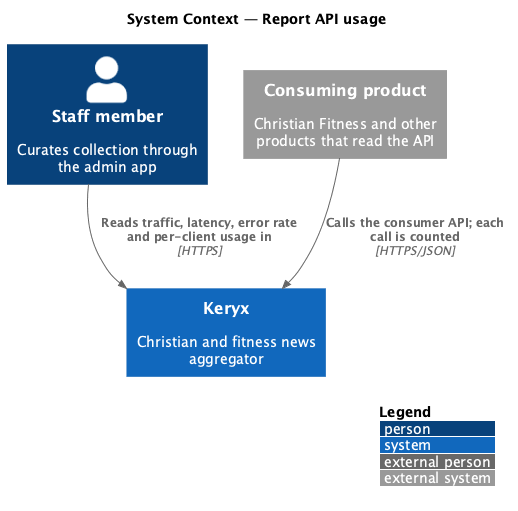
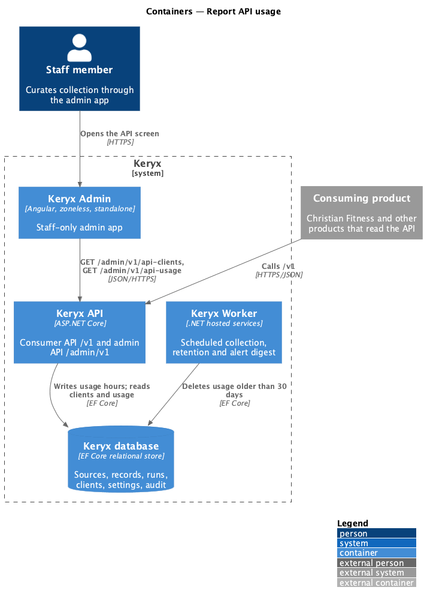
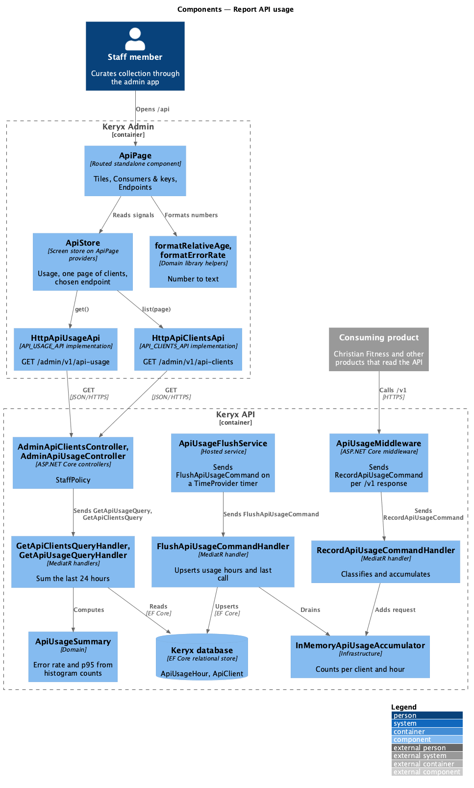
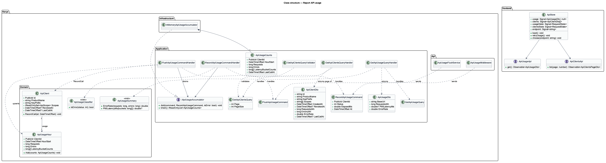
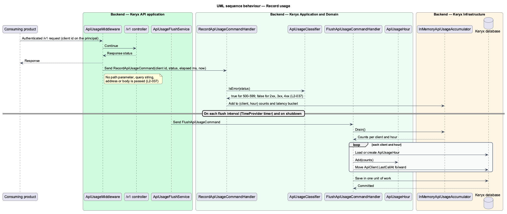
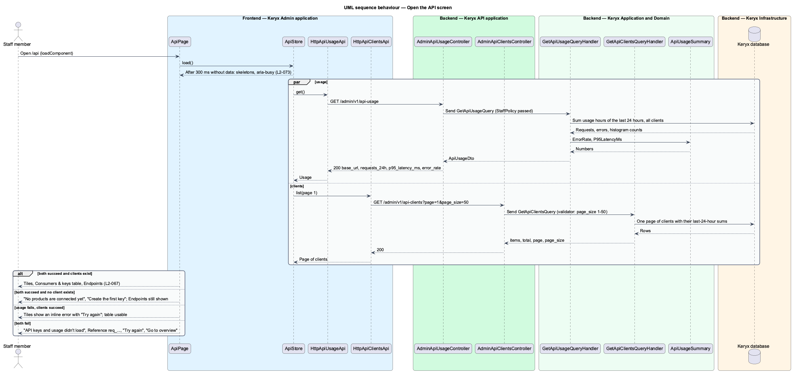
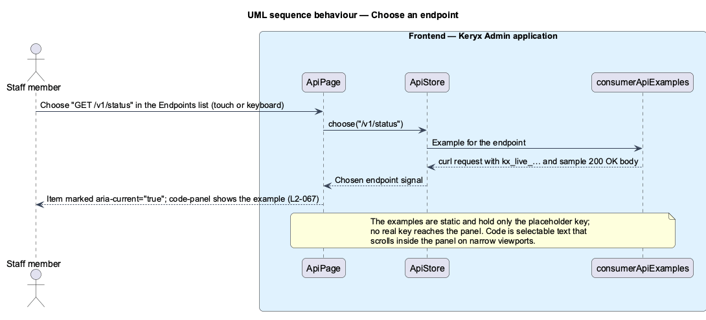
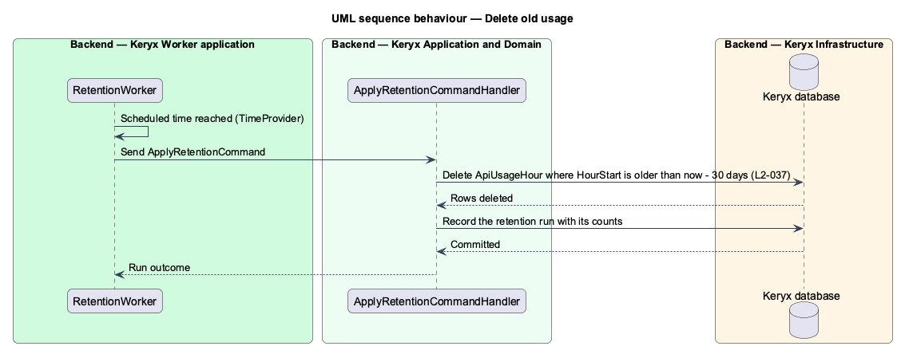

# Report API usage

## Overview

Keryx is a news aggregator for Christian and fitness news, events and organizations, first in
Toronto and the Greater Toronto Area. Other products, Christian Fitness first, read Keryx through
the consumer API under `/v1`, each with its own API key. This feature counts how each product
uses the API and shows it to staff on the API screen of the admin app, beside an example of each
endpoint.

**API client** — record of one consuming product that may call the consumer API, identified to
staff by its product name and key prefix

**usage hour** — stored counts for one API client in one clock hour (UTC): requests, errors,
latency histogram counts and the time of the last call

**error** — consumer API response with a status from 500 to 599; a `4xx` response counts as a
request and not as an error (L2-037)

**error rate** — errors divided by requests, served as a number from 0 to 1

**p95 latency** — response time, in milliseconds, under which 95 percent of the consumer API's
requests in the last 24 hours completed

**API screen** — admin app page at `/api` with the base URL and usage tiles, the "Consumers &
keys" table, and the "Endpoints" list with its example panel

Usage is counted per client per hour and holds no request path parameter, query string, IP
address or body. Usage older than 30 days is deleted by the retention worker. The admin API
serves every count, rate and latency as a number; the admin app formats them ("52,826", "84 ms",
"0.05%", "2 min ago").

The API screen shows the consumer API's base URL from configuration
("https://api.keryx.ca/v1"), the requests in the last 24 hours, the p95 latency and the error
rate; then one row per client with its product, key prefix, scopes, requests, errors, last call
and a "Revoke" button; then the endpoints, each with a `curl` example and a sample `200 OK`
response that never holds a real key.

The feature sits in the `consumer-api` subsystem. The manage-api-keys feature adds key creation
and revocation to the same screen and the same `ApiStore`. The authenticate-api-clients feature
identifies the client each request is counted against. The retention feature of the catalogue
subsystem runs the deletion this feature defines for usage hours.

## Description

The slice runs from the consumer API's request pipeline, which records usage, through the admin
API to the API screen of the Keryx Admin application, and stores usage in the relational
database (PostgreSQL, [ADR 0001](../../../adr/0001-postgresql-and-the-backend-packages.md)) via EF Core.

**Recording usage (`Keryx.Api`, `Keryx.Application`, `Keryx.Infrastructure`)**

- **`ApiUsageMiddleware`** (`Keryx.Api`) — runs on `/v1` after authentication. When the response
  completes, it sends one `RecordApiUsageCommand` with the client id, the status code, the elapsed
  milliseconds and the completion time from `TimeProvider`. It passes no path, query string,
  address, header or body (L2-037). Requests that fail authentication have no client and are
  not counted, in the whole-API figures either: those are the sum of the clients' rows, so the
  tiles and the table always agree. A request that authenticates and is then refused (`403`
  `insufficient_scope`, `429`) has a client and is counted.
- **`RecordApiUsageCommandHandler`** (`Keryx.Application`) — classifies the status with
  `ApiUsageClassifier` and adds the request to `IApiUsageAccumulator`.
- **`ApiUsageClassifier`** (`Keryx.Domain`) — pure rule: every response is a request; a status
  from 500 to 599 is also an error; a `4xx` is not. It has a unit test per row of its case table.
- **`IApiUsageAccumulator`** (`Keryx.Application`) and **`InMemoryApiUsageAccumulator`**
  (`Keryx.Infrastructure`) — adds counts in memory per client and hour, so a request causes no
  database write. It is flushed every 60 seconds and on shutdown, so a crash loses at most one
  minute of counts.
- **`ApiUsageFlushService`** (`Keryx.Api`, hosted service) — on each interval of a timer created
  from `TimeProvider`, and on shutdown, sends one `FlushApiUsageCommand`.
- **`FlushApiUsageCommandHandler`** — drains the accumulator and, in one unit of work, adds the
  counts to each `ApiUsageHour` row (creating it when absent) and moves each client's
  `LastCallAt` forward.
- **`ApiUsageHour`** (`Keryx.Domain`) — entity keyed by `ClientId` and `HourStart` (UTC) with
  `Requests`, `Errors` and `LatencyBucketCounts`. L2-037 allows counts per client per hour only,
  so p95 latency is derived from bucket counts. The buckets' upper bounds are 10, 25, 50, 100,
  250, 500, 1,000, 2,500, 5,000 and 10,000 ms, and one bucket above 10,000 ms.
- **`ApiClient.LastCallAt`** (`Keryx.Domain`) — time of the client's last call, or `null` if it
  has never called.

**Reading usage (`Keryx.Api`, `Keryx.Application`)**

- **`AdminApiClientsController`** — `GET /admin/v1/api-clients`, under `StaffPolicy`, sends one
  `GetApiClientsQuery`.
- **`GetApiClientsQuery`** / **`GetApiClientsQueryValidator`** / **`GetApiClientsQueryHandler`**
  — `page` (from 1) and `page_size` (1 to 50, default 50); a value out of range gives `400`
  `invalid_page`. The handler orders clients newest first, active and revoked alike (a revoked
  client stays listed with its usage, L2-036), and sums each client's `ApiUsageHour` rows over the
  last 24 hours. Clients are ordered newest first by creation, then by id, as the key-created
  mock shows.
- **`AdminApiUsageController`** — `GET /admin/v1/api-usage`, under `StaffPolicy`, sends one
  `GetApiUsageQuery`.
- **`GetApiUsageQueryHandler`** — sums every client's usage hours over the last 24 hours and
  computes `requests_24h`, `error_rate` and `p95_latency_ms` with `ApiUsageSummary`. It also
  returns `base_url`, the public API base URL setting (L2-096).
- **`ApiUsageSummary`** (`Keryx.Domain`) — pure calculation: error rate as errors over requests,
  `0` when there were no requests; p95 latency from the merged histogram, `null` when there were
  no requests. The 95th percentile's rank is `ceil(0.95 × requests)`. Within the bucket that
  holds that rank, the value is interpolated linearly between the bucket's lower and upper bounds
  (the first bucket starts at 0) and rounded to a whole millisecond. A rank in the bucket above
  10,000 ms reads 10,000, the highest bound known, as Prometheus' `histogram_quantile` does. It has a unit test per row of its case table.
- **Window** — "last 24 hours" is the usage hours whose `HourStart` is within 24 hours before now,
  read from `TimeProvider`: the current hour's row and the 23 before it. The window therefore
  covers between 23 and 24 hours, and never part of a 25th.
- **Retention** — `RetentionWorker` sends `ApplyRetentionCommand`, whose handler
  `ApplyRetentionCommandHandler` deletes `ApiUsageHour` rows older than 30 days, measured from now
  read from `TimeProvider` (L2-037). The run is recorded as every worker run is.

**Endpoints**

| Method and path | Request | Response `200` | Errors (`code`) |
|---|---|---|---|
| `GET /admin/v1/api-clients` | `page`, `page_size` (at most 50) | `items`, `total`, `page`, `page_size`; each item `id`, `product_name`, `key_prefix`, `scopes`, `created_at`, `revoked_at`, `requests_24h`, `errors_24h`, `error_rate` (0 to 1), `last_call_at` (or `null`) | `400` `invalid_page`; `401`; `403` `not_staff` |
| `GET /admin/v1/api-usage` | none | `base_url`, `requests_24h`, `p95_latency_ms`, `error_rate` | `401`; `403` `not_staff` |

Both responses carry `Cache-Control: no-store` (L2-082). `base_url` is a field this design adds
beside the three L2-037 names.

**Admin app (`frontend/projects`)**

- **`ApiPage`** (`admin`) — routed page for `/api`, loaded with `loadComponent`. It requests the
  usage and the first page of clients in parallel and renders the states of the mocks:
  `default`, `endpoint`, `loading`, `empty`, `error`.
- **`ApiStore`** (`admin`) — screen store on `ApiPage`'s `providers`. It holds the usage result,
  the current page of clients and the chosen endpoint as signals, and one request state for each
  of the two requests. It holds one page of clients at most (L2-089).
- **`API_USAGE_API`** / **`ApiUsageApi`** (`api`) — `get()` returning `ApiUsageDto`;
  `HttpApiUsageApi` implements it. The clients list uses `API_CLIENTS_API` / `ApiClientsApi`
  `list(page)` from the manage-api-keys feature. Both are bound in `app.config.ts`.
- **Usage tiles** — `summary-card` with `summary-card__lead` ("Base URL" in `code`) and `stats` of
  three `stat` items: "Requests · 24h", "p95 latency" (value and `stat__unit` "ms") and "Error
  rate". With no requests, the tiles read "0", "—" and "—" (mock `empty`). They stay in one row at
  every viewport (L2-067).
- **"Consumers & keys" table** — `table` with the columns Product, Key (prefix followed by "…" in
  the monospace face), Scopes (one item per scope), "Requests · 24h", Errors, Last call and the
  "Revoke" action. A revoked row carries `table__row--revoked`, a "Revoked" `badge` and no
  "Revoke" button. Below LG the row stacks as `table__sub` with the prefix, the requests and the
  last call (L2-090).
- **"Endpoints"** — `split` holding a `list` of `endpoint` items (`endpoint__method`,
  `endpoint__sig`, `endpoint__desc`) and a `code-panel` with "Example request", the status "200
  OK", and two focusable `code-panel__block` elements, one for the `curl` request with the key
  placeholder `kx_live_…` and one for the sample response. The chosen endpoint carries
  `aria-current="true"`. The examples are static data in the admin app, `consumerApiExamples`,
  one entry for each endpoint of L2-026 to L2-030; no real key appears in them. Below 1024 px the
  list sits above the panel; from 1024 px they sit side by side, and the code scrolls inside its
  panel.
- **Empty** — with no client, `empty` reads "No products are connected yet" with "Create the first
  key"; the endpoints section is still shown.
- **Errors** — when the usage request fails and the clients request succeeds, the tiles show an
  inline error with "Try again" and the table stays usable; the markup of that inline error is
  `pages/api/usage-error.html`: an `alert` (danger) in the summary card's place, "Usage didn't
  load", "The keys below are up to date; only the usage figures failed. Reference req_…", and
  "Try again". The base URL comes with the usage, so it is not shown then either. When both fail, the page shows the L2-073 error state "API keys
  and usage didn't load" with "Reference req_…", "Try again" and "Go to overview".
- **Loading** — after 300 ms without data, `skeleton` items shaped as the tiles, table and
  endpoints, with `aria-busy="true"` and the status "Loading API usage…".
- **Paging** — the endpoint pages at 50 clients; the mocks show no pager on this screen, so its
  control is the `pagination` component under the table (`pages/api/paged.html`), shown only when
  there is a second page: "Previous" and "Next", each disabled at its end.

**Domain library (`frontend/projects/domain`)**

- **`formatRelativeAge`** — the Last call text: "just now", "2 min ago", a time today ("6:15
  AM"), a date ("Feb 2"), or "never" for `null`, in Toronto time. Its thresholds are fixed in its
  own design.
- **`formatErrorRate`** — a rate from 0 to 1 as a percentage ("0.05%", "0.4%", "0%"), or "—"
  when there were no requests. Below 1% it shows up to two decimals and from 1% up to one, with
  trailing zeros dropped ("0.4%", "12.5%", "3%"). A rate above 0 that would round to "0%" reads
  "<0.01%".
- **`formatCount`** and **`formatLatency`** — "52,826" and "84" with the unit "ms".

**Components library (`frontend/projects/components`)** — `page-header`, `summary-card`,
`stats`, `stat`, `table`, `badge`, `tag`, `list`, `endpoint`, `split`, `code-panel`, `empty`,
`skeleton`, `alert`, `btn`.

## Implementation notes (journey 21)

- **Base URL.** The base URL is the new setting `Keryx__Api__PublicBaseUrl` (`Keryx.Api`): an
  absolute `http(s)` address ending in `/v1`. It is required: startup stops without it (L2-096).
- **Retention.** No retention worker exists yet. Deleting usage hours older than 30 days arrives
  with the retention design (journey 23).
- **Errors column.** The table's "Errors" column shows each client's error rate, as the mock
  shows ("0.02%"), and "—" for a client with no requests in the window.

## Requirements

The feature realizes the following level-2 (L2) requirements. Each L2 requirement refines a
level-1 (L1) requirement, cited by identifier. Their acceptance criteria are in
[L2.md](../../../specs/L2.md).

| L2 ID | Refines (L1) | Requirement |
|-------|--------------|-------------|
| `L2-037` | `L1-009` | Usage metrics per client — Keryx counts each client's requests, errors and last call, and the API's overall traffic, latency and error rate, and serves them as numbers. |
| `L2-067` | `L1-015` | API screen — The API screen shows the API's base address, its traffic, latency and error rate, each consumer with its key prefix and usage, and an example of each endpoint. |

## Diagrams

### System context

Consuming products call Keryx and generate the usage; staff read it in the admin app.

### Containers

The Keryx API records usage while it serves `/v1` and serves it on `/admin/v1`. The Keryx Admin
application shows it. The Keryx Worker deletes usage older than 30 days.

### Components

The usage middleware feeds an in-memory accumulator that a hosted service flushes to usage
hours. Two queries read clients and the overall usage for the API screen's store.

### Class structure

`ApiUsageHour` holds the hourly counts per client, `ApiUsageSummary` and `ApiUsageClassifier` hold
the rules, and the frontend `ApiStore` holds one page of clients and the usage result.

### Behaviour — record usage

Each authenticated `/v1` request adds one request, and one error for a `5xx`, to the accumulator.
The flush service writes the counts to usage hours and the client's last call time.

### Behaviour — open the API screen

The page requests usage and clients in parallel. A failed usage request leaves the table usable;
two failures give the page error state; no client gives the empty state.

### Behaviour — choose an endpoint

Choosing an endpoint marks it current and shows its static example, with the placeholder key.

### Behaviour — delete old usage

The retention worker deletes usage hours older than 30 days.

