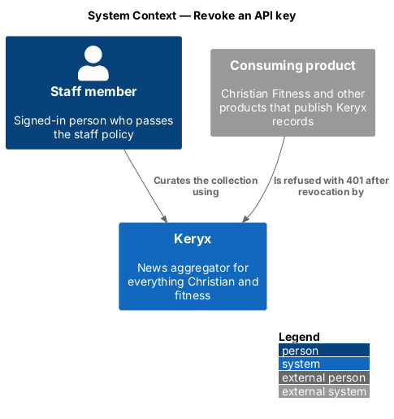
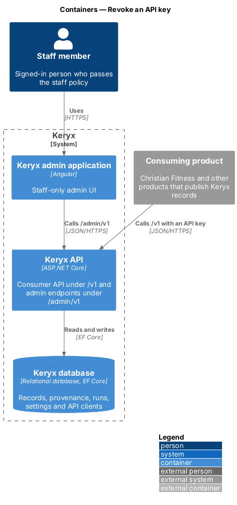
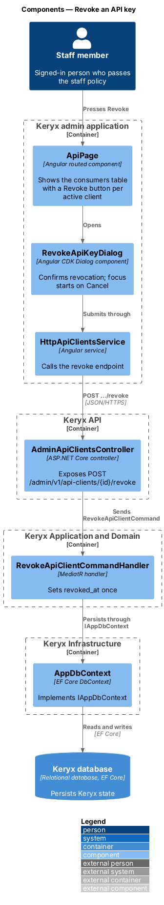
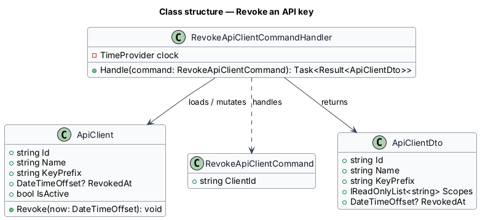
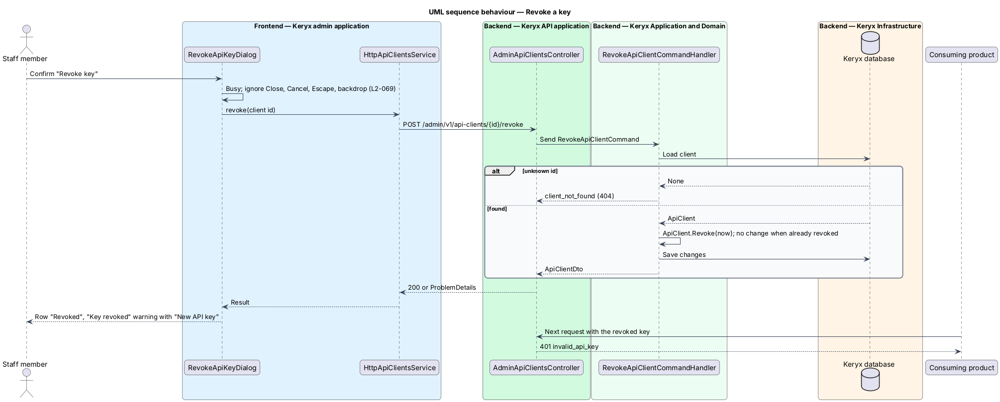

# Revoke an API key

## Overview

A staff member disconnects a consuming product by revoking its key on the API screen. Revocation takes effect on the next request with that key, which gets `401`. It cannot be undone: a revoked client stays listed, marked revoked, with its usage history, and a product reconnects only with a new key.

Revocation is destructive, so it is confirmed in a dialog. The dialog names the product and the key prefix, gives the requests of the last 24 hours, and starts focus on "Cancel".

## Description

The slice is one dialog, one command and one state change on `ApiClient`. The command is idempotent: revoking a revoked client answers `200` and leaves `revoked_at` unchanged.

- **`ApiPage`** — Angular routed component in the Keryx admin application. Shows the consumers table. After revocation the row carries a "Revoked" badge and no Revoke button, and a warning notification reads "Key revoked" with the action "New API key" and no Undo.
- **`RevokeApiKeyDialog`** — Angular CDK Dialog component in the Keryx admin application. Confirms revocation. While the request is in flight, Close, Cancel, Escape and the backdrop do nothing and one request is sent. On failure it shows its failed state and the key stays active.
- **`HttpApiClientsService`** — Angular service in the Keryx admin application. Calls the revoke endpoint.
- **`AdminApiClientsController`** — ASP.NET Core controller in the Keryx API. Exposes POST /admin/v1/api-clients/{id}/revoke.
- **`RevokeApiClientCommandHandler`** — MediatR handler in the Application and Domain layers. Sets `revoked_at` once. An unknown id answers `404` with `code` `client_not_found`.
- **`AppDbContext`** — EF Core DbContext in the Infrastructure layer. Implements IAppDbContext.
- **`RevokeApiClientCommand`** — MediatR request carrying the client id.

## Requirements

The feature realizes the following level-2 (L2) requirements. Each L2 requirement refines a level-1 (L1) requirement, cited by identifier. The acceptance criteria of each requirement are in [`docs/specs/L2.md`](../../../specs/L2.md).

| L2 ID | Refines (L1) | Requirement |
|-------|--------------|-------------|
| [`L2-036`](../../../specs/L2.md#l2-036-revoking-a-key) | `L1-009` | **Revoking a key.** The requirement is defined by its 4 acceptance criteria. |
| [`L2-069`](../../../specs/L2.md#l2-069-revoke-api-key-dialog) | `L1-015` | **Revoke API key dialog.** The requirement is defined by its 4 acceptance criteria. |

## Diagrams

### System context

A staff member curates the collection through Keryx. The consuming product is refused with 401 after revocation by Keryx.

### Containers

The staff member uses the Keryx admin application. The Keryx admin application calls the Keryx API at `/admin/v1`. The consuming product calls the Keryx API at `/v1` with an API key. The Keryx API reads and writes the Keryx database.

### Components

`RevokeApiKeyDialog` submits through `HttpApiClientsService`; `RevokeApiClientCommandHandler` loads the `ApiClient` and revokes it.

### Class structure

`ApiClient.Revoke` is the only transition; it is a no-op on an already revoked client, and no method makes a client active again.

### Behaviour — revoke a key

The handler sets `revoked_at` (`L2-036`). The authentication lookup reads the revoked state on each request, so the product's next call is refused.

