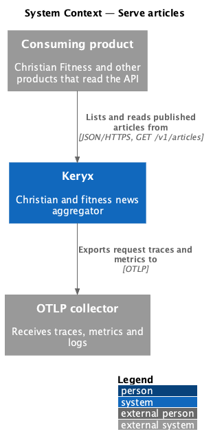
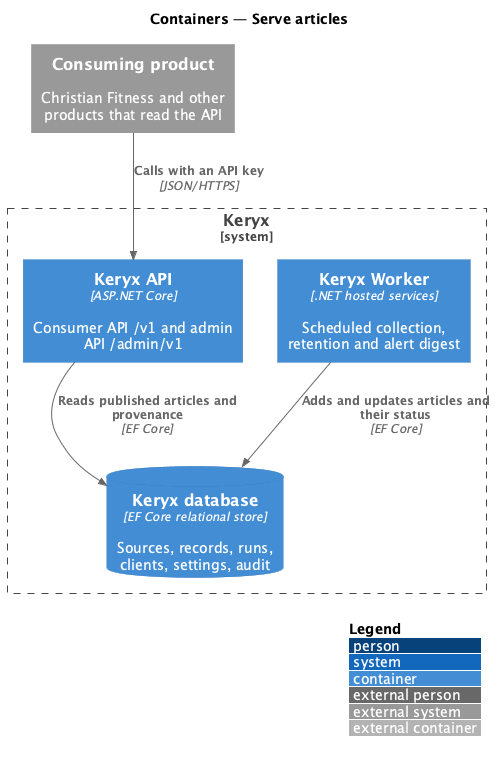
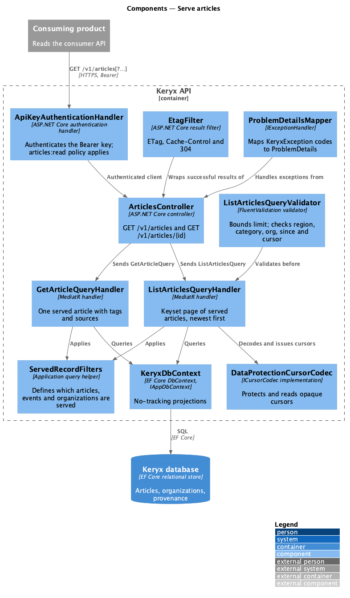
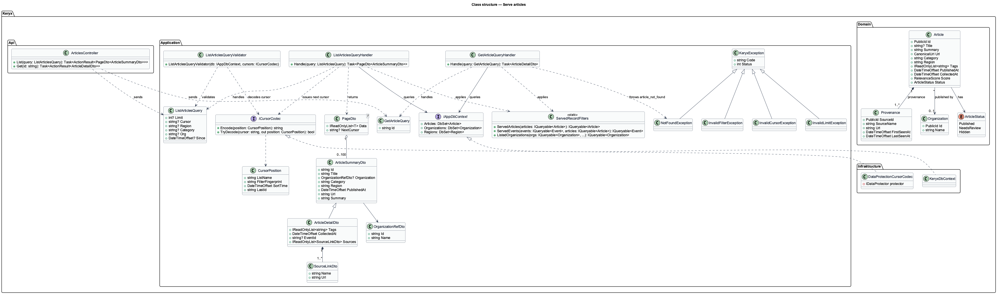
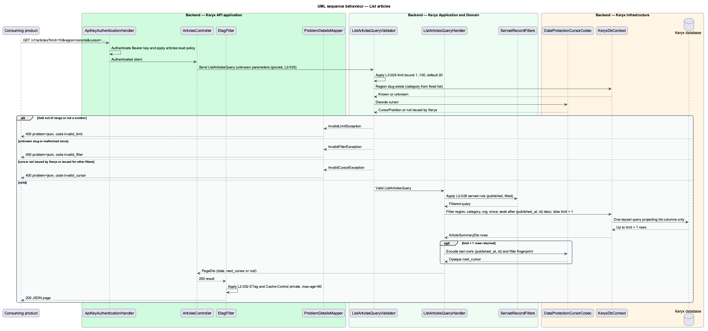
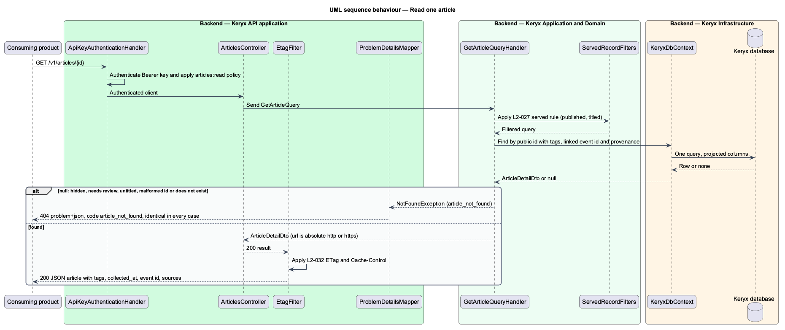

# Serve articles

## Overview

Keryx collects Christian and fitness news from sources in Toronto, the Greater Toronto Area
and beyond, and stores each story as an article. Keryx has no public website. Other products,
Christian Fitness first, read what Keryx knows through the consumer API under `/v1`. This
feature is the part of the consumer API that serves articles: a paged list and a single article
by its id.

**article** — pointer to a story published by a source: a title, a summary of at most 500
characters, a canonical link, an organization, a category, a region, tags and times, never a
copy of the story itself (L2-015)

**served article** — article whose status is `published` and whose title is present; only
served articles leave the consumer API

**consuming product** — external product that calls the consumer API with an API key carrying
the `articles:read` scope

**cursor** — opaque token issued by Keryx that marks where the previous page ended, so the next
page continues from that point

**keyset paging** — paging that seeks to the row after the last one returned by its sort key
instead of skipping a count of rows

The list is ordered newest first by the time the source published the article, with ties broken
by id, descending. Articles that need review or are hidden never appear, and a client cannot
tell a hidden article from one that does not exist. A staff decision in the admin app (L2-014)
takes effect on the next consumer request, because every query reads the current status.

The feature sits in the `consumer-api` subsystem beside the events, organizations and sources,
and reference and status features. Authentication by API key and the scope check belong to the
key-management features of the same subsystem. Versioning, error bodies, ETags and performance
rules shared by every `/v1` endpoint belong to the API contract, errors and caching feature.

## Description

The slice runs from the consuming product's HTTPS request to the relational database (PostgreSQL,
[ADR 0001](../../../adr/0001-postgresql-and-the-backend-packages.md)) via EF Core. It has no admin app part.

- **`ArticlesController`** (`Keryx.Api`) — exposes `GET /v1/articles` and
  `GET /v1/articles/{id}` under the `articles:read` scope policy. It binds the query string into
  a request, sends one MediatR request and returns the result. It checks nothing itself.
- **`ListArticlesQuery`** (`Keryx.Application`) — the list request: `Limit`, `Cursor`,
  `Region`, `Category`, `Org` and `Since`. Query parameters the endpoint does not define are not
  bound and do not affect the response (L2-025).
- **`ListArticlesQueryValidator`** — FluentValidation validator run by the MediatR validation
  behaviour before the handler. It applies these rules, each failure carrying its error `code`:
  - `limit` absent gives 20; an integer from 1 to 100 is accepted; `0`, `101` or a non-number
    fails with `invalid_limit`.
  - `region` shall be a known region slug, read from the regions table because Settings can add
    regions (L2-018); `category` shall be one of `events`, `races-challenges`, `gyms-studios`,
    `ministry-programs`, `nutrition`, `faith-wellness` (L2-015). An unknown slug fails with
    `invalid_filter`.
  - `since` shall parse as an ISO 8601 time with an offset; a malformed value fails with
    `invalid_filter`. The response to an `org` value that is well formed but unknown, or
    malformed, is `<TO SUPPLY>` (L2-026 names no code for it).
  - `cursor`, when present, shall decode through `ICursorCodec`; a cursor not issued by Keryx
    fails with `invalid_cursor`.
- **`ListArticlesQueryHandler`** — builds one keyset query over served articles. It applies
  every filter given, so a row matches all of them, orders by `published_at` descending then `id`
  descending, seeks after the cursor's position, takes `limit + 1` rows, and projects only the
  list columns into `ArticleSummaryDto` with no tracking. When the extra row exists it drops it
  and encodes the last returned row's position as `next_cursor`; otherwise `next_cursor` is
  `null`. An article published between two page requests sorts before the cursor's position,
  so the next page continues from where the previous one ended.
- **`GetArticleQuery`** / **`GetArticleQueryHandler`** — reads one served article by its public
  id with its tags, collection time, linked event id and provenance. Any article that is not
  served, any malformed id and any unknown id all raise the same `NotFoundException` with code
  `article_not_found`.
- **`ServedRecordFilters`** (`Keryx.Application`) — static query helpers shared by every
  consumer feature. `ServedArticles` keeps articles whose status is `published` and whose title
  is not `null` (L2-015 acceptance criterion 3). The events, organizations and status features
  reuse `ServedEvents` and `ListedOrganizations`, so "served" means one thing across `/v1`.
- **`ICursorCodec`** (`Keryx.Application`) and **`DataProtectionCursorCodec`**
  (`Keryx.Infrastructure`) — encode a `CursorPosition` (list name, filter fingerprint, last sort
  time, last id) into an opaque, URL-safe string protected by ASP.NET Core Data Protection, and
  refuse any string they did not produce. The filter fingerprint makes a cursor presented with
  different filters fail with `invalid_cursor`; that rule is a design choice that the
  requirements do not state, and its confirmation is `<TO SUPPLY>`. Cursor expiry is
  `<TO SUPPLY>`. The Data Protection key store is a documented deployment setting (L2-096).
- **DTOs** — `PageDto<T>` (`data`, `next_cursor`); `ArticleSummaryDto` (`id`, `title`,
  `organization` as `OrganizationRefDto` with `id` and `name` or `null`, `category`, `region`,
  `published_at`, `url`, `summary`); `ArticleDetailDto` adds `tags`, `collected_at`, the linked
  event id and `sources` as `SourceLinkDto` (`name`, `url`) from the article's provenance. No DTO
  carries a relevance score, a status or an internal field. Whether `category` and `region` are
  served as slugs or as objects is `<TO SUPPLY>`; this design serves slugs. The JSON name of the
  linked event id is `<TO SUPPLY>` (L2-027 says "the linked `event` id"); this design uses
  `event_id`.
- **Domain types** (`Keryx.Domain`) — `Article` with `ArticleStatus`, `Provenance`,
  `Organization`, `CanonicalUrl` and `PublicId` (`art_` prefix). `CanonicalUrl` holds only
  absolute `http` or `https` URLs, so the served `url` is always one (L2-027).
- **`KeryxDbContext`** (`Keryx.Infrastructure`) — implements `IAppDbContext`. Indexes serving
  the list are on (`status`, `published_at`, `id`) and on each filter column combined with that
  sort key; their exact definitions are in the API contract feature (L2-086).
- **Shared pipeline** — `ApiKeyAuthenticationHandler` and the scope policy authenticate the
  client; `EtagFilter` adds `ETag` and `Cache-Control: private, max-age=60`;
  `ProblemDetailsMapper` turns each `KeryxException` into ProblemDetails with its `code`.

Endpoints:

| Method and path | Request | Success | Errors (`code`) |
|-----------------|---------|---------|-----------------|
| `GET /v1/articles` | `limit` (1–100, default 20), `cursor`, `region`, `category`, `org`, `since` | `200` `{ data: [ArticleSummary], next_cursor }` | `400` `invalid_limit`, `invalid_filter`, `invalid_cursor` |
| `GET /v1/articles/{id}` | path `id` (`art_…`) | `200` `ArticleDetail` | `404` `article_not_found` |

The behaviour of an article whose source gave no publication time, within an order keyed on
`published_at`, is `<TO SUPPLY>`.

## Requirements

The feature realizes the following level-2 (L2) requirements. Each L2 requirement refines a
level-1 (L1) requirement, cited by identifier. Their acceptance criteria are in
[L2.md](../../../specs/L2.md).

| L2 ID | Refines (L1) | Requirement |
|-------|--------------|-------------|
| `L2-026` | `L1-008` | List articles — `GET /v1/articles` returns published articles, newest first by the time the source published them (ties broken by id, descending). |
| `L2-027` | `L1-008` | Read one article — A client can read one published article by its id; an article that is not published is indistinguishable from one that does not exist. |

## Diagrams

### System context

The consuming product lists and reads published articles from Keryx over HTTPS. Keryx exports
request traces and metrics to the OTLP collector.

### Containers

The Keryx API reads articles and provenance from the Keryx database. The Keryx Worker writes
them there; the API never collects anything itself.

### Components

Inside the Keryx API, the authenticated request reaches `ArticlesController`, which sends one
query. The handlers apply `ServedRecordFilters`, read through `KeryxDbContext`, and use
`DataProtectionCursorCodec` for cursors.

### Class structure

Both handlers depend on `IAppDbContext` and `ServedRecordFilters`. `ArticleDetailDto` extends
`ArticleSummaryDto`, and the error types derive from `KeryxException`.

### Behaviour — list articles

The validator bounds `limit`, checks each filter and decodes the cursor before the handler
runs. The handler issues one keyset query for `limit + 1` rows and issues `next_cursor` only when
more rows remain.

### Behaviour — read one article

The handler applies the served rule before the lookup. A hidden, held, untitled or unknown
article therefore returns the same `404` with `code` `article_not_found`.

