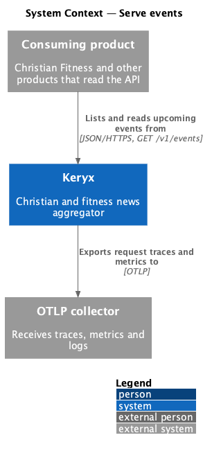
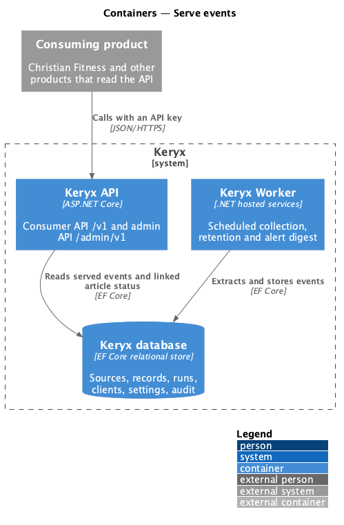
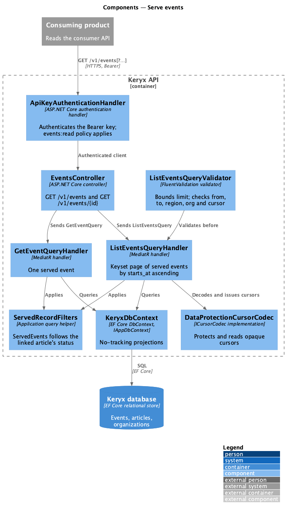
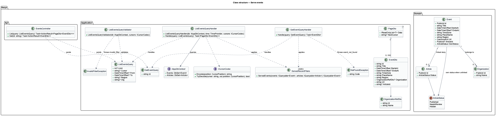
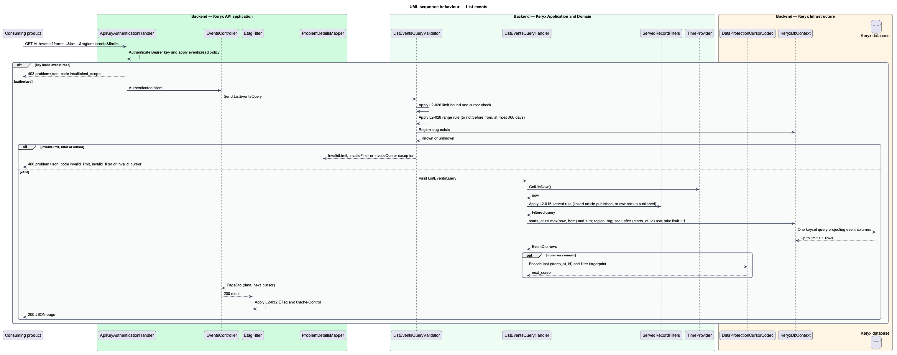
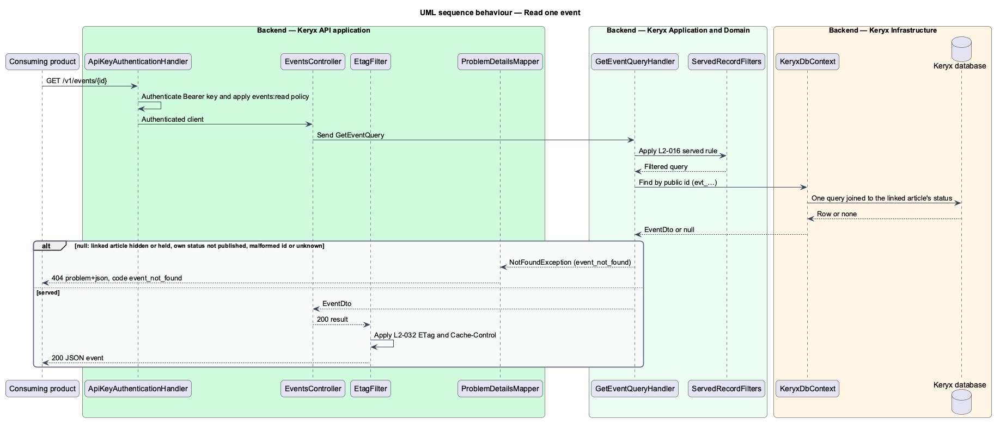

# Serve events

## Overview

Keryx stores three kinds of record: articles, events and organizations. Consuming products such
as Christian Fitness read them through the consumer API under `/v1`. This feature serves events:
a paged list of upcoming events and a single event by its id.

**event** — record of something with a start time and a place, such as a race, a class, a camp
or a service project, extracted when a source publishes a start time (L2-016)

**served event** — event whose linked article is published or, when the event has no linked
article, whose own status is `published`

**upcoming event** — served event whose start time is at or after the current time read from
`TimeProvider`

Staff curate through articles: an event linked to an article follows that article's status, so
hiding the article in the admin app removes its event from the consumer API on the next request.
An event with no linked article takes its own status from the same thresholds as articles
(L2-013). Every event carries its start time in UTC and the IANA time zone of its place, so a
consuming product can show local wall-clock time.

The list is ordered by `starts_at` ascending and paged by `limit` and `cursor` exactly as the
article list (L2-026). The feature sits in the `consumer-api` subsystem; the API key and the
`events:read` scope check belong to its key-management features, and the error, ETag and
performance rules belong to the API contract, errors and caching feature.

## Description

The slice runs from the consuming product's HTTPS request to the relational database (engine
`<TO SUPPLY>`) via EF Core. It has no admin app part.

- **`EventsController`** (`Keryx.Api`) — exposes `GET /v1/events` and `GET /v1/events/{id}`
  under the `events:read` scope policy. It sends one MediatR request per call and checks nothing
  itself. A key without `events:read` receives `403` with `code` `insufficient_scope` before the
  controller runs (L2-034).
- **`ListEventsQuery`** (`Keryx.Application`) — `Limit`, `Cursor`, `From`, `To`, `Region` and
  `Org`. Parameters the endpoint does not define are ignored (L2-025).
- **`ListEventsQueryValidator`** — applies the `limit` and `cursor` rules of L2-026
  (`invalid_limit`, `invalid_cursor`) and these filter rules, each failing with `invalid_filter`:
  - `from` and `to` shall parse as ISO 8601 times with an offset.
  - `to` shall not be earlier than `from`.
  - the range from `from` to `to` shall not be longer than 366 days.
  - `region` shall be a known region slug.
  The validity of a range given by `to` alone, measured from the current time, is
  `<TO SUPPLY>`.
- **`ListEventsQueryHandler`** — reads the current time from `TimeProvider`, never
  `DateTime.Now`. It applies `ServedRecordFilters.ServedEvents`, keeps events starting at or
  after the current time and inside `from`..`to`, applies `region` and `org`, orders by
  `starts_at` then `id` ascending, seeks after the cursor's position and takes `limit + 1` rows.
  The result is one keyset query projected into `EventDto` with no tracking; `next_cursor` is
  issued through `ICursorCodec` only when more rows remain. Whether a `from` earlier than the
  current time widens the list to past events is `<TO SUPPLY>`; this design keeps the later of
  the two, as L2-028 says the list starts "from now".
- **`GetEventQuery`** / **`GetEventQueryHandler`** — reads one served event by its public id.
  An event that is not served, a malformed id and an unknown id all raise `NotFoundException`
  with code `event_not_found` (L2-028, L2-083).
- **`ServedRecordFilters.ServedEvents`** — the single definition of a served event, shared with
  the article and organization features: the linked article has status `published` and a title,
  or the event has no linked article and its own status is `published`.
- **`EventDto`** — `id` (prefixed `evt_`), `title`, `starts_at` (UTC), `ends_at` or `null`,
  `time_zone` (IANA, for example `America/Toronto`), `place_name`, `region`, `organization`
  (`id`, `name`, or `null`), `url` and `article_id` or `null`. The shape of `organization` and
  `region` follows the article list; L2-028 does not state it, so its confirmation is
  `<TO SUPPLY>`.
- **Domain types** (`Keryx.Domain`) — `Event` with its own `ArticleStatus`-valued status,
  linked `Article`, `Organization`, `Region` and `PublicId`.
- **Reused parts** — `ICursorCodec` and `DataProtectionCursorCodec`, `PageDto<T>`,
  `OrganizationRefDto`, `EtagFilter` and `ProblemDetailsMapper`, as described in the serve
  articles and API contract features. The index on (`starts_at`, `id`) and the indexes combining
  `region` and organization with it serve every filter (L2-086).

Endpoints:

| Method and path | Request | Success | Errors (`code`) |
|-----------------|---------|---------|-----------------|
| `GET /v1/events` | `limit` (1–100, default 20), `cursor`, `from`, `to`, `region`, `org` | `200` `{ data: [Event], next_cursor }` | `400` `invalid_limit`, `invalid_filter`, `invalid_cursor`; `403` `insufficient_scope` |
| `GET /v1/events/{id}` | path `id` (`evt_…`) | `200` `Event` | `404` `event_not_found`; `403` `insufficient_scope` |

## Requirements

The feature realizes the following level-2 (L2) requirements. Each L2 requirement refines a
level-1 (L1) requirement, cited by identifier. Their acceptance criteria are in
[L2.md](../../../specs/L2.md).

| L2 ID | Refines (L1) | Requirement |
|-------|--------------|-------------|
| `L2-028` | `L1-008` | Events endpoints — A client with `events:read` can list upcoming published events, filtered by time range, region and organization, and read one by id. |

## Diagrams

### System context

The consuming product lists and reads upcoming events from Keryx over HTTPS.

### Containers

The Keryx Worker extracts events into the Keryx database during collection. The Keryx API reads
them, together with the status of each linked article.

### Components

`EventsController` sends one query to its handler. The handlers apply
`ServedRecordFilters.ServedEvents` and read through `KeryxDbContext`.

### Class structure

An `Event` links to at most one `Article` and one `Organization`. The handler depends on
`TimeProvider` for the current time and on `ICursorCodec` for paging.

### Behaviour — list events

The scope check refuses a key without `events:read`. The validator applies the range rule
before the handler reads the current time and runs one keyset query ordered by `starts_at`.

### Behaviour — read one event

An event whose linked article is hidden or held returns the same `404` as an unknown id, with
`code` `event_not_found`.

