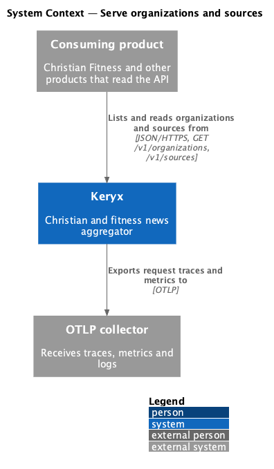
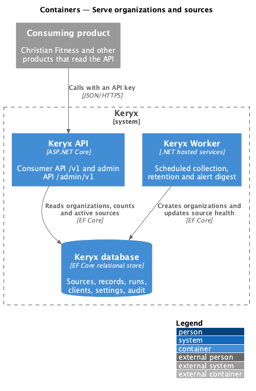
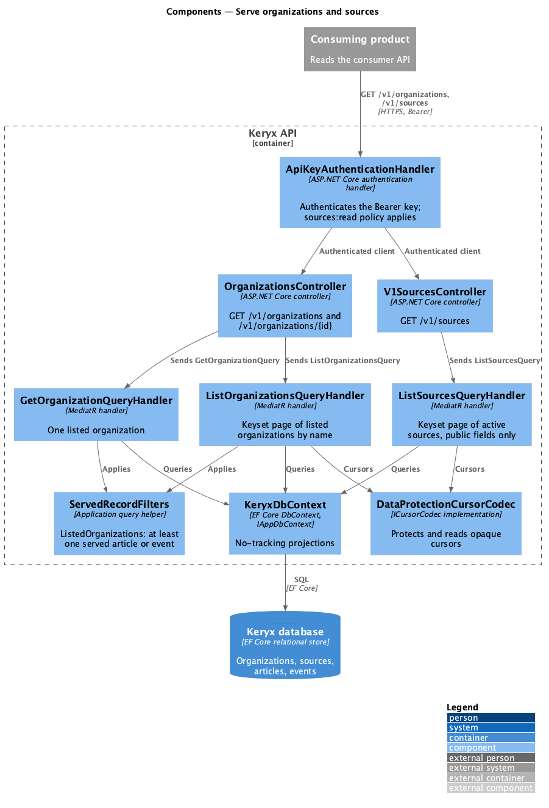
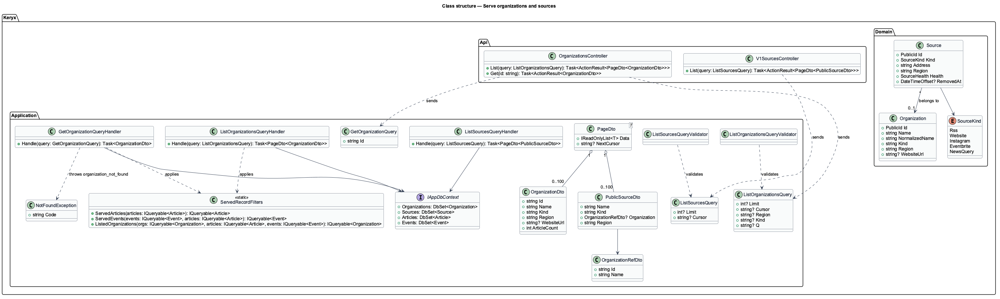
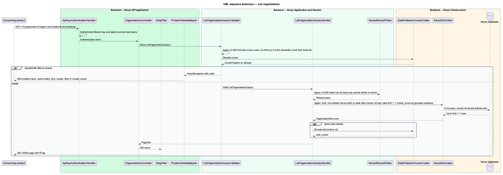
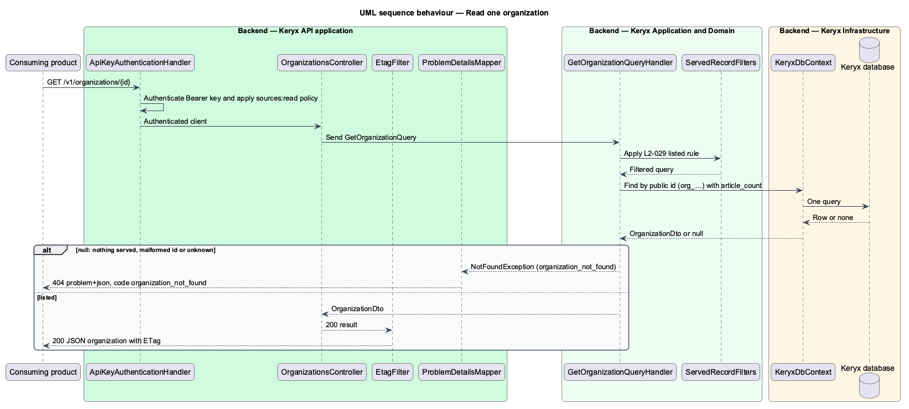
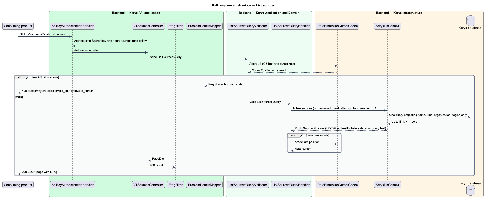

# Serve organizations and sources

## Overview

Keryx aggregates what organizations publish: churches, ministries, gyms, clubs, networks and
businesses that publish Christian fitness news. Consuming products such as Christian Fitness
read those organizations, and the list of sources Keryx collects from, through the consumer API
under `/v1`. Both resources need the `sources:read` scope.

**organization** — church, ministry, gym, club, network or business that publishes Christian
fitness news, with a name as it publishes it, a kind, a region and its public website (L2-017)

**listed organization** — organization with at least one served article or served event

**source** — place Keryx collects from: an RSS feed, a website, an Instagram account, an
Eventbrite organizer or a news query (L2-001)

**active source** — source that staff have not removed (L2-003)

An organization appears in the consumer API only once it has something published, and its
`article_count` counts served articles only. The sources list tells a consuming product where
Keryx's information comes from, and nothing about how well collection is going: a source's
health, its failure detail and a news query's text stay inside the admin API.

The feature sits in the `consumer-api` subsystem. The served rules it applies are the ones the
serve articles and serve events features define, held in one place, `ServedRecordFilters`.

## Description

The slice runs from the consuming product's HTTPS request to the relational database (PostgreSQL,
[ADR 0001](../../../adr/0001-postgresql-and-the-backend-packages.md)) via EF Core. It has no admin app part.

- **`OrganizationsController`** (`Keryx.Api`) — exposes `GET /v1/organizations` and
  `GET /v1/organizations/{id}` under the `sources:read` scope policy; it sends one MediatR
  request per call.
- **`V1SourcesController`** (`Keryx.Api`) — exposes `GET /v1/sources` under the
  `sources:read` scope policy. The name keeps it apart from the admin `AdminSourcesController`.
- **`ListOrganizationsQuery`** and **`ListOrganizationsQueryValidator`** — `Limit`, `Cursor`,
  `Region`, `Kind` and `Q`. The validator applies the `limit` and `cursor` rules of L2-026.
  `region` shall be a known slug, and `kind` shall be one of `church`, `ministry`, `gym`,
  `club`, `network`, `business`, `other` (lower case, as served); either failing gives
  `invalid_filter`. `q` shall be a name prefix of 2 to 60 characters, and one outside those
  bounds gives `invalid_filter`, as every other filter does (L2-026).
- **`ListOrganizationsQueryHandler`** — applies `ServedRecordFilters.ListedOrganizations`,
  then `region`, `kind` and a prefix match of `q` on the organization's normalized name. It
  orders by name then `id`, seeks after the cursor and takes `limit + 1` rows. The database's
  collation both orders the names and compares the seek, so the two agree; the cursor carries
  the last name as its sort value (cursors are JSON inside Data Protection, so a name may hold
  any character). `article_count`
  comes from one grouped subquery over served articles in the same statement, so the query
  count does not grow with the page size (L2-086). The match is case-insensitive through the
  normalized name; the exact normalization is the one L2-010 uses for organization names, so
  `q` ignores case and a leading "The", and matches from the first word.
- **`GetOrganizationQuery`** / **`GetOrganizationQueryHandler`** — reads one listed
  organization by its public id (`org_…`) with the same fields. An organization that is not
  listed, a malformed id and an unknown id all give `NotFoundException` with code
  `organization_not_found`.
- **`ListSourcesQuery`**, **`ListSourcesQueryValidator`** and **`ListSourcesQueryHandler`** —
  page through active sources with `limit` and `cursor`, projecting only `name`, `kind`,
  `organization` and `region` into `PublicSourceDto`. The projection selects no other column,
  so health, `failure_reason`, counts and a news query's address cannot reach the response. The
  sort order of the sources list is `<TO SUPPLY>`; this design orders by name then internal id.
  How a source's `name` is formed for a news query without revealing its query text is
  `<TO SUPPLY>`. Whether a platform source whose credentials are not configured (L2-001,
  decision 9) counts as active is `<TO SUPPLY>`.
- **`ServedRecordFilters.ListedOrganizations`** — keeps organizations that have a served
  article or a served event, reusing `ServedArticles` and `ServedEvents`.
- **DTOs** — `OrganizationDto` (`id`, `name`, `kind`, `region`, `website_url`, `article_count`
  as a number); `PublicSourceDto` (`name`, `kind`, `organization`, `region`). Sources are
  served with no id, because L2-029 names only those four fields. The `organization` of a source
  is served as `OrganizationRefDto` (`id`, `name`) or `null`, matching the article list; L2-029
  does not state the shape, so its confirmation is `<TO SUPPLY>`.
- **Domain types** (`Keryx.Domain`) — `Organization`, `Source`, `SourceKind`, `SourceHealth`
  and `PublicId`. An organization holds no personal contact detail (L2-017, L2-081).
- **Reused parts** — `ICursorCodec`, `PageDto<T>`, `EtagFilter` and `ProblemDetailsMapper`.
  Indexes on (`name`, `id`), on normalized name, and on `region` and `kind` serve the filters
  (L2-086).

Endpoints:

| Method and path | Request | Success | Errors (`code`) |
|-----------------|---------|---------|-----------------|
| `GET /v1/organizations` | `limit`, `cursor`, `region`, `kind`, `q` (2–60 characters) | `200` `{ data: [Organization], next_cursor }` | `400` `invalid_limit`, `invalid_filter`, `invalid_cursor`; `403` `insufficient_scope` |
| `GET /v1/organizations/{id}` | path `id` (`org_…`) | `200` `Organization` | `404` `organization_not_found`; `403` `insufficient_scope` |
| `GET /v1/sources` | `limit`, `cursor` | `200` `{ data: [Source], next_cursor }` | `400` `invalid_limit`, `invalid_cursor`; `403` `insufficient_scope` |

## Requirements

The feature realizes the following level-2 (L2) requirements. Each L2 requirement refines a
level-1 (L1) requirement, cited by identifier. Their acceptance criteria are in
[L2.md](../../../specs/L2.md).

| L2 ID | Refines (L1) | Requirement |
|-------|--------------|-------------|
| `L2-029` | `L1-008` | Organizations and sources endpoints — A client with `sources:read` can list and read the organizations that have something published, and the sources Keryx collects from. |

## Diagrams

### System context

The consuming product reads organizations and sources from Keryx over HTTPS.

### Containers

The Keryx Worker creates organizations and keeps source health current in the Keryx database.
The Keryx API reads organizations, their counts and the active sources from it.

### Components

Two controllers send three queries. The organization handlers apply
`ServedRecordFilters.ListedOrganizations`; the sources handler projects public fields only.

### Class structure

`PublicSourceDto` carries four fields, while `Source` also holds health and address. The
handler projects across that gap, and no mapping copies the internal fields.

### Behaviour — list organizations

The validator bounds `q` and checks `kind` and `region`. The handler runs one query that filters
listed organizations and counts their served articles.

### Behaviour — read one organization

An organization with nothing served returns the same `404` as an unknown id, with `code`
`organization_not_found`.

### Behaviour — list sources

The handler pages active sources and projects `name`, `kind`, `organization` and `region` only.

