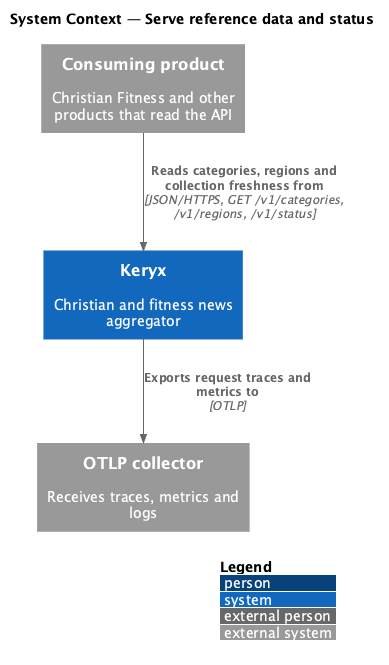
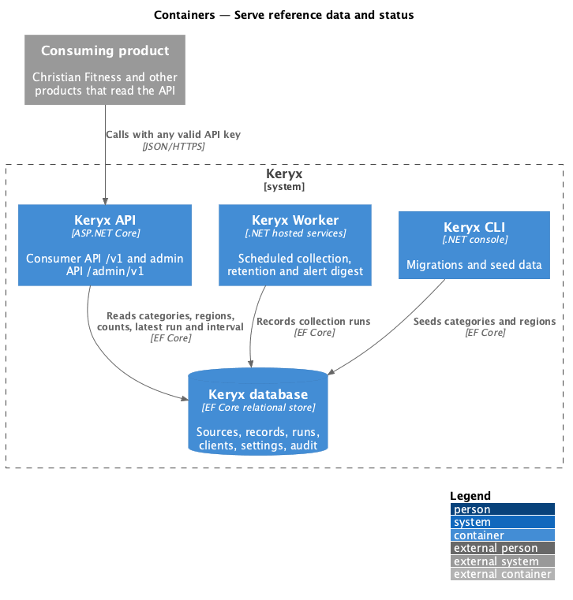
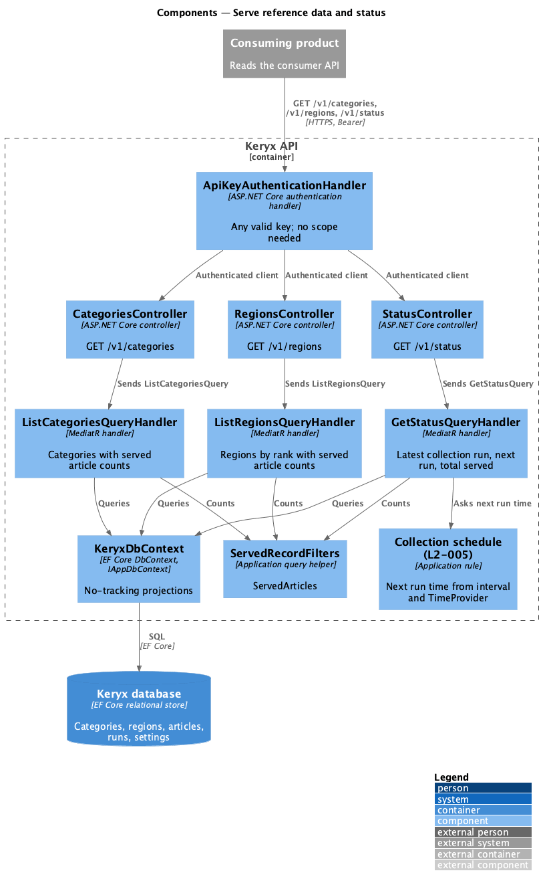
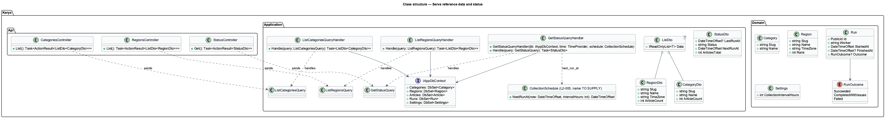
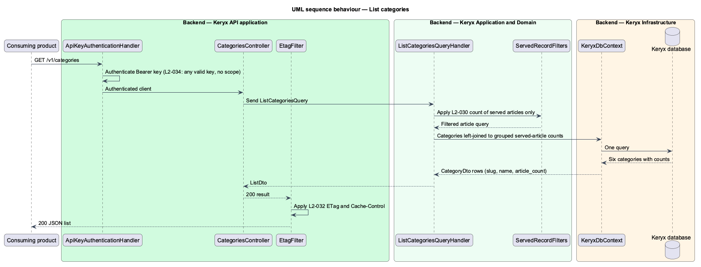
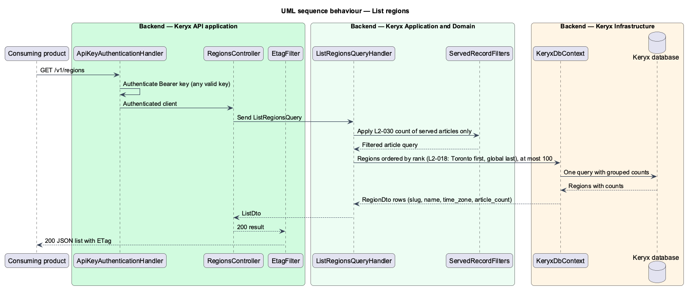
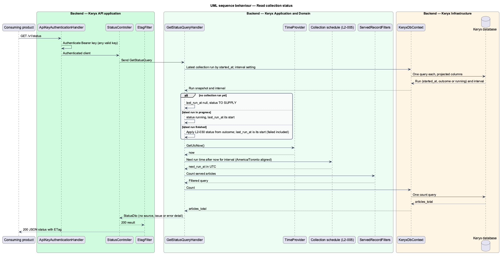

# Serve reference data and status

## Overview

Consuming products such as Christian Fitness filter Keryx's articles by category and region, and
show how fresh Keryx's information is. This feature serves the three small resources they need
for that: the categories, the regions and the collection status. Any valid API key can read
them; no scope is needed (L2-034).

**category** — one of the six fixed topics an article is classified under: `events`,
`races-challenges`, `gyms-studios`, `ministry-programs`, `nutrition`, `faith-wellness` (L2-015)

**region** — entry in the fixed, ranked list of places a record belongs to: the GTA
municipalities with Toronto first, then `gta`, `ontario`, `canada` and `global` (L2-018)

**collection status** — summary of the most recent collection run, the time of the next
scheduled run and the number of served articles

**collection run** — one execution of the `collection` worker's pipeline, recorded with its
start time and outcome (L2-019)

Every count in this feature covers served articles only, so a held or hidden article never
inflates a number a consuming product shows. The status describes collection as a whole and
reveals nothing about an individual source, issue or error. When the latest run fails, the
status says so, while the article endpoints go on serving the data collected earlier.

The feature sits in the `consumer-api` subsystem. It reuses `ServedRecordFilters` from the serve
articles feature and the next-run rule of the collection schedule (L2-005), owned by the
collection subsystem.

## Description

The slice runs from the consuming product's HTTPS request to the relational database (engine
`<TO SUPPLY>`) via EF Core. It has no admin app part and takes no query parameters.

- **`CategoriesController`**, **`RegionsController`** and **`StatusController`**
  (`Keryx.Api`) — expose `GET /v1/categories`, `GET /v1/regions` and `GET /v1/status`. Each
  requires an authenticated API client with no scope policy and sends one MediatR request.
- **`ListCategoriesQuery`** / **`ListCategoriesQueryHandler`** — reads the seeded categories
  with a left-joined, grouped count of served articles per category, in one query. A category
  with no served article has `article_count` 0. The order of the categories is `<TO SUPPLY>`;
  this design keeps the order of L2-015.
- **`ListRegionsQuery`** / **`ListRegionsQueryHandler`** — reads the regions ordered by rank,
  Toronto first and `global` last, each with `slug`, `name`, `time_zone` and a served-article
  `article_count`, in one query. Settings can add regions (L2-018), so the handler bounds the
  list at 100 entries (L2-031); the behaviour beyond 100 regions is `<TO SUPPLY>`.
- **`GetStatusQuery`** / **`GetStatusQueryHandler`** — reads the latest `collection` run by
  `started_at` and the collection interval from Settings. It derives:
  - `last_run_at` — the start of the latest collection run, whatever its outcome, so after a
    failed run it is that run's start (L2-030).
  - `status` — `running` while the latest run has no outcome, otherwise its outcome:
    `succeeded`, `completed_with_issues` or `failed`.
  - `next_run_at` — the next scheduled time after the current time, read from `TimeProvider`,
    computed by the collection schedule rule of L2-005 (aligned to midnight Toronto time). The
    class name of that rule belongs to the collection design and is `<TO SUPPLY>` here.
  - `articles_total` — the count of served articles.
  The values when no collection run has ever been recorded (`last_run_at` `null`, and the
  `status` to serve) are `<TO SUPPLY>`. The status never names a source, an issue or an error
  message.
- **DTOs** — `ListDto<T>` (`data`); `CategoryDto` (`slug`, `name`, `article_count`);
  `RegionDto` (`slug`, `name`, `time_zone`, `article_count`); `StatusDto` (`last_run_at`,
  `status`, `next_run_at`, `articles_total`). Every count is a JSON number. The `data` envelope
  matches the paged lists so every `/v1` list reads the same way; the requirements do not fix
  it, and its confirmation is `<TO SUPPLY>`.
- **Domain types** (`Keryx.Domain`) — `Category`, `Region` (with rank and IANA zone), `Run`,
  `RunOutcome` and `Settings`. The Keryx CLI `seed` command creates the categories and regions
  exactly once (L2-095).
- **Reused parts** — `ServedRecordFilters.ServedArticles`, `EtagFilter` and
  `ProblemDetailsMapper`.

Endpoints:

| Method and path | Request | Success | Errors (`code`) |
|-----------------|---------|---------|-----------------|
| `GET /v1/categories` | none | `200` `{ data: [{ slug, name, article_count }] }` | `401` `invalid_api_key` (L2-033) |
| `GET /v1/regions` | none | `200` `{ data: [{ slug, name, time_zone, article_count }] }` | `401` `invalid_api_key` |
| `GET /v1/status` | none | `200` `{ last_run_at, status, next_run_at, articles_total }` | `401` `invalid_api_key` |

## Requirements

The feature realizes the following level-2 (L2) requirements. Each L2 requirement refines a
level-1 (L1) requirement, cited by identifier. Their acceptance criteria are in
[L2.md](../../../specs/L2.md).

| L2 ID | Refines (L1) | Requirement |
|-------|--------------|-------------|
| `L2-030` | `L1-008` | Categories, regions and status endpoints — Any valid key can read the categories, the regions and the freshness of collection, with counts of published records only. |

## Diagrams

### System context

The consuming product reads categories, regions and collection freshness from Keryx over HTTPS.

### Containers

The Keryx CLI seeds categories and regions, and the Keryx Worker records collection runs. The
Keryx API reads both, with the interval setting, from the Keryx database.

### Components

Three controllers each send one query. The status handler also asks the collection schedule
rule for the next run time.

### Class structure

`GetStatusQueryHandler` depends on `TimeProvider` and the collection schedule rule as well as
`IAppDbContext`. `Run` holds an optional `RunOutcome`, absent while the run is in progress.

### Behaviour — list categories

The handler counts served articles per category in one query.

### Behaviour — list regions

The handler returns regions in rank order with their served-article counts.

### Behaviour — read collection status

The handler derives `status` and `last_run_at` from the latest collection run, then adds the
next scheduled time and the served-article total.

