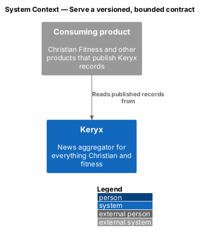
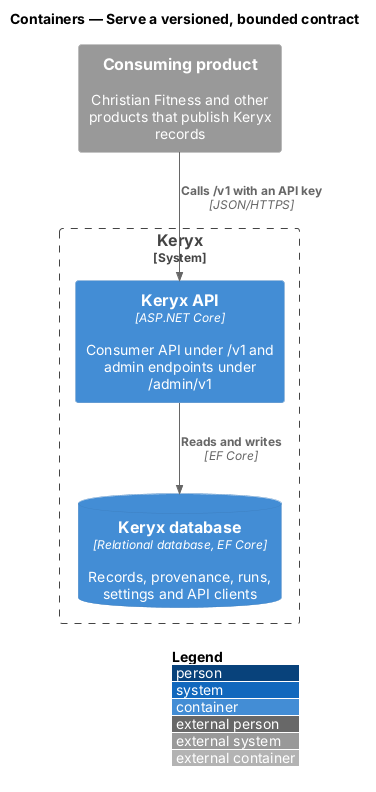
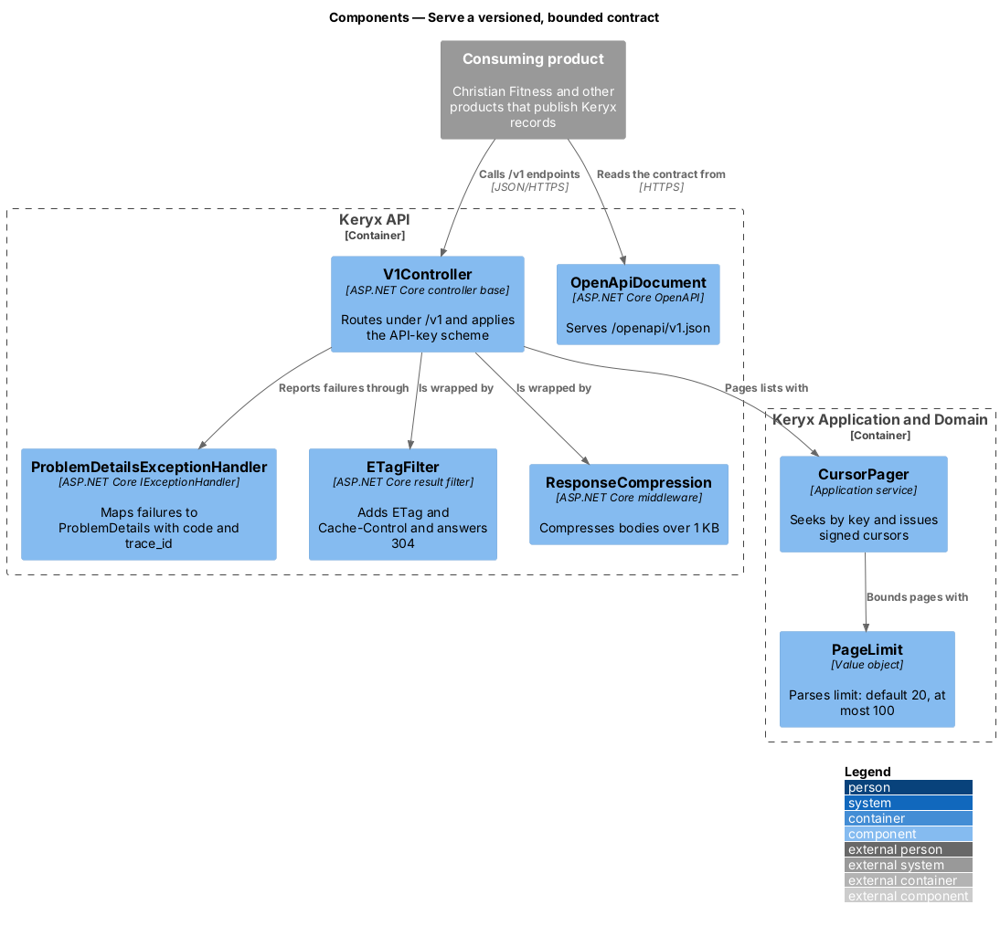
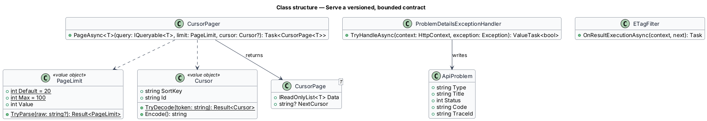
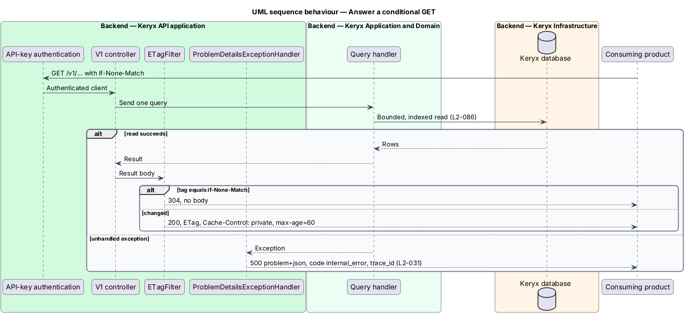

# Serve a versioned, bounded contract

## Overview

Other products depend on the Keryx API, so the API is a product contract. Each consumer endpoint lives under the version prefix `/v1`, is described by an OpenAPI document, pages and bounds each list, and is never broken in place. Christian Fitness is the first consumer.

This feature covers what each `/v1` endpoint shares: the version prefix and its compatibility rule, the error format, response caching with `ETag`, and the performance budget. The endpoints themselves are designed in the other features of this subsystem.

A compatible change adds a field. A removed or renamed field, a changed type or a tightened bound appears only under a new version prefix, with an ADR, and after a check against the Christian Fitness repository.

> **cursor** — opaque token issued by Keryx that encodes the sort key of the last item of a page

> **ProblemDetails** — RFC 9457 error body with `type`, `title`, `status`, a `code` extension and a `trace_id`

## Description

The slice is the set of shared building blocks in the API host and the Application layer that each `/v1` endpoint composes.

- **`V1Controller`** — ASP.NET Core controller base in the Keryx API. Routes under `/v1` and applies the API-key scheme. A query parameter that an endpoint does not define is ignored.
- **`ProblemDetailsExceptionHandler`** — ASP.NET Core IExceptionHandler in the Keryx API. Maps failures to `application/problem+json`. An unhandled exception becomes `500` with `code` `internal_error` and no exception message, stack trace, SQL, file path or host name. An unknown `/v1` path is `404` `not_found`; a method the path does not allow is `405`.
- **`ETagFilter`** — ASP.NET Core result filter in the Keryx API. Adds an `ETag` and `Cache-Control: private, max-age=60` to each successful `GET`. A request whose `If-None-Match` equals the current `ETag` gets `304` with no body. The tag is computed from the response body, so a hidden article changes the tag of each list that contained it.
- **`OpenApiDocument`** — ASP.NET Core OpenAPI in the Keryx API. Serves `/openapi/v1.json` anonymously. It describes each `/v1` endpoint, each parameter with its bounds, each response body and each error `code`, and changes in the same commit as the endpoint.
- **`ResponseCompression`** — ASP.NET Core middleware in the Keryx API. Compresses bodies over 1 KB.
- **`CursorPager`** — Application service in the Application and Domain layers. Seeks by key instead of skipping rows, so page 500 costs the same as page 1. A cursor that Keryx did not issue is refused with `invalid_cursor`. A page continues from where the previous one ended when a new record is published between two requests.
- **`PageLimit`** — Value object in the Application and Domain layers. Parses `limit`: default 20, at most 100. `0`, `101` or a non-number is refused with `invalid_limit`.
- **`CursorPage<T>`** — response envelope with `data` and `next_cursor`, `null` on the last page.
- **`ErrorCode`** — catalogue of the `code` values the OpenAPI document lists.

With 20,000 published articles and 50 concurrent clients on the reference deployment, the 95th-percentile response time is at most 200 ms and the 99th at most 500 ms, measured at the server (L2-086). The reference deployment is `<TO SUPPLY>`. Each list issues a bounded number of queries independent of page size, reads only the columns it returns, and each filter is served by an index.

## Requirements

The feature realizes the following level-2 (L2) requirements. Each L2 requirement refines a level-1 (L1) requirement, cited by identifier. The acceptance criteria of each requirement are in [`docs/specs/L2.md`](../../../specs/L2.md).

| L2 ID | Refines (L1) | Requirement |
|-------|--------------|-------------|
| [`L2-025`](../../../specs/L2.md#l2-025-api-versioning-and-contract) | `L1-008` | **API versioning and contract.** The requirement is defined by its 5 acceptance criteria. |
| [`L2-031`](../../../specs/L2.md#l2-031-consumer-api-errors) | `L1-008` | **Consumer API errors.** The requirement is defined by its 4 acceptance criteria. |
| [`L2-032`](../../../specs/L2.md#l2-032-caching-for-consumers) | `L1-008` | **Caching for consumers.** The requirement is defined by its 3 acceptance criteria. |
| [`L2-086`](../../../specs/L2.md#l2-086-api-performance) | `L1-021` | **API performance.** The requirement is defined by its 5 acceptance criteria. |

## Diagrams

### System context

A consuming product reads published records from Keryx.

### Containers

The consuming product calls the Keryx API at `/v1` with an API key. The Keryx API reads and writes the Keryx database.

### Components

Each `/v1` controller derives from `V1Controller`. `ETagFilter`, `ProblemDetailsExceptionHandler` and `ResponseCompression` wrap each response; list handlers use `CursorPager` and `PageLimit`.

### Class structure

`CursorPager` turns a `PageLimit` and a `Cursor` into a `CursorPage`. `ProblemDetailsExceptionHandler` writes an `ApiProblem`.

### Behaviour — answer a conditional GET

The filter compares `If-None-Match` with the tag of the current body and answers `304` when nothing has changed (`L2-032`). A failure anywhere becomes a ProblemDetails body (`L2-031`).

