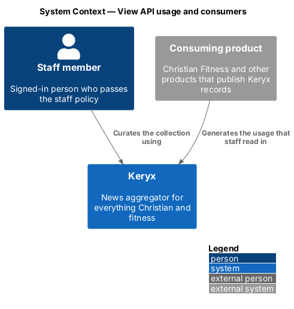
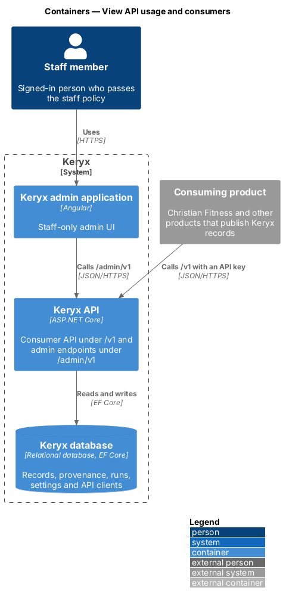
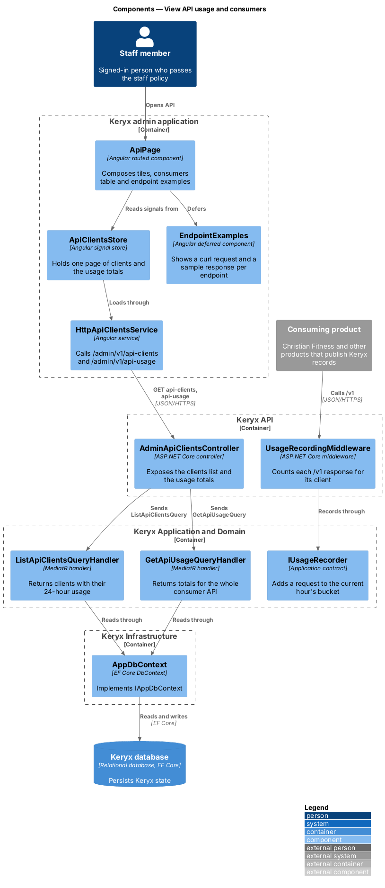
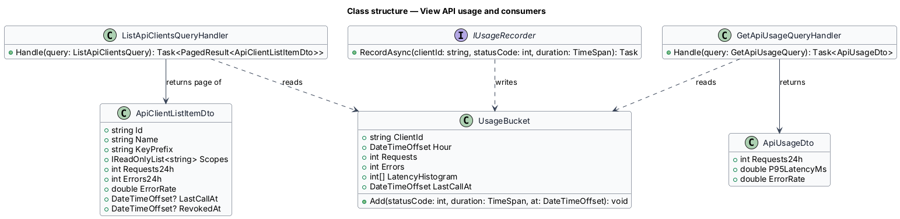
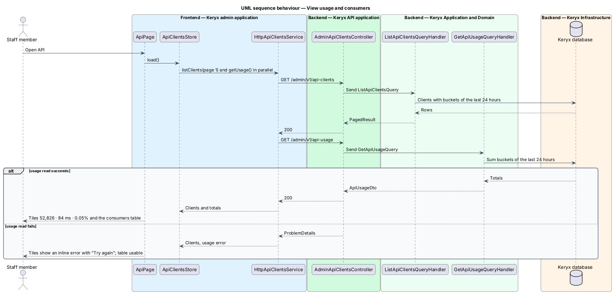

# View API usage and consumers

## Overview

The API screen shows staff how other products use Keryx. It gives the base address of the consumer API, its requests, 95th-percentile latency and error rate over the last 24 hours, each consumer with its key prefix, scopes and usage, and the list of endpoints with an example request and response for each.

Usage is recorded as counts per client per hour. It holds no request path parameter, query string, IP address or body. A response with status 500 to 599 counts as an error; a `4xx` response counts as a request and not as an error. The retention worker deletes usage older than 30 days.

> **usage bucket** — count of requests and errors of one client in one clock hour

## Description

The slice has a write side in the `/v1` pipeline (one recorder) and a read side for the screen (two queries). The endpoint examples are static content of the admin application.

- **`ApiPage`** — Angular routed component in the Keryx admin application. Composes tiles, consumers table and endpoint examples. It formats numbers into "52,826", "84 ms" and "0.05%", shows "—" for the error rate of a client with no requests, and names each Revoke button "Revoke the key for &lt;product>". When usage fails and clients load, only the tiles show an inline error.
- **`ApiClientsStore`** — Angular signal store in the Keryx admin application. Holds one page of clients and the usage totals.
- **`EndpointExamples`** — Angular deferred component in the Keryx admin application. Shows a `curl` request with the placeholder key `kx_live_…` and a sample `200 OK` response per endpoint, as selectable monospace text that scrolls inside its panel. It is loaded with `@defer` and holds no real key.
- **`HttpApiClientsService`** — Angular service in the Keryx admin application. Calls /admin/v1/api-clients and /admin/v1/api-usage.
- **`AdminApiClientsController`** — ASP.NET Core controller in the Keryx API. Exposes the clients list and the usage totals.
- **`UsageRecordingMiddleware`** — ASP.NET Core middleware in the Keryx API. Counts each `/v1` response for its client after the response is sent. It records the client id, the hour, whether the status is 5xx and the duration, and nothing else.
- **`IUsageRecorder`** — Application contract in the Application and Domain layers. Adds a request to the current hour's bucket.
- **`ListApiClientsQueryHandler`** — MediatR handler in the Application and Domain layers. Returns clients, at most 50 per page, each with `requests_24h` and `errors_24h` as numbers, `error_rate` from 0 to 1 and `last_call_at` or `null`. A revoked client stays listed.
- **`GetApiUsageQueryHandler`** — MediatR handler in the Application and Domain layers. Returns `requests_24h`, `p95_latency_ms` and `error_rate` for the whole consumer API. The source of the latency percentile (stored histogram buckets or the metrics backend) is `<TO SUPPLY>`.
- **`AppDbContext`** — EF Core DbContext in the Infrastructure layer. Implements IAppDbContext.
- **`UsageBucket`** — entity keyed by client id and hour, with `Requests`, `Errors` and latency histogram counts.
- **`ApiClientListItemDto`** — `id`, `name`, `key_prefix`, `scopes`, `requests_24h`, `errors_24h`, `error_rate`, `last_call_at`, `revoked_at`.

## Requirements

The feature realizes the following level-2 (L2) requirements. Each L2 requirement refines a level-1 (L1) requirement, cited by identifier. The acceptance criteria of each requirement are in [`docs/specs/L2.md`](../../../specs/L2.md).

| L2 ID | Refines (L1) | Requirement |
|-------|--------------|-------------|
| [`L2-037`](../../../specs/L2.md#l2-037-usage-metrics-per-client) | `L1-009` | **Usage metrics per client.** The requirement is defined by its 5 acceptance criteria. |
| [`L2-067`](../../../specs/L2.md#l2-067-api-screen) | `L1-015` | **API screen.** The requirement is defined by its 8 acceptance criteria. |

## Diagrams

### System context

A staff member curates the collection through Keryx. The consuming product generates the usage that staff read in Keryx.

### Containers

The staff member uses the Keryx admin application. The Keryx admin application calls the Keryx API at `/admin/v1`. The consuming product calls the Keryx API at `/v1` with an API key. The Keryx API reads and writes the Keryx database.

### Components

`UsageRecordingMiddleware` writes through `IUsageRecorder` on each `/v1` response. `ApiPage` reads through `ApiClientsStore`, whose two requests reach `ListApiClientsQueryHandler` and `GetApiUsageQueryHandler`.

### Class structure

`UsageBucket` is the stored shape; the two DTOs are computed from the buckets of the last 24 hours.

### Behaviour — view usage and consumers

The page sends two independent requests, so a failure of the usage totals leaves the consumers table usable (`L2-067`). Each number arrives as a number and is formatted by the page (`L2-037`).

