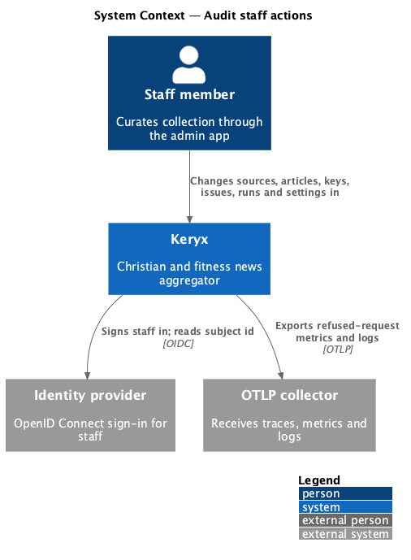
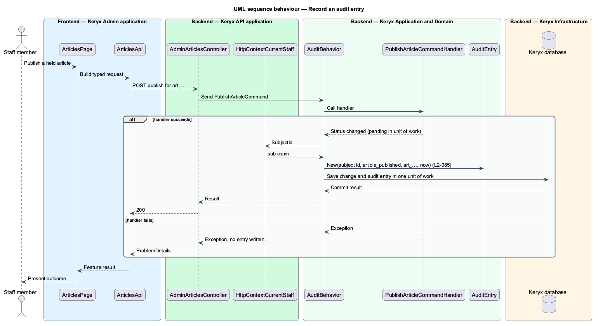
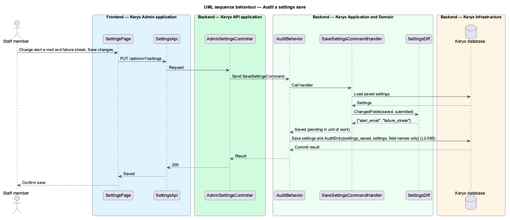
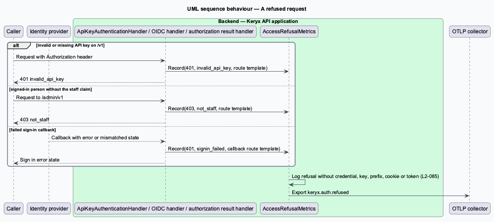

# Audit staff actions

## Overview

Staff change what Keryx collects and serves: they publish and hide articles, manage sources and
API keys, mute issues, start runs and save settings. This cross-cutting feature keeps an audit
trail of each of those changes, so it is always known who changed what and when. It also counts
and logs refused access. It has no screen of its own, and the trail holds no secret or personal
data beyond the staff member's subject id.

- **audit entry** — stored record of one successful state-changing staff action: the staff member's subject id, the action, the target's id and the time
- **subject id** — identifier of a staff member issued by the identity provider (`sub` claim)
- **auditable command** — MediatR command that changes state on behalf of staff and declares its audit action and target
- **refused request** — request answered `401` or `403`, or a failed sign-in callback

Every auditable command is wrapped by one MediatR pipeline behaviour. The behaviour writes the
audit entry in the same unit of work as the change, after the handler succeeds. A failed command
therefore leaves no entry, and a stored change always has one. An entry holds no key, no e-mail
address and no copy of source text. For Settings it holds the names of the fields changed, never
their values. Entries older than the retention period are deleted by the retention worker
(apply retention feature, catalogue subsystem).

## Description

**Application (`Keryx.Application`)**

- **`IAuditableCommand`** — marker interface implemented by each state-changing staff command.
  It exposes `AuditAction Action` and `string TargetId`, and `IReadOnlyList<string>
  ChangedFields` for Settings. Implementers: `PublishArticleCommand`, `HideArticleCommand`,
  `AddSourceCommand`, `EditSourceCommand`, `RemoveSourceCommand`, `CreateApiKeyCommand`,
  `RevokeApiKeyCommand`, `MuteIssueCommand`, `StartRunCommand`, `RetryFailedSourcesCommand`,
  `SaveSettingsCommand`. The final names follow each owning subsystem's design. Whether
  `UnmuteIssueCommand` and an article's Undo are audited is `<TO SUPPLY>`: `L2-085` lists
  neither.
- **`AuditBehavior<TRequest, TResponse>`** — MediatR pipeline behaviour for `IAuditableCommand`.
  After the handler succeeds it adds an `AuditEntry` through `IAppDbContext` and commits it
  with the change. It reads the subject id from `ICurrentStaff` and the time from
  `TimeProvider`.
- **`ICurrentStaff`** — contract giving the signed-in staff member's `SubjectId`.
- **`SettingsDiff`** — compares saved and submitted `Settings` and returns the names of the
  changed fields (for example `alert_email`, `failure_streak`), never their values.

**Domain (`Keryx.Domain`)**

- **`AuditEntry`** — `Guid Id`, `string SubjectId`, `AuditAction Action`, `string TargetId`
  (a public id such as `art_…`, `src_…`, `run_…`, an issue id, an API client id, or `settings`),
  `IReadOnlyList<string> ChangedFields`, `DateTimeOffset OccurredAt` (UTC). It has no field for
  a key, an e-mail address or source text.
- **`AuditAction`** — `article_published`, `article_hidden`, `source_added`, `source_edited`,
  `source_removed`, `api_key_created`, `api_key_revoked`, `issue_muted`, `run_started`,
  `run_retried`, `settings_saved`.

**API (`Keryx.Api`)**

- **`HttpContextCurrentStaff`** — implements `ICurrentStaff` from the authenticated principal's
  `sub` claim.
- **`AccessRefusalMetrics`** — counts refused requests in the counter `keryx.auth.refused` with
  the tags `status` (`401` or `403`), `reason` (for example `invalid_api_key`, `not_staff`,
  `session_expired`, `signin_failed`) and the route template. It is fed by the
  `OnRemoteFailure` event of the OpenID Connect handler, by `ApiKeyAuthenticationHandler` and
  by an `IAuthorizationMiddlewareResultHandler`. Each refusal is logged with the same fields and
  without the credential, cookie, key, key prefix or token presented. The metric name is
  provisional until the telemetry conventions (`L2-094`) fix it: `<TO SUPPLY>`.

**Infrastructure (`Keryx.Infrastructure`)**

- **`KeryxDbContext`** — maps `AuditEntries` with an index on `OccurredAt` for retention.

**Worker (`Keryx.Worker`)**

- **`RetentionWorker`** — deletes audit entries older than the retention period (`L2-085`
  criterion 4), designed in the apply retention feature.

**Read access**

- No endpoint or screen reads the audit trail in this version. How an auditor reads it, and
  whether an endpoint is added, is `<TO SUPPLY>`.

## Requirements

The feature realizes the following level-2 (L2) requirements. Each L2 requirement refines a
level-1 (L1) requirement, cited by identifier. Their acceptance criteria are in
[L2.md](../../../specs/L2.md).

| L2 ID | Refines (L1) | Requirement |
|-------|--------------|-------------|
| `L2-085` | `L1-020` | Audit of staff actions — Every state-changing staff action is recorded for audit, without the secrets or personal data it touched. |

## Diagrams

### System context

Staff act through Keryx after signing in with the identity provider. Refused and failed
sign-ins are reported as metrics to the OTLP collector.

### Containers

The Keryx API writes audit entries to the Keryx database with each change. The Keryx Worker
deletes old entries.

### Components

`AuditBehavior` wraps every auditable command and writes through `IAppDbContext`.
`AccessRefusalMetrics` observes the authentication handlers.

### Class structure

Each auditable command implements `IAuditableCommand`. `AuditBehavior` builds an `AuditEntry`
from it, `ICurrentStaff` and `TimeProvider`.

### Behaviour — record an audit entry

Publishing an article commits the status change and its audit entry together; a failing
handler leaves no entry.

### Behaviour — audit a settings save

Saving Settings records the names of the changed fields; the alert address value is never
written to the entry.

### Behaviour — a refused request

A `401`, a `403` or a failed sign-in callback is counted and logged without the credential.

