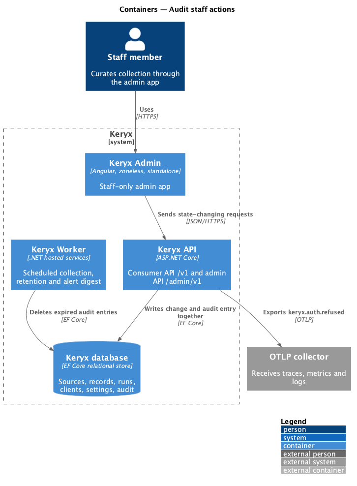
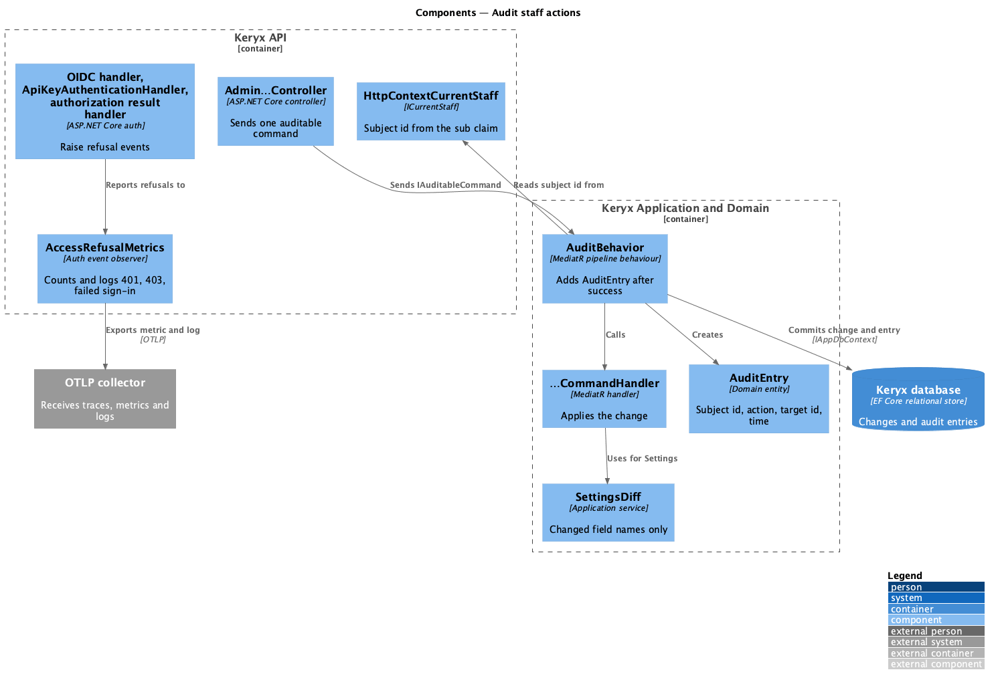
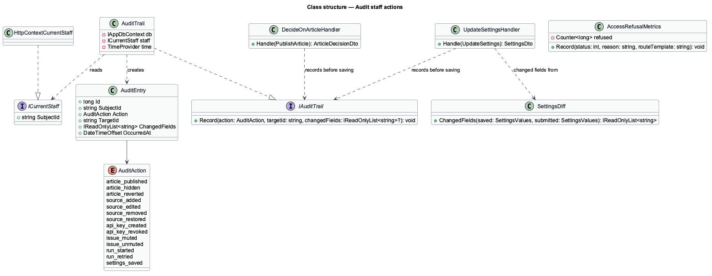

# Audit staff actions

## Overview

Staff change what Keryx collects and serves: they publish and hide articles, manage sources and
API keys, mute issues, start runs and save settings. This cross-cutting feature keeps an audit
trail of each of those changes, so it is always known who changed what and when. It also counts
and logs refused access. It has no screen of its own, and the trail holds no secret or personal
data beyond the staff member's subject id.

- **audit entry** — stored record of one successful state-changing staff action: the staff member's subject id, the action, the target's id and the time
- **subject id** — identifier of a staff member issued by the identity provider (`sub` claim)
- **audit trail** — scoped service a handler calls to add an audit entry to the change it is about to save
- **refused request** — request answered `401` or `403`, or a failed sign-in callback

Each handler that changes state for staff records the change through the audit trail just before
its own save, so the entry is committed by the same `SaveChanges` as the change. A failed command
therefore leaves no entry, and a stored change always has one. A request that changes nothing,
such as publishing an article that is already published, saves nothing and records nothing. An entry holds no key, no e-mail
address and no copy of source text. For Settings it holds the names of the fields changed, never
their values. Entries older than the retention period are deleted by the retention worker
(apply retention feature, catalogue subsystem).

## Description

**Application (`Keryx.Application`)**

- **`IAuditTrail`** — contract with one method, `Record(AuditAction action, string targetId,
  IReadOnlyList<string>? changedFields = null)`, which adds an `AuditEntry` to the unit of work
  through `IAppDbContext`. It reads the subject id from `ICurrentStaff` and the time from
  `TimeProvider`. It saves nothing: the handler's own save commits the entry with the change.
  Its callers and their actions: `PublishArticle`, `HideArticle` and `RevertArticleDecision`
  (the article's Undo); `AddSource`, `UpdateSource`, `RemoveSource` and `RestoreSource` (the
  source's Undo); `CreateApiClient` and `RevokeApiClient`; `MuteIssueCommand` and
  `UnmuteIssueCommand`; `StartRun` and `RetryFailedSources`; `UpdateSettings`. Undo and Unmute
  are audited although `L2-085` lists neither: each changes state, and the requirement is that
  every state-changing staff action is recorded.
  Retrying a failed run starts a new one: it records `run_retried` for the failed run and
  `run_started` for the new run, committed together by the new run's save. Muting a muted
  issue, unmuting an open one and revoking a revoked key change nothing and record nothing.
- **Why not a pipeline behaviour.** Every handler saves its own change, and saves only when
  something changed. A behaviour that wrote the entry after the handler would need a second
  save, which could fail alone and leave a change with no entry, and it could not tell a change
  from a repeat. A transaction around both would close that gap, but the EF Core InMemory
  provider the tests use has no transactions, so the guarantee could not be tested.
- **`ICurrentStaff`** — contract giving the signed-in staff member's `SubjectId`.
- **`SettingsDiff`** — compares the saved and submitted `SettingsValues` and returns the names
  of the changed fields as the API writes them (for example `alert_email`,
  `alert_failure_streak`), never their values.

**Domain (`Keryx.Domain`)**

- **`AuditEntry`** — `long Id` (as every other table, which lets retention delete in key order), `string SubjectId`, `AuditAction Action`, `string TargetId`
  (a public id such as `art_…`, `src_…`, `run_…`, an issue id, an API client id, or `settings`),
  `IReadOnlyList<string> ChangedFields`, `DateTimeOffset OccurredAt` (UTC). It has no field for
  a key, an e-mail address or source text.
- **`AuditAction`** — `article_published`, `article_hidden`, `article_reverted`,
  `source_added`, `source_edited`, `source_removed`, `source_restored`, `api_key_created`,
  `api_key_revoked`, `issue_muted`, `issue_unmuted`, `run_started`, `run_retried`,
  `settings_saved`.

**API (`Keryx.Api`)**

- **`HttpContextCurrentStaff`** — implements `ICurrentStaff` from the authenticated principal's
  `sub` claim.
- **`AccessRefusalMetrics`** — counts refused requests in the counter `keryx.auth.refused` with
  the tags `status` (`401` or `403`), `reason` (for example `invalid_api_key`, `not_staff`,
  `session_expired`, `signin_failed`) and the route template. It is fed by the
  `OnRemoteFailure` event of the OpenID Connect handler, by `ApiKeyAuthenticationHandler` and
  by an `IAuthorizationMiddlewareResultHandler`. Each refusal is logged with the same fields and
  without the credential, cookie, key, key prefix or token presented. The metric is named
  `keryx.auth.refused`, unit `{request}`, after the OpenTelemetry convention of a
  dot-separated namespace; the route template's tag is `http.route`. `L2-094` names no
  metric, so the observability journey adopts this name.

**Infrastructure (`Keryx.Infrastructure`)**

- **`KeryxDbContext`** — maps `AuditEntries` with an index on `OccurredAt` for retention.

**Worker (`Keryx.Worker`)**

- **`RetentionWorker`** — deletes audit entries older than the retention period (`L2-085`
  criterion 4), designed in the apply retention feature.

**Read access**

- No endpoint or screen reads the audit trail in this version. An operator reads the
  `AuditEntries` table with read access to the database; an endpoint, if one is wanted, is a
  later requirement.

## Requirements

The feature realizes the following level-2 (L2) requirements. Each L2 requirement refines a
level-1 (L1) requirement, cited by identifier. Their acceptance criteria are in
[L2.md](../../../specs/L2.md).

| L2 ID | Refines (L1) | Requirement |
|-------|--------------|-------------|
| `L2-085` | `L1-020` | Audit of staff actions — Every state-changing staff action is recorded for audit, without the secrets or personal data it touched. |

## Diagrams

### System context

Staff act through Keryx after signing in with the identity provider. Refused and failed
sign-ins are reported as metrics to the OTLP collector.

### Containers

The Keryx API writes audit entries to the Keryx database with each change. The Keryx Worker
deletes old entries.

### Components

Each handler records through `AuditTrail`, which adds the entry to the handler's own save.
`AccessRefusalMetrics` observes the authentication handlers.

### Class structure

Handlers depend on `IAuditTrail`. `AuditTrail` builds an `AuditEntry` from the action, the
target, `ICurrentStaff` and `TimeProvider`.

### Behaviour — record an audit entry

Publishing an article commits the status change and its audit entry together; a failing
handler leaves no entry.

### Behaviour — audit a settings save

Saving Settings records the names of the changed fields; the alert address value is never
written to the entry.

### Behaviour — a refused request

A `401`, a `403` or a failed sign-in callback is counted and logged without the credential.

