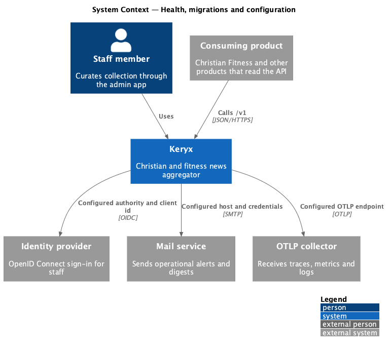
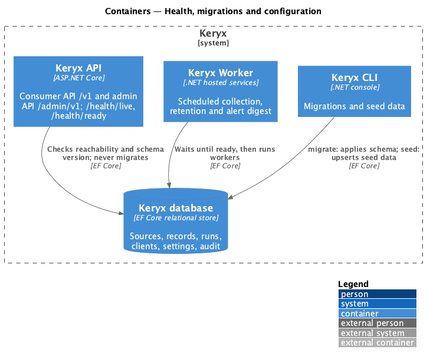
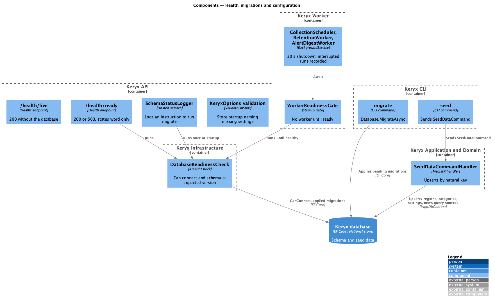
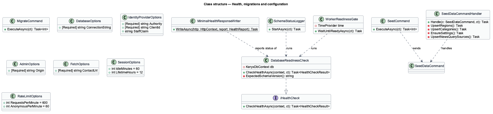
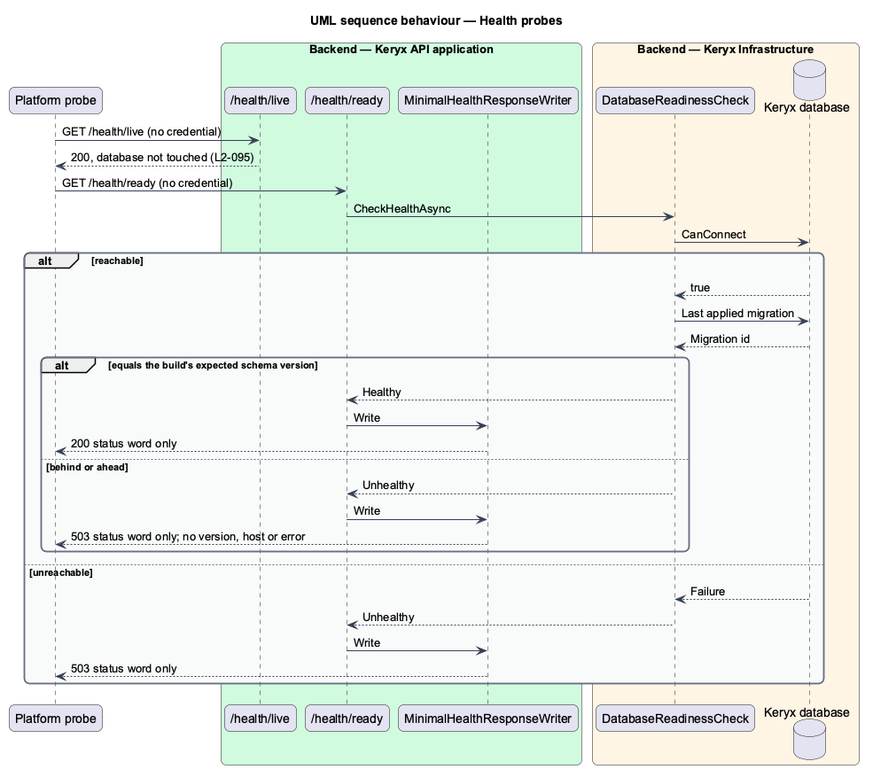
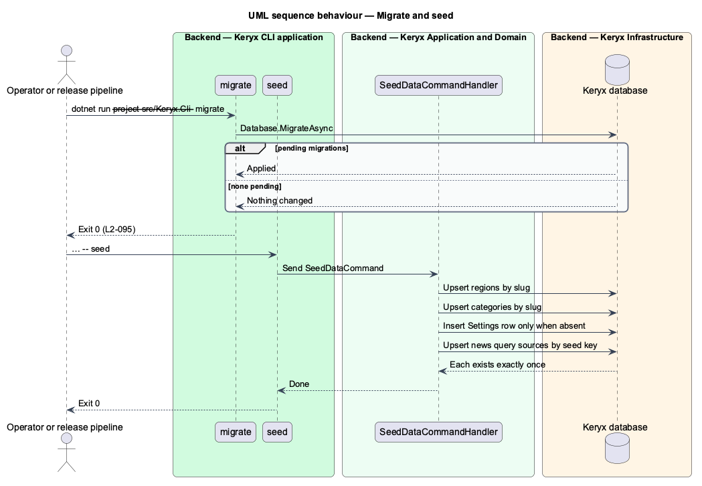
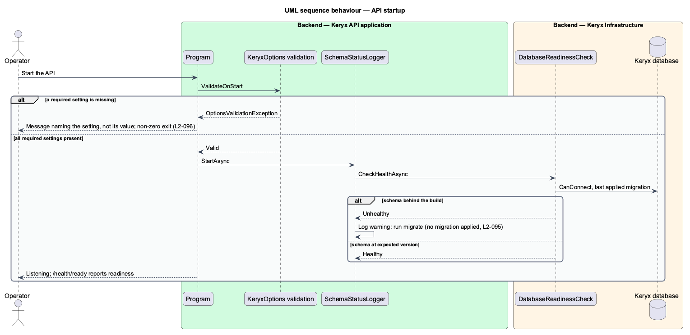
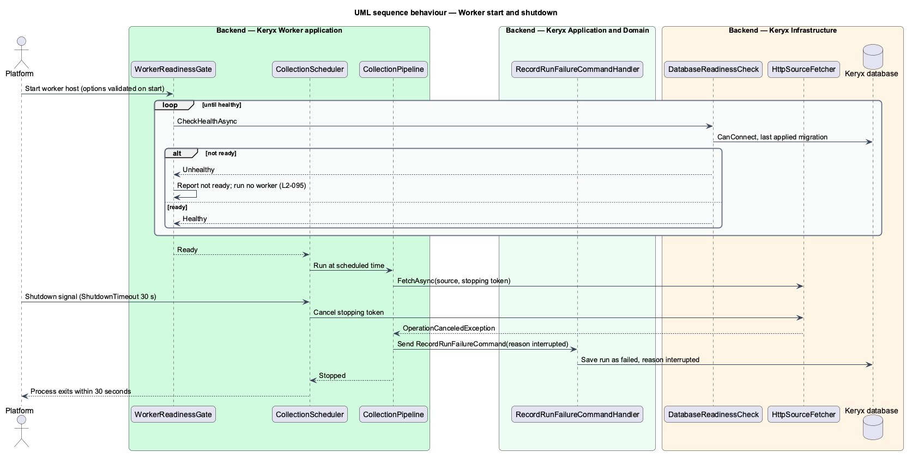

# Health, migrations and configuration

## Overview

Keryx is deployed as three .NET processes beside one database: the Keryx API, the Keryx Worker
and the Keryx CLI. This feature covers how they are operated. The API reports whether it is
alive and ready. The database schema changes only when an operator runs an explicit CLI
command, never when the API starts. Seed data can be applied any number of times with the same
result. Every setting a deployment needs is documented, and a missing required setting stops a
process at startup with a message naming it. Continuous integration (CI) keeps the build green
and fast.

- **liveness** — the process is running and can answer; it says nothing about the database
- **readiness** — the process can do its work: the database is reachable and its schema is at the version the build expects
- **migration** — versioned EF Core change to the database schema
- **expected schema version** — identifier of the last migration compiled into the build
- **seed data** — rows every deployment needs: the regions, the categories, the default settings and the seeded news query sources
- **idempotent** — giving the same result whether run once or any number of times
- **required setting** — configuration value without which a process cannot run correctly, and which has no safe default

Neither health endpoint needs a credential, and neither reveals a version, a host or an error
message. When the database is behind the build, the API still starts but reports not ready and
logs an instruction to run `migrate`. The worker does the same and runs no worker until the database
is ready. On a shutdown signal during a run, the worker cancels the current fetch, records the
run as `failed` with reason `interrupted`, and exits within 30 seconds.

## Description

**API (`Keryx.Api`)**

- **`/health/live`** — `MapHealthChecks` with a predicate that runs no check; it answers `200`
  without touching the database. It is `AllowAnonymous` and excluded from the OpenAPI document.
- **`/health/ready`** — runs `DatabaseReadinessCheck`; it answers `200` when healthy and `503`
  otherwise. It is `AllowAnonymous`. `MinimalHealthResponseWriter` writes the status word only:
  no version, host, exception or check detail.
- **`SchemaStatusLogger`** — hosted service that runs `DatabaseReadinessCheck` once at startup.
  When the schema is behind, it logs a warning to run `migrate`. It never migrates.
- **Startup validation** — `Program` binds each options class with
  `ValidateDataAnnotations().ValidateOnStart()`. On `OptionsValidationException` it writes the
  names of the missing settings, never their values, and exits with a non-zero code
  (`<TO SUPPLY>`).

**Infrastructure (`Keryx.Infrastructure`)**

- **`DatabaseReadinessCheck`** — `IHealthCheck` shared by the API and the worker. It is healthy
  only when `Database.CanConnectAsync` succeeds and the last applied migration equals the
  build's expected schema version (`GetAppliedMigrationsAsync` against `GetMigrations`). A
  database ahead of the build is not ready either.
- **`KeryxOptions`** classes — `DatabaseOptions`, `IdentityProviderOptions`, `AdminOptions`,
  `PublicApiOptions`, `MailOptions`, `PlatformCredentialsOptions`, `FetchOptions`,
  `RateLimitOptions`, `SessionOptions`, `DataProtectionOptions`, each with `[Required]` on its
  required members.

**Worker (`Keryx.Worker`)**

- **`WorkerReadinessGate`** — awaited by `CollectionScheduler`, `RetentionWorker` and
  `AlertDigestWorker` before their first schedule. It runs `DatabaseReadinessCheck` and, while
  unhealthy, reports not ready and re-checks. The re-check interval, read through
  `TimeProvider`, and how the worker reports not ready (log, metric or a health endpoint) are
  `<TO SUPPLY>`.
- **Graceful shutdown** — `HostOptions.ShutdownTimeout` is 30 seconds. The stopping token
  cancels the current source fetch. `CollectionPipeline` then sends `RecordRunFailureCommand`
  with reason `interrupted` (run recording subsystem, `L2-019`) and the process exits.

**CLI (`Keryx.Cli`)**

- **`migrate`** — `dotnet run --project src/Keryx.Cli -- migrate` calls
  `Database.MigrateAsync`. It applies pending migrations and exits `0`; run again, it changes
  nothing and exits `0`.
- **`seed`** — sends `SeedDataCommand`. `SeedDataCommandHandler` upserts by natural key:
  regions by `slug`, categories by `slug`, the single `Settings` row when absent, and news query
  sources by a fixed seed key. Each therefore exists exactly once after any number of runs. The
  list of GTA regions and of seeded news queries is `<TO SUPPLY>`.

**Configuration (`tools/deploy/`)**

- **`tools/deploy/configuration.md`** — one row per setting with its name, meaning, default and
  whether it is a secret, updated in the same change that introduces or changes a setting. The
  settings named by `L2-096` and their proposed keys:

  | Setting | Proposed key | Secret | Default |
  |---------|--------------|--------|---------|
  | Database connection | `ConnectionStrings__Keryx` | Yes | none (required) |
  | Identity provider authority | `Keryx__Oidc__Authority` | No | none (required) |
  | Identity provider client id | `Keryx__Oidc__ClientId` | No | none (required) |
  | Identity provider client secret | `Keryx__Oidc__ClientSecret` | Yes | `<TO SUPPLY>` |
  | Staff claim | `Keryx__Oidc__StaffClaim` | No | `<TO SUPPLY>` |
  | Admin origin | `Keryx__Admin__Origin` | No | none (required) |
  | Public API base URL | `Keryx__PublicApi__BaseUrl` | No | none (required) |
  | OTLP endpoint | `OTEL_EXPORTER_OTLP_ENDPOINT` | No | unset (no export) |
  | Mail service host, port, user, password | `Keryx__Mail__*` | Password: yes | `<TO SUPPLY>` |
  | Platform credentials (Instagram, Eventbrite, news search) | `Keryx__Platforms__*` | Yes | unset (kind unavailable, `L2-021`) |
  | User-agent contact URL | `Keryx__Fetch__ContactUrl` | No | none (required) |
  | Client rate limit | `Keryx__RateLimit__RequestsPerMinute` | No | 600 (`L2-038`) |
  | Anonymous rate limit | `Keryx__RateLimit__AnonymousPerMinute` | No | 60 (`L2-038`) |
  | Session idle time | `Keryx__Session__IdleMinutes` | No | 60 (`L2-041`) |
  | Session lifetime | `Keryx__Session__LifetimeHours` | No | 12 (`L2-041`) |
  | Data-protection key store | `Keryx__DataProtection__*` | Yes | none (required with more than one instance, `L2-084`) |

  The final key names and which settings are required are `<TO SUPPLY>` until each is
  introduced.

**CI (`.github/workflows/`)**

- **`ci.yml`** — GitHub Actions workflow with a 5-minute job timeout. It runs Prettier and
  ESLint checks, the Angular build, `dotnet format --verify-no-changes`, the .NET build, and one
  critical acceptance path per feature: the `Keryx.Api.Tests` tests tagged critical (EF Core
  InMemory, fake sources) and the Playwright specs tagged critical (fixtures, Chromium only). It
  calls no real source and no real database. The tag names are `<TO SUPPLY>`.

## Requirements

The feature realizes the following level-2 (L2) requirements. Each L2 requirement refines a
level-1 (L1) requirement, cited by identifier. Their acceptance criteria are in
[L2.md](../../../specs/L2.md).

| L2 ID | Refines (L1) | Requirement |
|-------|--------------|-------------|
| `L2-095` | `L1-023` | Health, migrations and seed data — The system reports its liveness and readiness, changes its schema only through an explicit CLI command, and seeds idempotently. |
| `L2-096` | `L1-023` | Documented configuration — Every setting a deployment needs is documented, and a missing required setting stops startup with a clear message. |

## Diagrams

### System context

Each external system Keryx reaches is configured through settings that this feature documents
and validates at startup.

### Containers

The Keryx CLI is the only container that changes the schema. The Keryx API and the Keryx Worker
check the schema version and wait while it is behind.

### Components

`DatabaseReadinessCheck` serves `/health/ready`, `SchemaStatusLogger` and
`WorkerReadinessGate`. The CLI's `migrate` and `seed` commands own every schema and seed change.

### Class structure

The options classes validate on start. The readiness check compares the applied migration with
the build's expected schema version.

### Behaviour — health probes

`/health/live` answers without the database. `/health/ready` answers `200` only when the
database is reachable at the expected schema version, else `503`, with no detail in the body.

### Behaviour — migrate and seed

`migrate` applies pending migrations and is a no-op when run again; `seed` upserts by natural
key, so each seeded row exists exactly once.

### Behaviour — API startup

A missing required setting stops startup with its name. A database behind the build leaves the
API running and not ready, with a log line telling the operator to run `migrate`.

### Behaviour — worker start and shutdown

The worker runs nothing until the database is ready. On a shutdown signal it cancels the
current fetch, records the run as `failed` with reason `interrupted`, and exits within
30 seconds.

