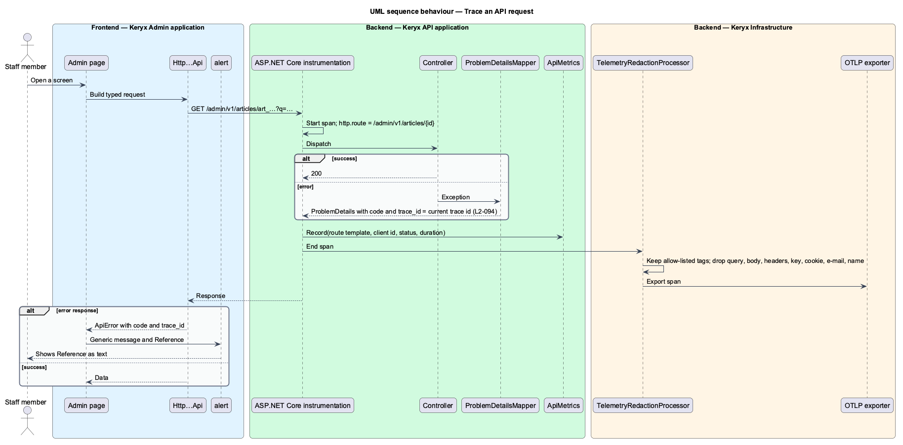
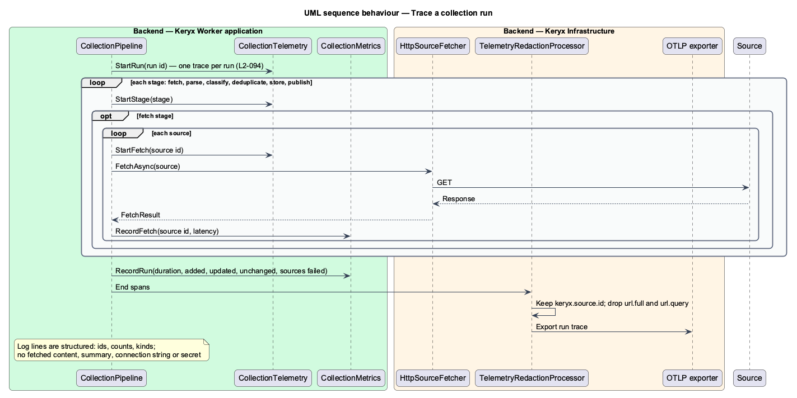

# Observe the system

## Overview

Keryx runs unattended: workers collect on a schedule, and other products call the API at any
time. The people who run it need to see what happened, how long it took and where it failed,
without that view leaking anything private. This cross-cutting feature makes the Keryx API and
the Keryx Worker observable through OpenTelemetry. It has no screen of its own; the admin app
shows only the `trace_id` of an error, as its "Reference".

- **OpenTelemetry** — vendor-neutral standard and SDK for traces, metrics and logs
- **OTLP** — OpenTelemetry protocol used to export telemetry to a collector
- **span** — timed unit of work in a trace, such as one HTTP request, one run stage or one source fetch
- **trace** — tree of spans that shares one trace id
- **route template** — route as declared, with placeholders (`/v1/articles/{id}`), never the requested path or its query
- **redaction** — removal of a value from telemetry before it is exported

Both processes export traces, metrics and logs over OTLP to the configured endpoint. With no
endpoint configured they run without error and export nothing. A request span records the
route template, method, status and duration and nothing else that could identify a person or a
secret. A collection run is one trace, with a span per stage and per source fetch; a fetch span
names the source by id, never by its URL's query. Every log line is structured and carries no
fetched content, summary, connection string or secret. An error response carries the trace's id
as `trace_id`.

## Description

**Shared (`Keryx.Infrastructure`)**

- **`KeryxTelemetry.AddKeryxTelemetry(IServiceCollection, IConfiguration, string defaultServiceName, configureTracing, configureMetrics)`**
  — extension called by the API and the worker. It registers the OpenTelemetry SDK for traces,
  metrics and logs under one service name (`OTEL_SERVICE_NAME`, else the default the caller
  gives: `keryx-api` or `keryx-worker`), with the `HttpClient` instrumentation, the activity
  sources and meters below, and the OpenTelemetry logging provider. It adds the OTLP exporter
  only when `OTEL_EXPORTER_OTLP_ENDPOINT` is set; with none, nothing is exported and the process
  runs the same. Sampling and export intervals are the SDK's defaults (every trace sampled,
  spans and logs exported in batches every 5 seconds, metrics every 60 seconds); each can be
  changed through the standard `OTEL_*` variables without a build. The API adds the ASP.NET
  Core instrumentation through the two callbacks (`configureTracing`, `configureMetrics`), so
  `Keryx.Infrastructure` and the worker carry no web dependency. The redaction processor is
  registered after the caller's callback, so no caller can leave it out.
- **`TelemetryRedactionProcessor`** — `BaseProcessor<Activity>` that runs before export. It
  keeps an allow-list of tags (`http.route`, `http.request.method`,
  `http.response.status_code`, `keryx.source.id`, `keryx.run.id`, `keryx.stage`,
  `keryx.client.id`, `error.type`) and removes every other tag, including `url.query`,
  `url.full`, `url.path`, header values, `enduser.*` and exception messages; it also clears the
  span's status description, which may hold an exception's message. Each `keryx.*` tag joins
  the list in the change that first sets it.
- **Request logs** — the API filters the `Microsoft.AspNetCore` log categories to `Warning`,
  because their information lines print each request's full URL with its query string. Those
  lines are neither written to the console nor exported.
- **`HttpClient` instrumentation options** — `EnrichWithHttpRequestMessage` sets
  `keryx.source.id`, and `url.full` is never recorded, so a fetch span carries no query.
- **`LogRedaction`** — the logging rules. Log calls use source-generated `LoggerMessage`
  methods whose parameters are ids, counts, kinds and durations only. Scopes and state that
  carry request data are not logged. Exceptions are logged by type and correlation id, never by
  message, where the message may hold fetched text.

**API (`Keryx.Api`)**

- **ASP.NET Core instrumentation** — records `http.route` from the endpoint's route template,
  method, status and duration. `Filter` and `EnrichWithHttpRequest` add `keryx.client.id` (the
  client's public id, never its key or prefix) for `/v1`.
- **`ApiMetrics`** — meter `Keryx.Api`: counter `keryx.api.requests`, histogram
  `keryx.api.request.duration` (milliseconds) and counter `keryx.api.errors`, each tagged by
  route template and client id.
- **`ProblemDetailsMapper`** — adds `trace_id` from `Activity.Current.TraceId` to every
  ProblemDetails body (`L2-031`).

**Worker (`Keryx.Worker`)**

- **`CollectionTelemetry`** — activity source `Keryx.Collection`. `CollectionPipeline` starts a
  root span `collection.run` per run, a child span per stage (`fetch`, `parse`, `classify`,
  `deduplicate`, `store`, `publish`), and a span per source fetch tagged with
  `keryx.source.id`. The retention and alert digest workers each start a root span per run.
- **`CollectionMetrics`** — meter `Keryx.Collection`: histogram `keryx.run.duration`
  (milliseconds), counter `keryx.run.items` tagged `result` = `added`, `updated` or
  `unchanged`, counter `keryx.run.sources_failed`, and histogram `keryx.fetch.duration`
  (milliseconds) tagged by source id. The final instrument names follow the OpenTelemetry
  semantic conventions where one exists; the names above are `<TO SUPPLY>` until confirmed.

**Admin app (`frontend/projects`)**

- **`ApiError`** (`api` library) — the error DTO carries `code` and `trace_id`. The HTTP
  implementations map a ProblemDetails body to it.
- **`alert`** component (`components` library) — shows the generic message and "Reference"
  followed by the `trace_id` as text, as the screens' error states require (`L2-073`).

**Configuration**

- `OTEL_EXPORTER_OTLP_ENDPOINT`, `OTEL_EXPORTER_OTLP_PROTOCOL`, `OTEL_SERVICE_NAME` (defaults
  `keryx-api` and `keryx-worker`) and `OTEL_RESOURCE_ATTRIBUTES` are documented in
  `tools/deploy/` (health, migrations and configuration feature). The OTLP protocol default is
  the SDK's, `grpc`; `http/protobuf` is chosen with `OTEL_EXPORTER_OTLP_PROTOCOL`.

**Delivered in steps**

- Journey 1 (scaffolding) builds the wiring both processes share: `AddKeryxTelemetry`, the
  ASP.NET Core instrumentation, the redaction processor with the four tags a request span
  carries today (`http.route`, `http.request.method`, `http.response.status_code`,
  `error.type`), the request-log filter and `trace_id` on every ProblemDetails body
  (`L2-094` criteria 1 and 5, and the span half of criterion 2).
- The `HttpClient` instrumentation and `CollectionTelemetry` arrive with the first worker that
  fetches (journey 4); `keryx.client.id` and `ApiMetrics` with the first `/v1` endpoint.
- Journey 25 completes the feature: the run traces and run metrics, the `LogRedaction` rules
  for exceptions, and the acceptance tests of criteria 3, 4 and 6.

## Requirements

The feature realizes the following level-2 (L2) requirements. Each L2 requirement refines a
level-1 (L1) requirement, cited by identifier. Their acceptance criteria are in
[L2.md](../../../specs/L2.md).

| L2 ID | Refines (L1) | Requirement |
|-------|--------------|-------------|
| `L2-094` | `L1-023` | Telemetry — The API and the worker are observable through OpenTelemetry, and no telemetry carries a secret, a query string, a body or personal data. |

## Diagrams

### System context

Keryx exports its telemetry to the OTLP collector. Staff and consuming products generate the
requests it describes.

### Containers

The Keryx API and the Keryx Worker each export traces, metrics and logs. The Keryx Admin app
reads only the `trace_id` returned in an error.

### Components

Instrumentation and the API and collection meters feed the SDK; `TelemetryRedactionProcessor`
removes every tag outside the allow-list before the OTLP exporter sends anything.

### Class structure

`KeryxTelemetry` wires the sources, meters, processor and exporter that both processes share.

### Behaviour — configure telemetry at startup

Each process registers OpenTelemetry and adds the OTLP exporter only when an endpoint is
configured.

### Behaviour — trace an API request

A request span records the route template, method, status and duration. An error carries the
trace id as `trace_id`, which the admin app shows as the "Reference".

### Behaviour — trace a collection run

One trace covers the run, with a span per stage and per source fetch, and the run's counts are
recorded as metrics.

