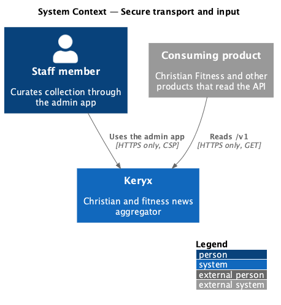
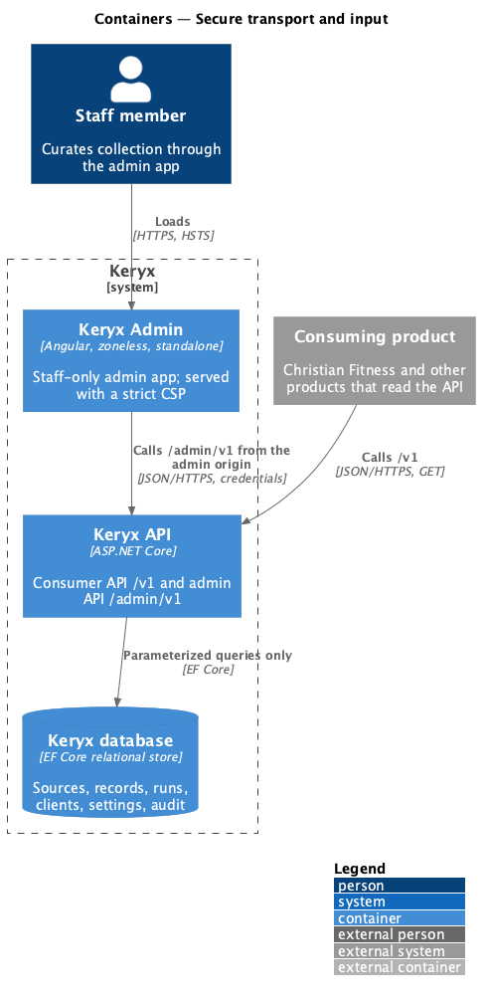
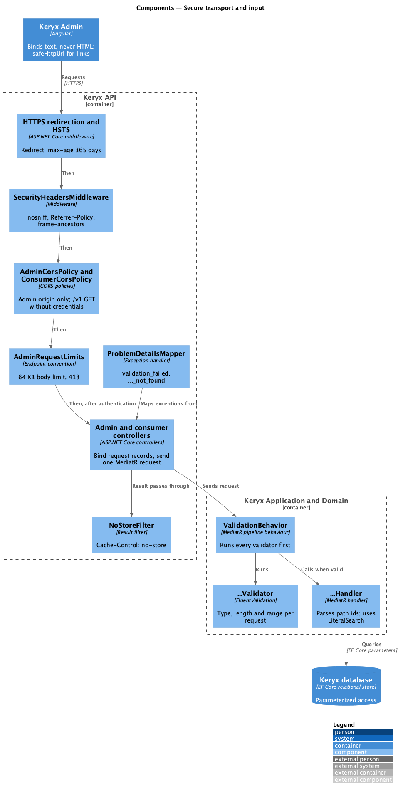
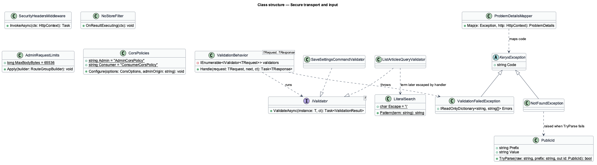
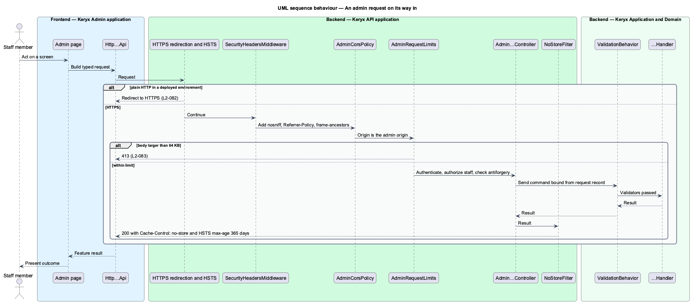
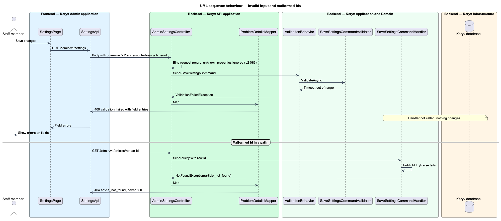
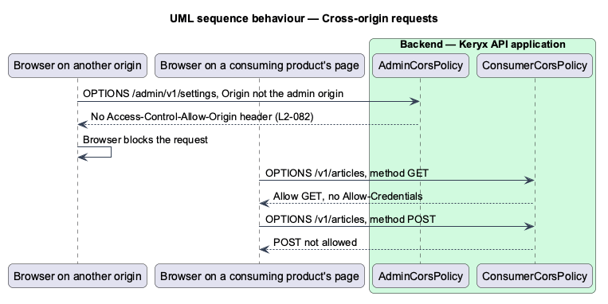
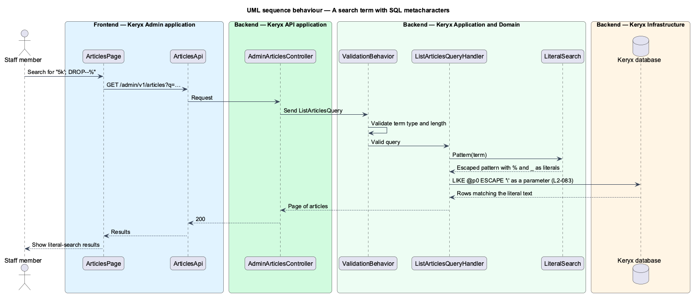

# Secure transport and input

## Overview

Keryx is reached by two kinds of caller: staff in a browser through the Keryx Admin app, and
consuming products through the consumer API. Both reach the Keryx API over the public internet.
This cross-cutting feature protects every request on its way in. It has no screen of its own.
It sets transport security and browser security headers, limits cross-origin access, and
validates every input before a handler uses it, so no input can change the meaning of a query.

- **HSTS** — `Strict-Transport-Security` response header that tells a browser to use HTTPS only for the host
- **Content-Security-Policy (CSP)** — response header listing the origins a page may load scripts, styles, fonts and connections from
- **admin origin** — configured scheme, host and port that serves the Keryx Admin app
- **CORS policy** — rule for which cross-origin browser requests the API accepts, with which methods and whether credentials are sent
- **validator** — FluentValidation class that checks one request's types, lengths and ranges before its handler runs
- **over-posting** — setting a field through a request body that the endpoint does not expose
- **literal search** — search in which every character of the term matches itself, including SQL wildcard and quote characters

The rules are enforced in a fixed order on each request: transport, headers, cross-origin
policy, body size, authentication and authorization (staff authentication and API client
subsystems), binding, then validation in the MediatR pipeline. A refused request changes
nothing. The admin app adds the output side: every text from a source or a person is bound as
text, never as HTML.

## Description

**API host (`Keryx.Api`)**

- **HTTPS redirection and HSTS** — `UseHttpsRedirection` and `UseHsts` with a max-age of
  365 days, enabled in deployed environments. Behind a reverse proxy, `UseForwardedHeaders`
  trusts only the configured proxy. The deployment topology is `<TO SUPPLY>`.
- **`SecurityHeadersMiddleware`** — adds `X-Content-Type-Options: nosniff`,
  `Referrer-Policy: strict-origin-when-cross-origin` and
  `Content-Security-Policy: frame-ancestors 'none'` to every API response.
- **`AdminCorsPolicy`** — named CORS policy on the `/admin/v1` route group. It allows only the
  configured admin origin, with credentials. Any other origin receives no
  `Access-Control-Allow-Origin` header.
- **`ConsumerCorsPolicy`** — named CORS policy on `/v1`. It allows `GET` only and no credentials.
  The origins it allows (any, or a configured list) are `<TO SUPPLY>`.
- **`AdminRequestLimits`** — endpoint convention on the `/admin/v1` group that sets a request
  body limit of 65,536 bytes (64 KB); a larger body is refused with `413` before binding.
- **`NoStoreFilter`** — result filter on `/admin/v1` that sets `Cache-Control: no-store` on every
  response carrying data.
- **Request models** — each endpoint binds a request record holding only the fields it exposes,
  then maps it to its command. `System.Text.Json` skips unknown members, so `status`, `id`,
  `revoked_at` or `key_hash` in a body cannot set anything.
- **Path ids** — bound as strings. The handler parses them with `PublicId.TryParse`; a malformed
  id is a not-found, never a `500`.
- **`ProblemDetailsMapper`** — maps `ValidationFailedException` to `400` with `code`
  `validation_failed` and an `errors` map of field to messages, and `NotFoundException` to
  `404` with the resource's code (`article_not_found`, `source_not_found`, `run_not_found`,
  `issue_not_found`, `api_client_not_found`; the full list is `<TO SUPPLY>` from each endpoint's
  design).

**Application (`Keryx.Application`)**

- **`ValidationBehavior<TRequest, TResponse>`** — MediatR pipeline behaviour that runs every
  `IValidator<TRequest>` before the handler. Any failure throws `ValidationFailedException`
  before any state is read or written. Each request type has a `…Validator`, and its ranges are
  those stated by its L2 requirement (for example `L2-070` for Settings).
- **`LiteralSearch`** — helper that escapes `%`, `_`, `[` and the escape character in a term and
  returns a `LIKE` pattern. Handlers pass it to `EF.Functions.Like(column, pattern, escape)`, so
  EF Core sends it as a parameter. No query is built by string concatenation; raw SQL APIs are
  not used.
- **`ValidationFailedException`**, **`NotFoundException`** — `KeryxException` subclasses that
  carry an error `code`.

**Admin app (`frontend/projects`)**

- **Static host of Keryx Admin** — serves the app with
  `Content-Security-Policy: default-src 'self'; script-src 'self'; style-src 'self';
  font-src 'self'; img-src 'self' data:; connect-src 'self' <API origin>; frame-ancestors 'none';
  object-src 'none'; base-uri 'self'`, plus `nosniff`, the same `Referrer-Policy`, HSTS and
  `Cache-Control: no-store` on data. Angular injects component styles as `<style>` elements, so
  `style-src` needs either a per-response nonce (`ngCspNonce`) or `'unsafe-inline'` for styles.
  That choice, the host that serves the app, and the `img-src` list are `<TO SUPPLY>` and need
  an ADR.
- **Text binding** — components bind source and user text with interpolation or `textContent`.
  The lint configuration rejects `[innerHTML]`, `[outerHTML]` and `bypassSecurityTrust*` in the
  `admin` and `components` projects; the rule configuration is `<TO SUPPLY>`.
- **`safeHttpUrl`** (`domain` library) — returns a source link only when its scheme is `http` or
  `https`, else `null`, with a unit test per case.
- **Fonts and assets** — bundled and self-hosted; the build loads nothing from a third-party
  host.

## Requirements

The feature realizes the following level-2 (L2) requirements. Each L2 requirement refines a
level-1 (L1) requirement, cited by identifier. Their acceptance criteria are in
[L2.md](../../../specs/L2.md).

| L2 ID | Refines (L1) | Requirement |
|-------|--------------|-------------|
| `L2-082` | `L1-020` | Transport and browser security — Every response is served over HTTPS with security headers, a strict Content-Security-Policy and a CORS policy limited to the admin origin. |
| `L2-083` | `L1-020` | Input validation and injection — Every input is validated for type, length and range before it is used, and none can change the meaning of a query. |

## Diagrams

### System context

Staff and consuming products reach Keryx over HTTPS; both directions of the trust boundary
carry the controls of this feature.

### Containers

The static host of Keryx Admin sends the CSP. The Keryx API enforces HTTPS, headers, CORS, body
limits and validation before it touches the Keryx database.

### Components

The API middleware and filters handle transport and headers. `ValidationBehavior` and
`LiteralSearch` in the application layer handle input. `ProblemDetailsMapper` turns refusals
into coded errors.

### Class structure

Each request type has a validator run by `ValidationBehavior`. Failures surface as
`KeryxException` subclasses with a `code`.

### Behaviour — an admin request on its way in

A plain HTTP request is redirected, an oversized body is refused with `413`, and an accepted
request leaves with the security headers and `no-store`.

### Behaviour — invalid input and malformed ids

A failing validator returns `400` `validation_failed` with field entries and changes nothing; a
malformed path id returns `404` with the resource's code.

### Behaviour — cross-origin requests

A preflight from an origin other than the admin origin gets no allowing header on `/admin/v1`.
On `/v1` only `GET` without credentials is allowed.

### Behaviour — a search term with SQL metacharacters

The term is escaped and passed as a parameter, so the result is that of a literal search.

