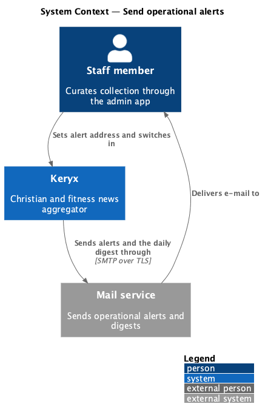
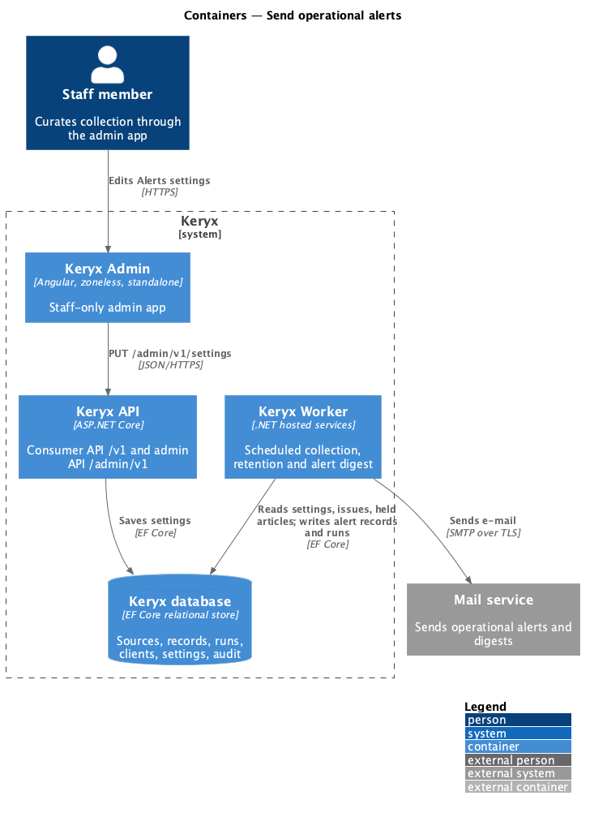
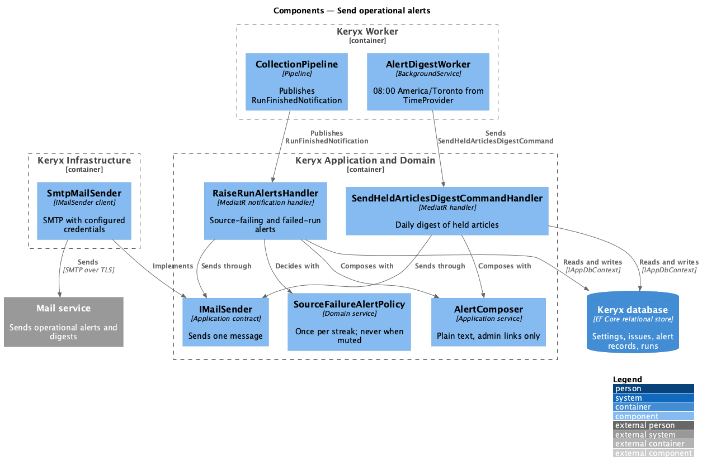
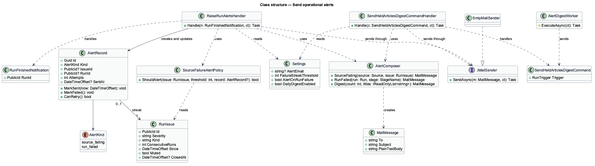
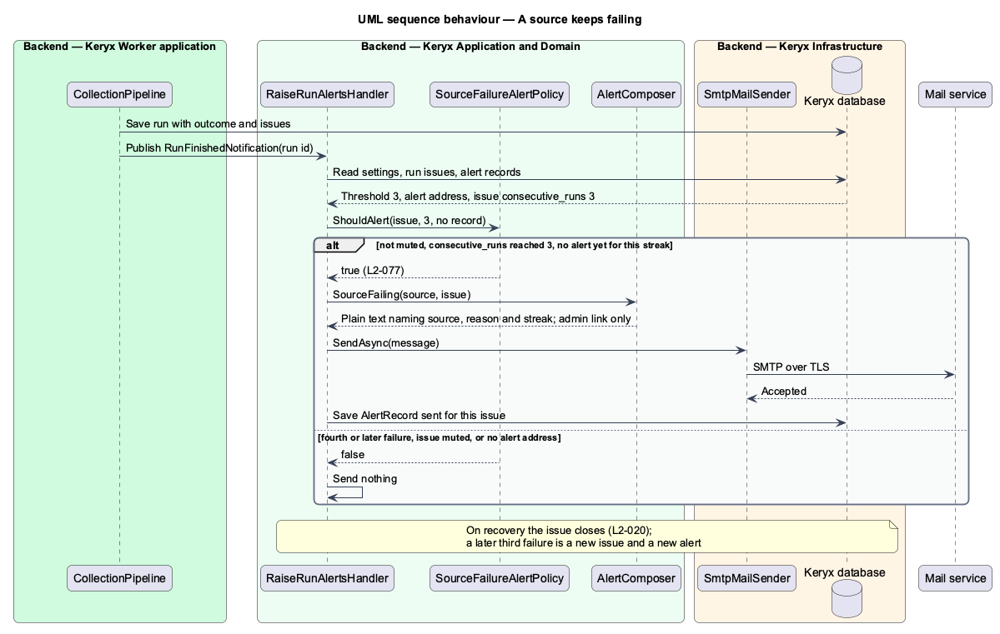
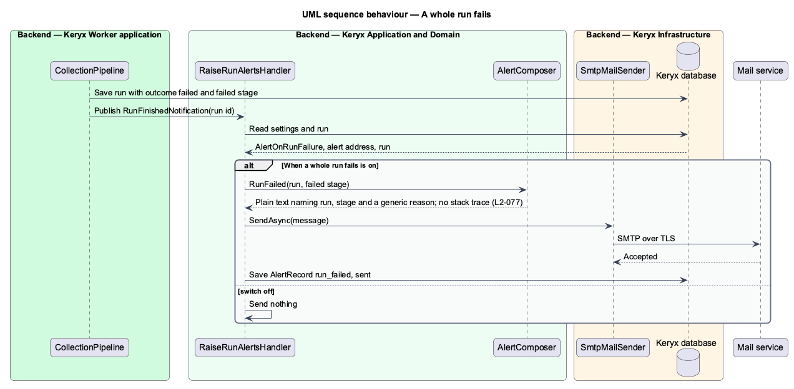
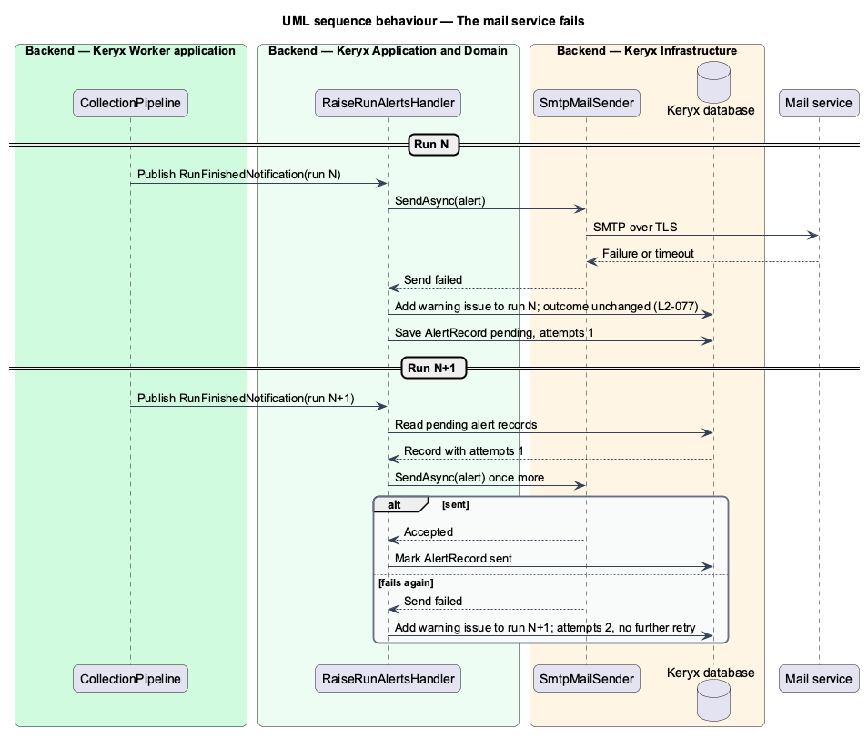
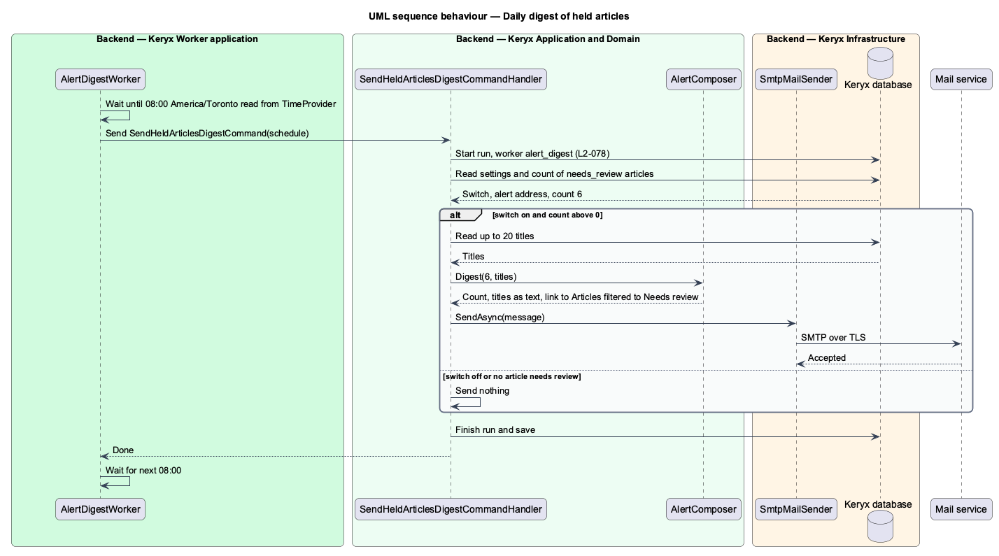

# Send operational alerts

## Overview

Keryx collects without a person watching, so the people who run it are told by e-mail when
something needs them. This feature sends three kinds of e-mail to the alert address set in
Settings (`L2-070`): an alert when a source keeps failing, an alert when a whole collection run
fails, and, if staff turn it on, a daily digest of articles waiting for review. It has no screen
of its own; staff configure it in the Alerts section of Settings.

- **alert address** — single e-mail address in Settings that receives every alert and digest
- **failure streak** — consecutive collection runs in which one source fails with the same issue; it is the life of one open issue (`L2-020`) and ends when the source recovers
- **streak threshold** — number of consecutive failures that raises an alert, set as "Alert when a source fails N runs in a row" (1 to 20)
- **source-failing alert** — e-mail naming a source, the reason and the streak, sent once per streak
- **failed-run alert** — e-mail naming a run, the stage that failed and a generic reason, sent when "When a whole run fails" is on
- **daily digest** — e-mail at 08:00 Toronto time listing the count of articles in Needs review, up to 20 titles, and a link to that list
- **alert record** — stored note of one alert, its attempts and when it was sent, which makes "once per streak" and "retry at most once" checkable

A source-failing alert is sent when an issue's `consecutive_runs` reaches the threshold, and not
again for that streak. A muted issue raises no alert. When the source recovers, its issue
closes (`L2-020`), so a later streak is a new issue and raises a new alert. When the mail
service fails, the failure is recorded as a warning issue on the run, the alert is retried on
the next run at most, and the run's outcome is not changed.

The digest is sent by its own worker, `alert_digest`, one of the three workers (`L2-019`). Every
run of it is recorded, whether or not it sends an e-mail.

## Description

The slice runs from the end of a collection run, and from a daily hosted service, through
MediatR handlers to the mail contract and its SMTP client.

**Worker (`Keryx.Worker`)**

- **`AlertDigestWorker`** — `BackgroundService` that computes the next 08:00 in
  `America/Toronto` from `TimeProvider` and sends one `SendHeldArticlesDigestCommand` with
  trigger `schedule`. It checks nothing itself. Tests advance `FakeTimeProvider` to 08:00.
- **`CollectionPipeline`** — after a collection run is saved with its outcome, the run's handler
  (collection subsystem) publishes `RunFinishedNotification`. Alerts are raised only after the
  outcome is fixed, so they cannot change it.

**Application (`Keryx.Application`)**

- **`RunFinishedNotification`** — MediatR notification carrying the finished run's `PublicId`.
- **`RaiseRunAlertsHandler`** — notification handler. It reads `Settings` and, when an alert
  address is set:
  - for each unmuted issue on the run whose `consecutive_runs` has reached the streak threshold
    and has no sent `AlertRecord`, composes a source-failing alert;
  - when the run's outcome is `failed` and "When a whole run fails" is on, composes a
    failed-run alert;
  - for each `AlertRecord` left pending by the previous run with one attempt, retries it once;
  - sends each through `IMailSender`; on failure it records a `warning` issue on the run and
    leaves the record pending.
- **`SendHeldArticlesDigestCommand`** / **`SendHeldArticlesDigestCommandHandler`** — opens a
  `Run` with worker `alert_digest`. When the digest switch is off, or no article is
  `needs_review`, or no alert address is set, it sends nothing. Otherwise it sends one e-mail
  with the count, up to 20 titles as text and a link to Articles filtered to "Needs review". It
  finishes the run. The digest run records no articles, so its counts are all 0; its outcome is
  `succeeded`, or `completed_with_issues` with an `alert_not_sent` warning when the mail service
  fails. A digest that was not sent is not retried: the next morning's replaces it.
- **`AlertComposer`** — builds `MailMessage` values in plain text. Links point only to the admin
  app's configured origin. A message holds no connection string, key or stack trace; the reason
  is the issue's generic kind and bounded detail (`L2-020`). Text from a source (its name, a
  title) has its line breaks and runs of spaces collapsed to one space, so it cannot forge a
  line. "Needs review" is `/articles?status=needs_review` and a run is `/runs?run={id}`. The
  wording is under "E-mail wording" below.
- **`IMailSender`** — contract with `SendAsync(MailMessage, CancellationToken)`. Handlers never
  open their own connection.
- **`MailMessage`** — `To`, `Subject`, `PlainTextBody`.

**Domain (`Keryx.Domain`)**

- **`Settings`** — `AlertEmail` (at most 254 characters), `FailureStreakThreshold` (1 to 20),
  `AlertOnRunFailure`, `DailyDigestEnabled`.
- **`RunIssue`** — `Severity`, `Kind`, `ConsecutiveRuns`, `Since`, `Muted`, `ClosedAt`. The
  issue kind recorded for a mail failure is `alert_not_sent`, added to the kinds of `L2-020`:
  a `warning` concerning the worker (no source, no stage), with the detail "An alert e-mail
  could not be sent. Keryx tries it once more on the next run." (or, for the digest, "The daily
  digest could not be sent."). The admin app titles it "Alert e-mail not sent".
- **`AlertRecord`** — `AlertKind Kind` (`source_failing`, `run_failed`), `IssueId` or `RunId`,
  `Attempts`, `SentAt`. One record per issue gives "once per streak"; `Attempts` at most 2
  gives "retried on the next run at most".
- **`SourceFailureAlertPolicy`** — pure rule `ShouldAlert(issue, threshold, record)` with a
  direct unit test per case: below threshold, at threshold, beyond threshold, muted, already
  sent, closed and reopened.

**Infrastructure (`Keryx.Infrastructure`)**

- **`SmtpMailSender`** — implements `IMailSender` against the mail service with credentials
  from configuration, over TLS, with a timeout of 30 seconds. The credential is never
  logged or traced (`L2-084`). Tests use a fake `IMailSender` and never a real mail service.
  It is built on MailKit (ADR 0014). Port 465 uses TLS from the first byte and any other port
  requires STARTTLS; a server that offers neither is a failed send. With no mail host
  configured, the worker sends no e-mail and logs that once at start; nothing is recorded as an
  issue, since no alert could ever be delivered.

**Admin app**

- No new screen. The Alerts section of Settings (`L2-070`) edits the four settings above.

## E-mail wording

Times are Toronto time, written as "Fri 27 Nov, 10:00 AM". `{origin}` is
`Keryx__AdminApp__Origin`. Every message ends with the line "Change alerts in Settings:
{origin}/settings".

**Source-failing alert**

```text
Subject: Keryx: {source} has failed {n} runs in a row

{source} has failed {n} collection runs in a row, since {since}.

Reason: {kind title}. {detail}

See the latest run: {origin}/runs?run={run id}

You won't get another e-mail about this until the source recovers and fails again. To stop
these e-mails for this problem, mute the issue on the run.
```

`{kind title}` is the admin app's title for the issue's kind ("Feed returned 404", "Source timed
out", "Source blocked Keryx", "Feed couldn't be read").

**Failed-run alert**

```text
Subject: Keryx: a collection run failed

The collection run that started {started} failed {at the {stage} stage | before it finished}.

Reason: {failure reason}
Reference: {correlation id}

See the run: {origin}/runs?run={run id}
```

The reason is the run's own generic failure reason. The reference line appears only when the
run has a correlation id.

**Daily digest**

```text
Subject: Keryx: {n} article(s) need review

{n} article(s) are waiting in Needs review.

- {title}
  (up to 20, newest first)
…and {n - 20} more.

Review them: {origin}/articles?status=needs_review
```

## Implementation notes (journey 19)

- A collection run's handler publishes `RunFinishedNotification` after the run is saved, and so
  does the run-recording behaviour after it records a run that threw; alerts are raised only for
  collection runs. A digest run never raises alerts, so a mail failure cannot cause an e-mail.
- A retried alert is composed again from the issue or run when it is retried, so it states the
  streak as it is then, and links to the latest run. An issue that is no longer open (muted or
  closed) is not retried. A retry that fails too is recorded like any refused send, and the
  record is not tried again.
- Refused sends are one `alert_not_sent` issue per worker, continued run after run while they
  happen (`L2-020` AC1) and closed by the next send the mail service takes. A run with nothing
  to send leaves it open, since nothing shows the mail service has recovered; a refusal after
  such a gap is a new issue.
- The mail settings are read only by the worker: `Keryx__Mail__Host`, `Keryx__Mail__Port`,
  `Keryx__Mail__Username`, `Keryx__Mail__Password`, `Keryx__Mail__From` and
  `Keryx__AdminApp__Origin` (`tools/deploy/configuration.md`).

## Requirements

The feature realizes the following level-2 (L2) requirements. Each L2 requirement refines a
level-1 (L1) requirement, cited by identifier. Their acceptance criteria are in
[L2.md](../../../specs/L2.md).

| L2 ID | Refines (L1) | Requirement |
|-------|--------------|-------------|
| `L2-077` | `L1-018` | Alerts for failing sources and failed runs — The people who run Keryx are e-mailed when a source keeps failing or a whole run fails, once per streak. |
| `L2-078` | `L1-018` | Daily digest of held articles — If staff turn it on, one e-mail each morning lists the articles waiting for review. |

## Diagrams

### System context

Staff set the alert address and switches in Keryx. Keryx sends alerts and the digest through
the mail service to that address.



### Containers

The Keryx Worker raises every alert and digest and sends it through the mail service. The Keryx
API only stores the settings that drive them.



### Components

`RaiseRunAlertsHandler` reacts to a finished run; `AlertDigestWorker` sends the digest command.
Both compose through `AlertComposer` and send through `IMailSender`.



### Class structure

`AlertRecord` ties each alert to one issue or one run and counts its attempts.
`SourceFailureAlertPolicy` decides from the issue, the threshold and the record.



### Behaviour — a source keeps failing

When the third consecutive failure of a source is recorded, with a threshold of 3, one alert is
sent. The fourth failure, a muted issue, or no alert address sends none.



### Behaviour — a whole run fails

A run whose outcome is `failed` raises one e-mail naming the run, the failed stage and a generic
reason, only when "When a whole run fails" is on.



### Behaviour — the mail service fails

A failed send becomes a warning issue on the run, the outcome stays as it was, and the next run
retries the alert once.



### Behaviour — daily digest

At 08:00 Toronto time the digest worker records a run and sends the digest only when the switch
is on and articles need review.


