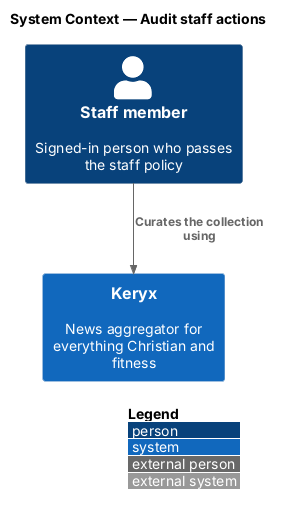
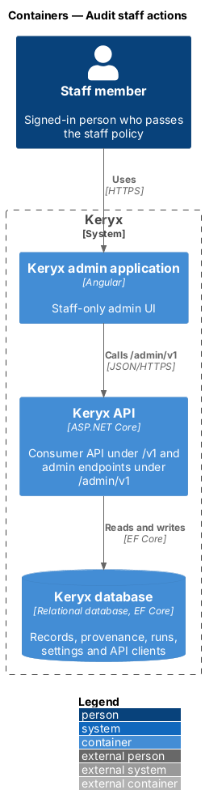
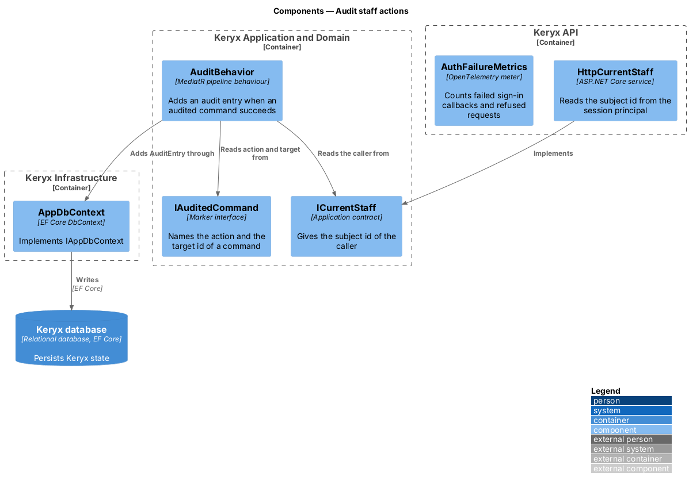
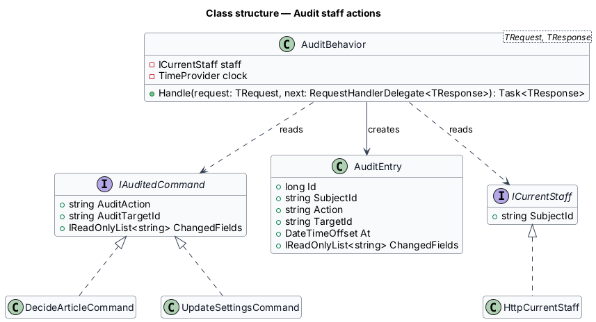
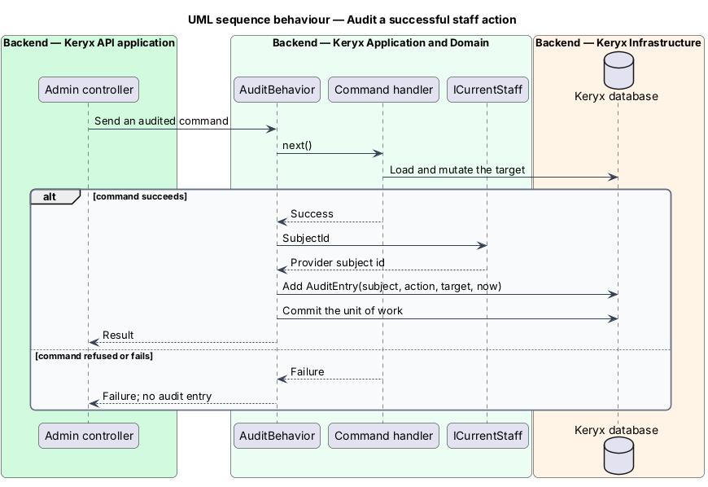

# Audit staff actions

## Overview

Keryx keeps a record of what staff change. When a staff member publishes or hides an article, adds, edits or removes a source, creates or revokes a key, mutes an issue, starts or retries a run, or saves settings, an *audit entry* is stored with who did it, what was done, to what, and when.

An audit entry identifies the staff member by the provider's subject id. It holds no key, no e-mail address and no copy of source text. For settings it holds the names of the fields changed, not the alert address. The retention worker deletes entries older than the retention period.

> **audit entry** — record of one successful staff action: subject id, action, target id and time

## Description

The slice is one MediatR behaviour and one marker interface. A command opts in by naming its action and target, and the entry is saved in the same unit of work as the change.

- **`AuditBehavior`** — MediatR pipeline behaviour in the Application and Domain layers. Adds an `AuditEntry` when an audited command succeeds, before the unit of work commits, so the change and its entry are stored together. A failed command adds nothing.
- **`IAuditedCommand`** — Marker interface in the Application and Domain layers. Names the action and the target id of a command. The eleven audited actions are `article.publish`, `article.hide`, `source.add`, `source.edit`, `source.remove`, `api_client.create`, `api_client.revoke`, `issue.mute`, `run.start`, `run.retry` and `settings.save`.
- **`ICurrentStaff`** — Application contract in the Application and Domain layers. Gives the subject id of the caller.
- **`HttpCurrentStaff`** — ASP.NET Core service in the Keryx API. Reads the subject id from the session principal.
- **`AuthFailureMetrics`** — OpenTelemetry meter in the Keryx API. Counts failed sign-in callbacks and refused requests (`401`, `403`) in a metric and logs them without the credential presented.
- **`AppDbContext`** — EF Core DbContext in the Infrastructure layer. Implements IAppDbContext.
- **`AuditEntry`** — entity with `SubjectId`, `Action`, `TargetId`, `At` and, for `settings.save`, `ChangedFields`.

## Requirements

The feature realizes the following level-2 (L2) requirements. Each L2 requirement refines a level-1 (L1) requirement, cited by identifier. The acceptance criteria of each requirement are in [`docs/specs/L2.md`](../../../specs/L2.md).

| L2 ID | Refines (L1) | Requirement |
|-------|--------------|-------------|
| [`L2-085`](../../../specs/L2.md#l2-085-audit-of-staff-actions) | `L1-020` | **Audit of staff actions.** The requirement is defined by its 4 acceptance criteria. |

## Diagrams

### System context

A staff member curates the collection through Keryx.

### Containers

The staff member uses the Keryx admin application. The Keryx admin application calls the Keryx API at `/admin/v1`. The Keryx API reads and writes the Keryx database.

### Components

`AuditBehavior` wraps each handler, reads the caller from `ICurrentStaff` (realized by `HttpCurrentStaff`) and the action from `IAuditedCommand`, and adds the entry through `IAppDbContext`.

### Class structure

A command realizes `IAuditedCommand`; `AuditBehavior` creates one `AuditEntry` per successful command.

### Behaviour — audit a successful staff action

The entry is added after the handler succeeds and before the commit, so the change and its entry share one unit of work (`L2-085`).

