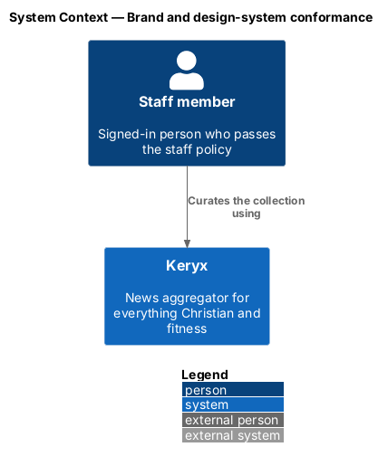
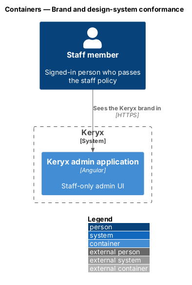
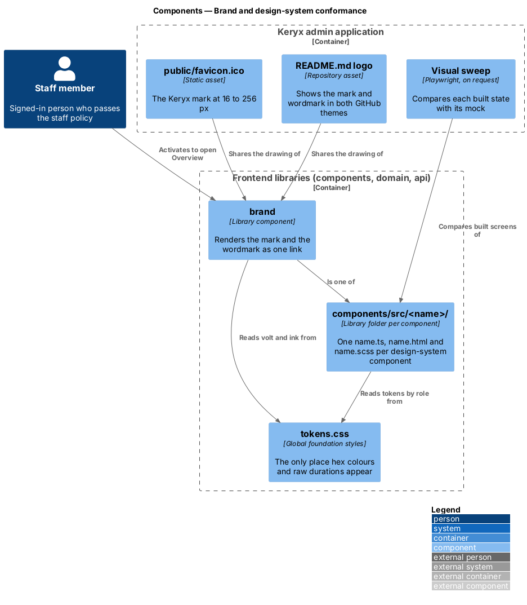
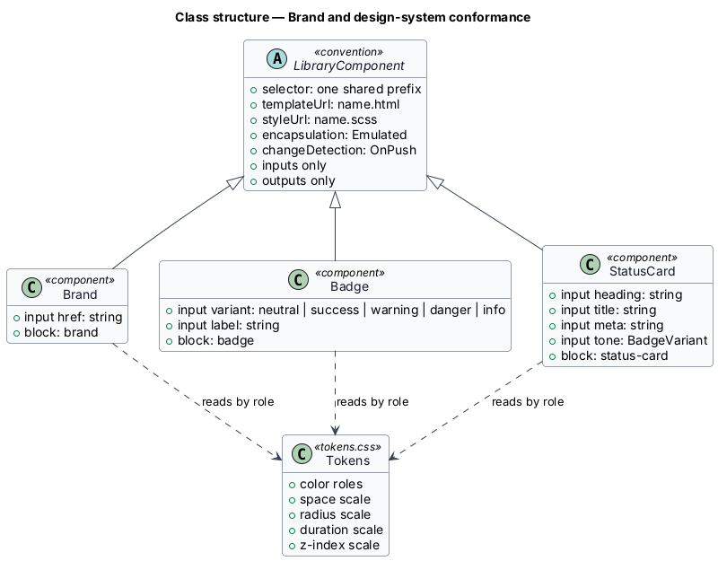
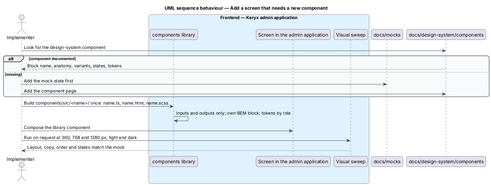

# Brand and design-system conformance

## Overview

The admin application looks and behaves as the mocks and the design system define. The brand has two parts. The *mark* is a cross whose right arm lifts into a K, in volt on an ink tile. The *wordmark* is "keryx" in Geist ExtraBold. Their files are in `docs/design-system/assets/brand/`.

Each design-system component is built once in the `components` library, under its design-system name, with that page's block name, anatomy, variants, states and tokens. Screens compose those components. No second component duplicates or renames one. A screen that needs a state or a component the mocks and the design system lack gets the mock and the design-system page first.

> **design token** — named value for a colour, size, radius, shadow, duration or z-index, read by role

> **BEM block** — class name that identifies one component and prefixes its elements and modifiers

## Description

The slice is the structure of the `components` library, the global token file, and the brand assets of the application and the repository.

- **`brand`** — Library component in the frontend libraries. Renders the mark and the wordmark as one link named "Keryx, go to overview". The mark is the 40-unit drawing with four square-ended strokes of width 4.2 in volt on an ink tile of radius 10. Its strokes are volt on ink or ink on volt, never volt on white, and are never recoloured, stretched or skewed.
- **`components/src/<name>/`** — Library folder per component in the frontend libraries. One `name.ts`, `name.html` and `name.scss` per design-system component, with `templateUrl` and `styleUrl`. A component takes inputs and emits outputs only, injects no application service, token or router, uses emulated encapsulation, and styles only its own BEM block. The mocks' BEM class names stay on the corresponding elements.
- **`tokens.css`** — Global foundation styles in the frontend libraries. The only place hex colours and raw durations appear. Each other stylesheet reads colours, sizes, radii, shadows, durations and z-indices from tokens by role.
- **`public/favicon.ico`** — Static asset in the Keryx admin application. The Keryx mark at 16, 24, 32, 48, 64, 128 and 256 px. The Angular default icon is not in the repository or the build output.
- **`README.md logo`** — Repository asset in the Keryx admin application. Shows the logo first on the page, centred, with alternative text "Keryx", in a variant legible in GitHub's light theme and in its dark theme.
- **`Visual sweep`** — Playwright, on request in the Keryx admin application. Compares each built screen state with its mock at 360, 768 and 1280 px in light and dark for layout, copy, order and states. It runs when a person asks, and baselines change only after an intended mock change.
- **`Component folder names`** — `alert`, `avatar`, `badge`, `brand`, `chip`, `code-panel`, `detail-panel`, `dialog`, `empty`, `field`, `filter-chip`, `health`, `input`, `issue-card`, `nav-link`, `pagination`, `run-chart`, `run-item`, `segmented`, `select`, `sidebar`, `skeleton`, `stat`, `status-card`, `switch`, `tab`, `table`, `tag`, `timeline`, `toast`; a starting list taken from the BEM blocks of the mocks, to be confirmed against `docs/design-system/components/` when those pages exist.

`docs/design-system/components/` does not exist yet in the repository; the component pages are extracted from the mocks before the first library component is built (L2-098).

## Requirements

The feature realizes the following level-2 (L2) requirements. Each L2 requirement refines a level-1 (L1) requirement, cited by identifier. The acceptance criteria of each requirement are in [`docs/specs/L2.md`](../../../specs/L2.md).

| L2 ID | Refines (L1) | Requirement |
|-------|--------------|-------------|
| [`L2-097`](../../../specs/L2.md#l2-097-logo-and-favicon) | `L1-024` | **Logo and favicon.** The mark is a cross whose right arm lifts into a K, in volt on an ink tile; the wordmark is "keryx" in Geist ExtraBold. Their source is the Magic Patterns *Keryx Brand* prototype; the files are in `docs/design-system/assets/brand/`. |
| [`L2-098`](../../../specs/L2.md#l2-098-design-system-conformance) | `L1-024` | **Design-system conformance.** The requirement is defined by its 5 acceptance criteria. |

## Diagrams

### System context

A staff member curates the collection through Keryx.

### Containers

The staff member sees the Keryx brand in the Keryx admin application.

### Components

Each folder under `components/src/` holds one component that reads `tokens.css` by role. `brand`, the favicon and the README logo carry the mark; the visual sweep compares screens with mocks.

### Class structure

A library component has inputs and outputs only. `Brand` and `Badge` show the shape that each component folder repeats.

### Behaviour — add a screen that needs a new component

The mock and the design-system page come first; the component is built once in the library and the screen composes it (`L2-098`).

