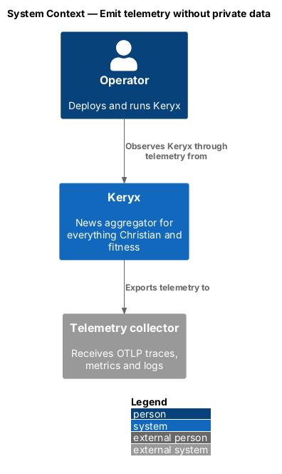
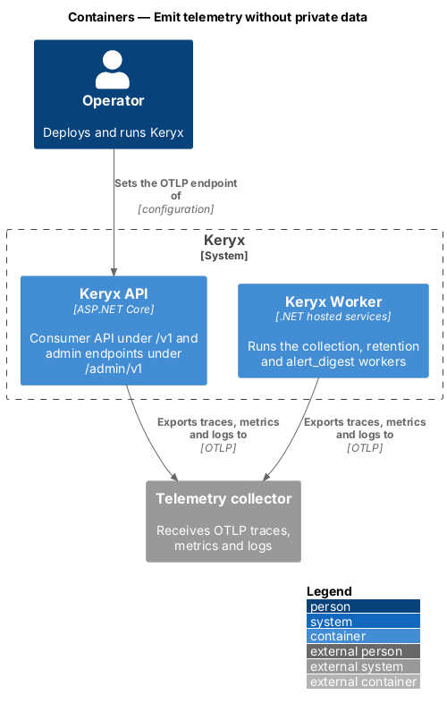
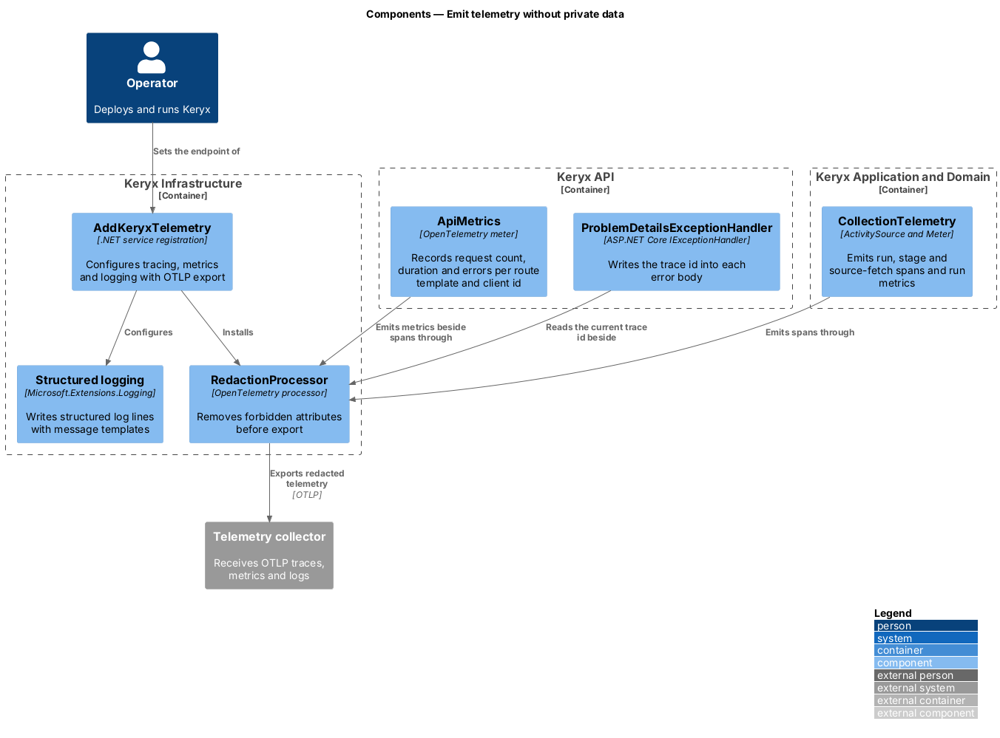
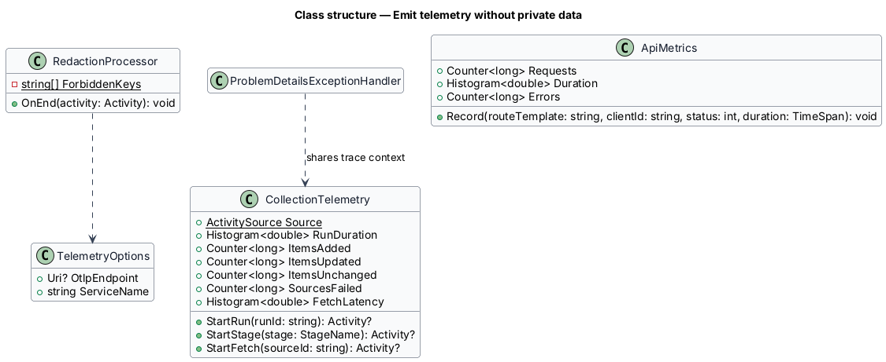
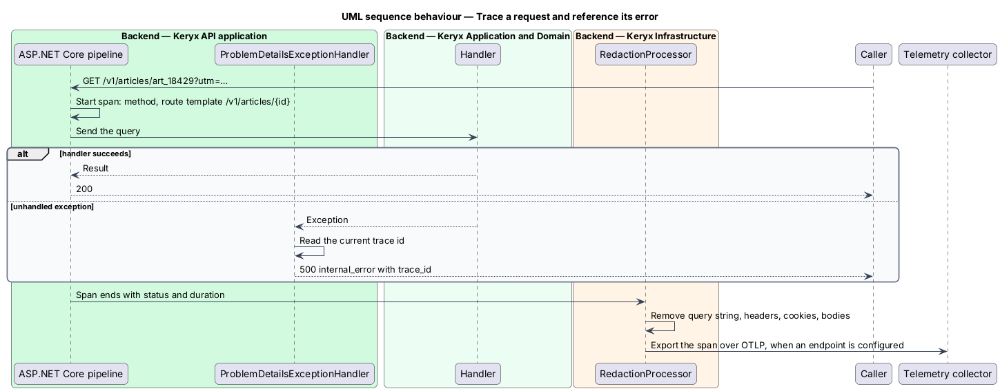

# Emit telemetry without private data

## Overview

Keryx is observable through OpenTelemetry. The API and the worker emit traces, metrics and logs through OTLP to a configured endpoint, and run without error when no endpoint is configured.

Telemetry never carries private data. No log, metric or span holds a contact detail, a token, an API key or its prefix, a cookie, a query string, a body, fetched content or a summary. A route is recorded as its template, such as `/v1/articles/{id}`.

An error response carries a `trace_id` equal to the id of its trace. The admin application shows it as the "Reference", so a staff member can give an operator the exact trace.

## Description

The slice is the shared telemetry registration of both hosts, two instrumentation sources and one redaction processor.

- **`AddKeryxTelemetry`** — .NET service registration in the Infrastructure layer. Configures tracing, metrics and logging once for both hosts. With no OTLP endpoint configured it registers no exporter and the hosts run without error.
- **`RedactionProcessor`** — OpenTelemetry processor in the Infrastructure layer. Removes the query string, header values, cookies and bodies from each span before export, and keeps method, route template, status and duration.
- **`CollectionTelemetry`** — ActivitySource and Meter in the Application and Domain layers. Emits one trace per run with a span per stage and per source fetch. A fetch span names the source's id, not its URL. Metrics record run duration, items added, updated and unchanged, sources failed and fetch latency.
- **`ApiMetrics`** — OpenTelemetry meter in the Keryx API. Records request count, a duration histogram and errors by route template and client id.
- **`ProblemDetailsExceptionHandler`** — ASP.NET Core IExceptionHandler in the Keryx API. Writes the trace id into each error body.
- **`Structured logging`** — Microsoft.Extensions.Logging in the Infrastructure layer. Writes structured log lines with message templates. No line contains fetched content, a summary, a connection string or a secret.
- **`TelemetryOptions`** — `OtlpEndpoint`, optional; `ServiceName` per host.

## Requirements

The feature realizes the following level-2 (L2) requirements. Each L2 requirement refines a level-1 (L1) requirement, cited by identifier. The acceptance criteria of each requirement are in [`docs/specs/L2.md`](../../../specs/L2.md).

| L2 ID | Refines (L1) | Requirement |
|-------|--------------|-------------|
| [`L2-094`](../../../specs/L2.md#l2-094-telemetry) | `L1-023` | **Telemetry.** The requirement is defined by its 6 acceptance criteria. |

## Diagrams

### System context

The operator observes Keryx through telemetry from Keryx. Keryx exports telemetry to the telemetry collector.

### Containers

The Keryx API exports traces, metrics and logs to the telemetry collector. The Keryx Worker exports traces, metrics and logs to the telemetry collector. The operator sets the OTLP endpoint of the Keryx API.

### Components

Both hosts call `AddKeryxTelemetry`, which installs `RedactionProcessor`. `CollectionTelemetry` and `ApiMetrics` are the two instrumentation sources; `ProblemDetailsExceptionHandler` links an error body to its trace.

### Class structure

`CollectionTelemetry` owns the `ActivitySource` and the instruments of a run; `RedactionProcessor` holds the list of attribute keys that never leave the process.

### Behaviour — trace a request and reference its error

The span records the route template, and the redaction processor strips what remains before export. The error body's `trace_id` is the trace's id (`L2-094`).

