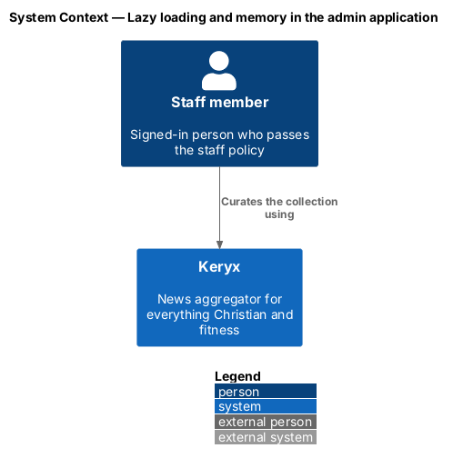
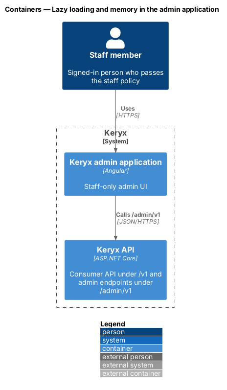
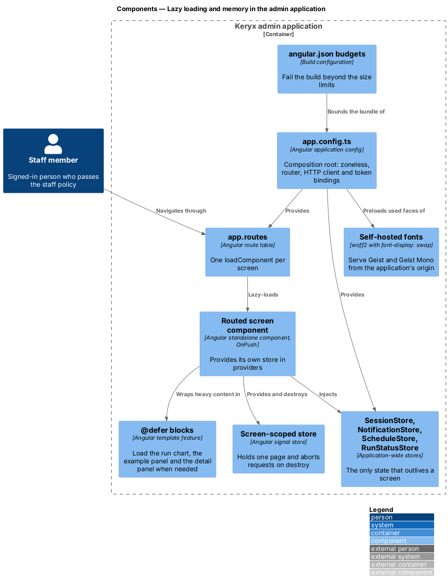
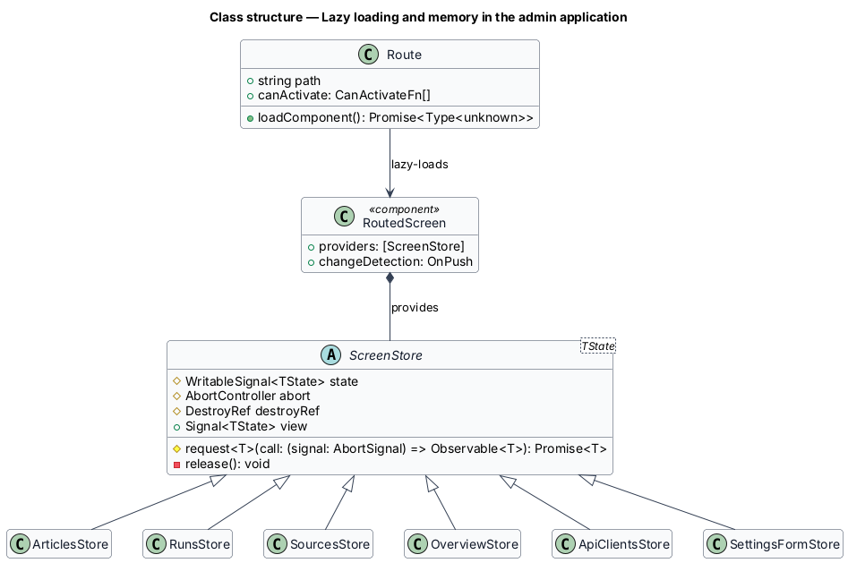
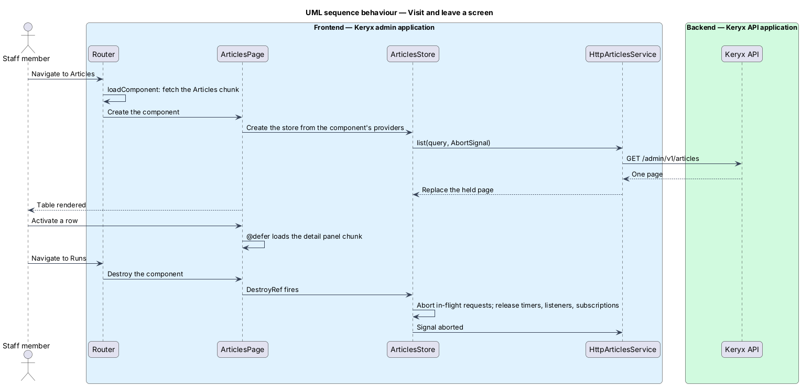

# Lazy loading and memory in the admin application

## Overview

The admin application stays as smooth after an hour on a low-power device as at the start. This outranks every other frontend rule. Two disciplines deliver it: load only what is needed now, and release everything that is acquired.

The initial bundle holds the shell and nothing else. Each of the six screens, each dialog and the sign-in screens is its own lazy chunk. Heavy or below-the-fold content is deferred. State is scoped to the screen that uses it, lists hold one page, and polling holds only the latest value.

> **initial bundle** — JavaScript and styles the browser downloads before the first screen renders

> **screen-scoped store** — store provided on a routed component, created when the screen opens and destroyed when it is left

## Description

The slice is a set of structural decisions in the Angular workspace: the route table, the provider scopes, the build budgets and the font loading.

- **`app.config.ts`** — Angular application config in the Keryx admin application. Composition root. It enables zoneless change detection, binds each service token to its HTTP implementation, and provides only the four application-wide stores.
- **`app.routes`** — Angular route table in the Keryx admin application. One `loadComponent` per screen, per sign-in screen and for the wildcard. Each dialog is imported dynamically by the screen that opens it, and the CDK Dialog, overlay and menu code loads with the first screen that uses it, not in `main`.
- **`Routed screen component`** — Angular standalone component, OnPush in the Keryx admin application. Provides its own store in `providers`, not in the route's providers, so the store is destroyed when the screen is left. Each component is standalone and `OnPush`, and holds its state in signals.
- **`Screen-scoped store`** — Angular signal store in the Keryx admin application. Holds one page of rows. On destroy it aborts in-flight requests through an `AbortController` and releases each subscription (`takeUntilDestroyed`), timer, animation frame, listener, observer and object URL it created.
- **`SessionStore, NotificationStore, ScheduleStore, RunStatusStore`** — Application-wide stores in the Keryx admin application. The only state that outlives a screen. L2-089 names the session, the notification store and the shell's schedule state; `RunStatusStore` is treated as part of the shell's schedule state because the shell and each screen show the current run.
- **`@defer blocks`** — Angular template feature in the Keryx admin application. Load the run chart, the example panel and the detail panel when needed.
- **`angular.json budgets`** — Build configuration in the Keryx admin application. Fail the build when the initial bundle exceeds 250 kB transferred or a component style exceeds 8 kB. Raising a budget needs a stated reason.
- **`Self-hosted fonts`** — woff2 with font-display: swap in the Keryx admin application. Serve Geist and Geist Mono from the application's origin as `woff2` with `font-display: swap`; only the faces used are preloaded.
- **`HEAP_SWEEP`** — Playwright sweep, run on request, that visits and leaves each screen 20 times and compares the heap after garbage collection with its size after the second visit; the bound is 10%.

On a throttled mid-range phone profile, a cold Overview has a Largest Contentful Paint under 2.5 s and a Cumulative Layout Shift under 0.1 (L2-088). The exact throttling profile is `<TO SUPPLY>`.

The first use of an `@angular/core` or CDK API in lazy code can still grow `main`. The initial total is read after each such first use.

## Requirements

The feature realizes the following level-2 (L2) requirements. Each L2 requirement refines a level-1 (L1) requirement, cited by identifier. The acceptance criteria of each requirement are in [`docs/specs/L2.md`](../../../specs/L2.md).

| L2 ID | Refines (L1) | Requirement |
|-------|--------------|-------------|
| [`L2-088`](../../../specs/L2.md#l2-088-initial-bundle-and-lazy-loading) | `L1-021` | **Initial bundle and lazy loading.** The requirement is defined by its 6 acceptance criteria. |
| [`L2-089`](../../../specs/L2.md#l2-089-memory-over-a-long-session) | `L1-021` | **Memory over a long session.** The requirement is defined by its 5 acceptance criteria. |

## Diagrams

### System context

A staff member curates the collection through Keryx.

### Containers

The staff member uses the Keryx admin application. The Keryx admin application calls the Keryx API at `/admin/v1`.

### Components

`app.config.ts` provides the four application-wide stores and `app.routes`. Each routed screen component provides its own screen-scoped store and wraps heavy content in `@defer` blocks; `angular.json budgets` guard the result.

### Class structure

A screen-scoped store follows one shape: signals for state, an `AbortController` for requests, and a `DestroyRef` callback that releases what it holds.

### Behaviour — visit and leave a screen

The screen's chunk loads on navigation, its store lives exactly as long as the screen (`L2-089`), and deferred content loads when it is needed (`L2-088`).

