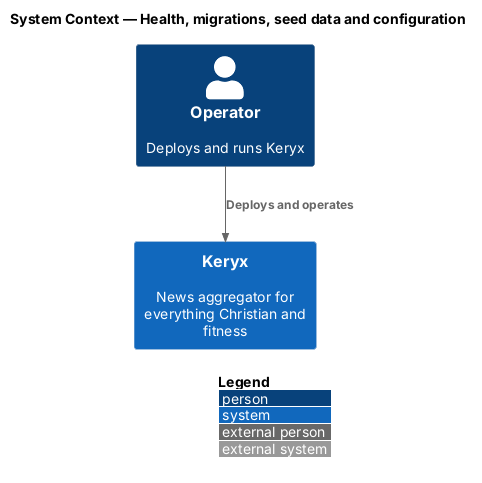
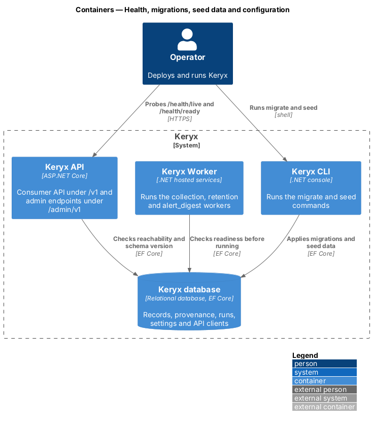
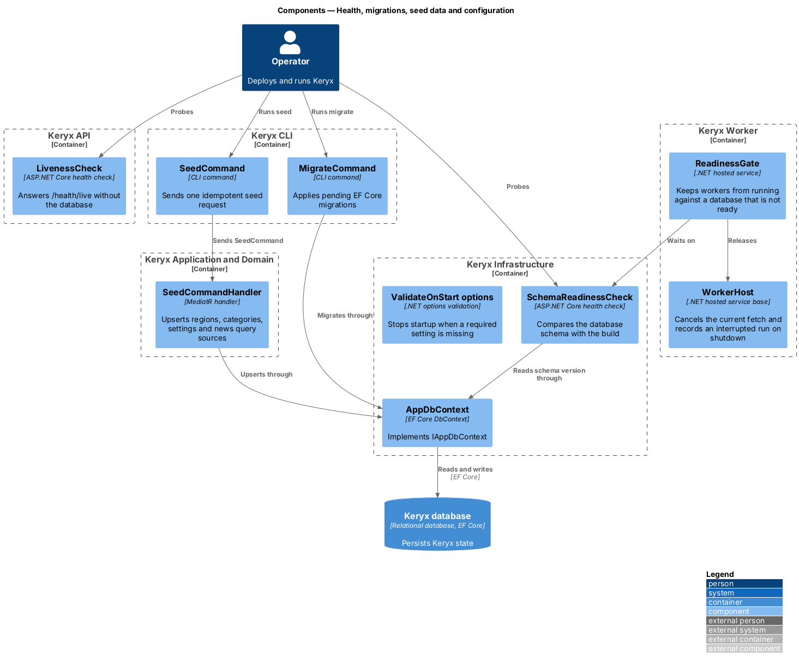
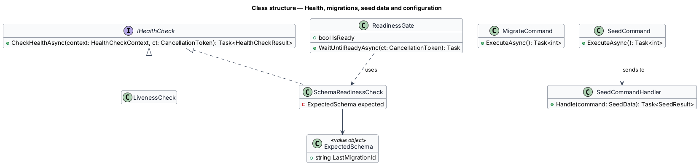
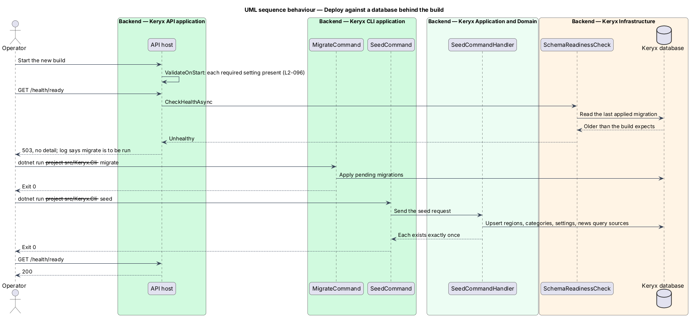

# Health, migrations, seed data and configuration

## Overview

Keryx changes its database only through an explicit command. The API does not migrate on startup. An operator runs `migrate` from the Keryx CLI, then `seed`, and both commands are safe to run again.

The API reports its health on two anonymous endpoints. `/health/live` answers without touching the database. `/health/ready` answers `200` only when the database is reachable and its schema is at the version the build expects. Neither reveals a version, a host or an error message.

Each setting a deployed system needs is documented in `tools/deploy/` in the same change that introduces it. A required setting that is missing stops the API or the worker at startup with a message that names the setting and not its value.

> **seed data** — regions, categories, default settings and the seeded news query sources, each present exactly once

## Description

The slice is the CLI's two commands, the health checks of both hosts, startup validation of options, and the worker's shutdown handling.

- **`MigrateCommand`** — CLI command in the Keryx CLI. Applies pending EF Core migrations and exits `0`. Run again, it changes nothing and exits `0`. It is invoked as `dotnet run --project src/Keryx.Cli -- migrate`.
- **`SeedCommand`** — CLI command in the Keryx CLI. Sends one idempotent seed request.
- **`SeedCommandHandler`** — MediatR handler in the Application and Domain layers. Upserts regions, categories, default settings and the seeded news query sources by their stable keys, so one run or many leave each exactly once.
- **`LivenessCheck`** — ASP.NET Core health check in the Keryx API. Answers /health/live without the database.
- **`SchemaReadinessCheck`** — ASP.NET Core health check in the Infrastructure layer. Answers ready only when the database is reachable and its last applied migration is the one the build expects. Behind the build's schema, the API starts, reports `503` on `/health/ready`, and logs that `migrate` is to be run.
- **`ReadinessGate`** — .NET hosted service in the Keryx Worker. Keeps each worker from running while the database is not ready, so no worker fails mid-run.
- **`WorkerHost`** — .NET hosted service base in the Keryx Worker. On a shutdown signal it cancels the current source fetch, records the run as `failed` with reason `interrupted`, and lets the process exit within 30 seconds.
- **`ValidateOnStart options`** — .NET options validation in the Infrastructure layer. Stops startup with a message that names the missing setting and not its value. The documented settings are the database connection, the identity provider authority, client id and staff claim, the admin origin, the public API base URL, the OTLP endpoint, the mail service, platform credentials, the user-agent contact URL, rate limits, session lifetimes and the Data Protection key store.
- **`AppDbContext`** — EF Core DbContext in the Infrastructure layer. Implements IAppDbContext.
- **`ExpectedSchema`** — identifier of the last migration compiled into the build.

CI runs lint, build and one critical acceptance path per feature in under 5 minutes, calls no real source and no real database, and fails on a formatting or lint error (L2-096).

## Requirements

The feature realizes the following level-2 (L2) requirements. Each L2 requirement refines a level-1 (L1) requirement, cited by identifier. The acceptance criteria of each requirement are in [`docs/specs/L2.md`](../../../specs/L2.md).

| L2 ID | Refines (L1) | Requirement |
|-------|--------------|-------------|
| [`L2-095`](../../../specs/L2.md#l2-095-health-migrations-and-seed-data) | `L1-023` | **Health, migrations and seed data.** The requirement is defined by its 6 acceptance criteria. |
| [`L2-096`](../../../specs/L2.md#l2-096-documented-configuration) | `L1-023` | **Documented configuration.** The requirement is defined by its 3 acceptance criteria. |

## Diagrams

### System context

An operator deploys and operates Keryx.

### Containers

The operator runs migrate and seed the Keryx CLI. The Keryx CLI applies migrations and seed data the Keryx database. The Keryx API checks reachability and schema version the Keryx database. The Keryx Worker checks readiness before running the Keryx database. The operator probes /health/live and /health/ready the Keryx API.

### Components

The CLI hosts `MigrateCommand` and `SeedCommand`. The API hosts `LivenessCheck` and `SchemaReadinessCheck`; the worker's `ReadinessGate` uses the same readiness check. `ValidateOnStart options` guards both hosts.

### Class structure

`SchemaReadinessCheck` realizes `IHealthCheck` and compares against `ExpectedSchema`; `ReadinessGate` exposes the result to the worker.

### Behaviour — deploy against a database behind the build

The API starts without migrating and reports not ready until the operator runs `migrate`; `seed` is idempotent (`L2-095`).

