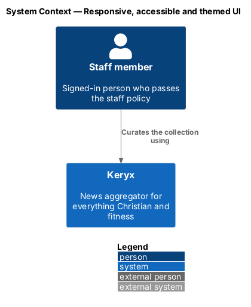
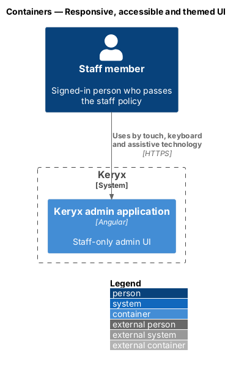
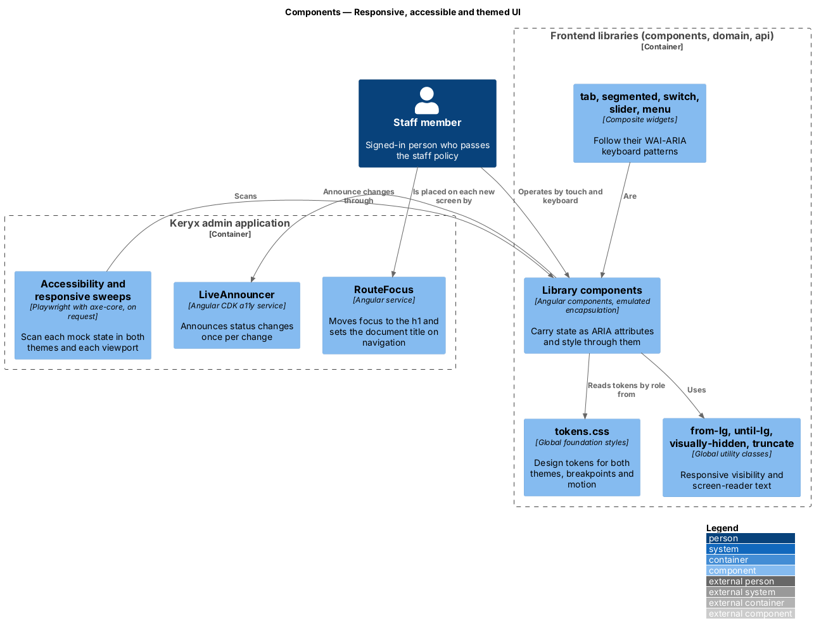
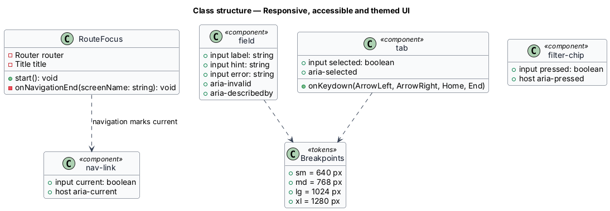
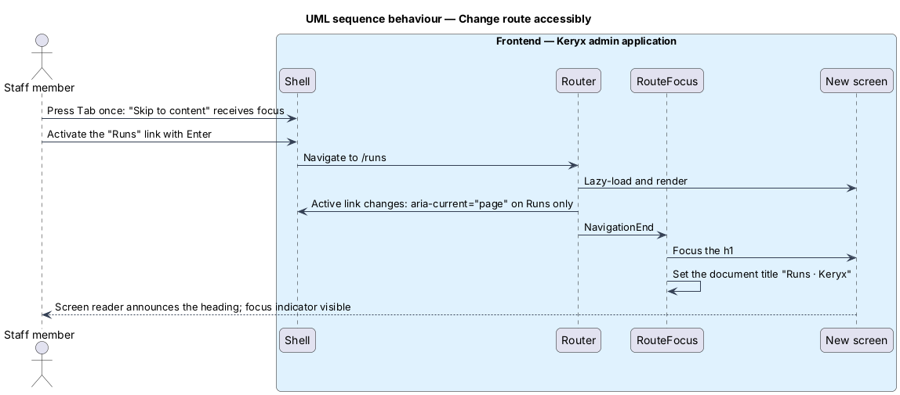

# Responsive, accessible and themed UI

## Overview

The admin application works at each viewport from a phone to a wide desktop, by touch and by keyboard, in light and dark themes, and meets WCAG 2.2 level AA. These qualities belong to each screen, so they are designed once, in the foundations and the component library, and each screen inherits them.

The breakpoints are those of the design system: 640 px, 768 px, 1024 px and 1280 px. From 1024 px the navigation is a sidebar; below it is a top bar. Below 768 px tables stack their rows and remain tables to assistive technology. Below 640 px dialogs are bottom sheets.

> **coarse pointer** — pointing device of limited accuracy, such as a finger on a touch screen

> **live region** — element whose changes assistive technology announces without a focus change

## Description

The slice is the global foundation styles, a small set of application services for focus and titles, and the contract each library component follows.

- **`tokens.css`** — Global foundation styles in the frontend libraries. Design tokens for both themes, breakpoints and motion. The theme follows `prefers-color-scheme`; both themes are complete. Under `prefers-reduced-motion` nothing moves and each state change stays visible. Under forced colours each control, focus indicator and status stays distinguishable. A print stylesheet omits navigation, notifications and the skip link.
- **`from-lg, until-lg, visually-hidden, truncate`** — Global utility classes in the frontend libraries. Responsive visibility and screen-reader text. Layout reflows without two-dimensional scrolling at 320 px and at 200% text size, code panels excepted.
- **`Library components`** — Angular components, emulated encapsulation in the frontend libraries. Carry state as attributes (`aria-current`, `aria-pressed`, `aria-selected`, `aria-invalid`, `disabled`, `aria-busy`, `aria-expanded`) and style through them. Each control has a target of at least 44 × 44 px with a coarse pointer and is 36 px tall with a fine pointer. Each icon-only control has an accessible name and each decorative icon is hidden. Each field has a visible label and associates its hint and error as descriptions.
- **`tab, segmented, switch, slider, menu`** — Composite widgets in the frontend libraries. Follow the keyboard map of their WAI-ARIA pattern as documented on their design-system pages. Focus indicators are at least 2 px thick with at least 3:1 contrast in both themes and are not hidden by the save bar, the top bar or a notification.
- **`RouteFocus`** — Angular service in the Keryx admin application. Moves focus to the new screen's `h1` on a route change and sets the document title to "&lt;Screen> · Keryx".
- **`LiveAnnouncer`** — Angular CDK a11y service in the Keryx admin application. Announces run progress, test-fetch results and list counts through a live region, no more than once per change. When content that holds focus is removed (a chip, a row, a notification), the owning component moves focus to a neighbour.
- **`Accessibility and responsive sweeps`** — Playwright with axe-core, on request in the Keryx admin application. Scan each mock state with axe-core for WCAG 2.2 A and AA in light and dark, and check each screen at 360, 576, 768, 992, 1024, 1280 and 1920 px for horizontal scroll, clipping and reachability. They are kept current and run when a person asks.
- **`Contrast rule`** — text at least 4.5:1, large text 3:1, component boundaries and state indicators 3:1; volt is never used for text on a light surface.

Below 768 px Overview stacks the status card, the stats, the chart, Latest articles and Needs attention in one column in that order; from 1024 px the stats sit in a row and the two lists sit side by side (L2-090).

## Requirements

The feature realizes the following level-2 (L2) requirements. Each L2 requirement refines a level-1 (L1) requirement, cited by identifier. The acceptance criteria of each requirement are in [`docs/specs/L2.md`](../../../specs/L2.md).

| L2 ID | Refines (L1) | Requirement |
|-------|--------------|-------------|
| [`L2-090`](../../../specs/L2.md#l2-090-responsive-layout) | `L1-022` | **Responsive layout.** The breakpoints are those of the design system: 640 px, 768 px, 1024 px and 1280 px. Every screen is specified at extra small (under 576 px), small, medium, large and extra large. |
| [`L2-091`](../../../specs/L2.md#l2-091-keyboard-and-focus) | `L1-022` | **Keyboard and focus.** The requirement is defined by its 5 acceptance criteria. |
| [`L2-092`](../../../specs/L2.md#l2-092-semantics-and-contrast) | `L1-022` | **Semantics and contrast.** The requirement is defined by its 7 acceptance criteria. |
| [`L2-093`](../../../specs/L2.md#l2-093-themes-and-preferences) | `L1-022` | **Themes and preferences.** The requirement is defined by its 4 acceptance criteria. |

## Diagrams

### System context

A staff member curates the collection through Keryx.

### Containers

The staff member uses by touch, keyboard and assistive technology the Keryx admin application.

### Components

`tokens.css` and the utility classes are the global foundations. Library components and the composite widgets build on them; `RouteFocus` and `LiveAnnouncer` handle focus and announcements; the sweeps verify the result.

### Class structure

`RouteFocus` reacts to the router's navigation end. Each library component exposes its states as inputs that become ARIA attributes on its host or inner element.

### Behaviour — change route accessibly

On each navigation the new screen's `h1` receives focus, the title names the screen, and exactly one navigation link is current (`L2-091`, `L2-092`).

