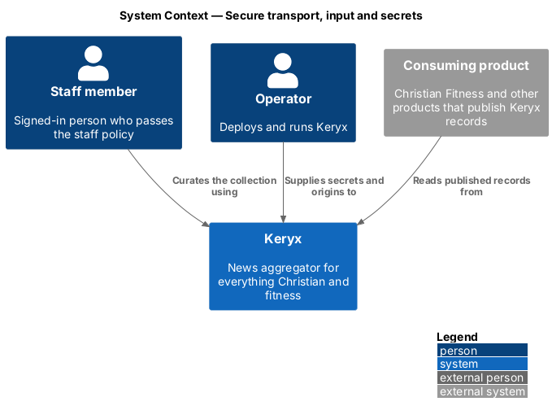
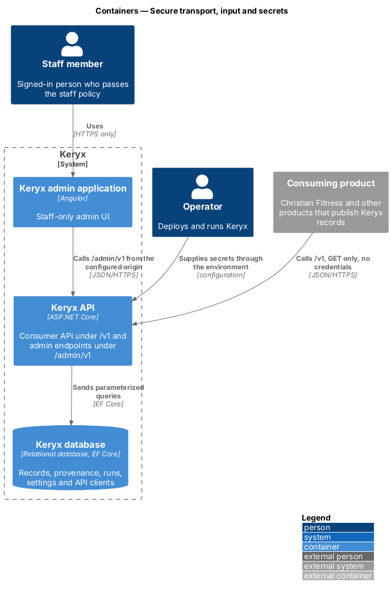
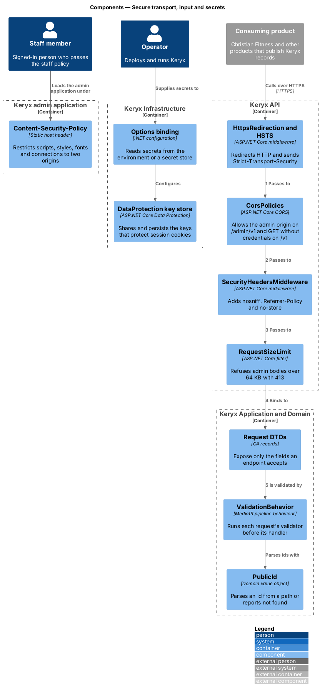
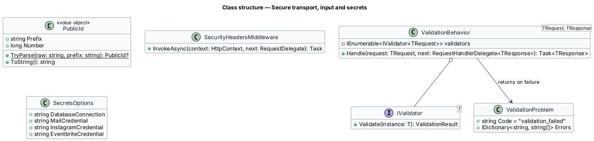
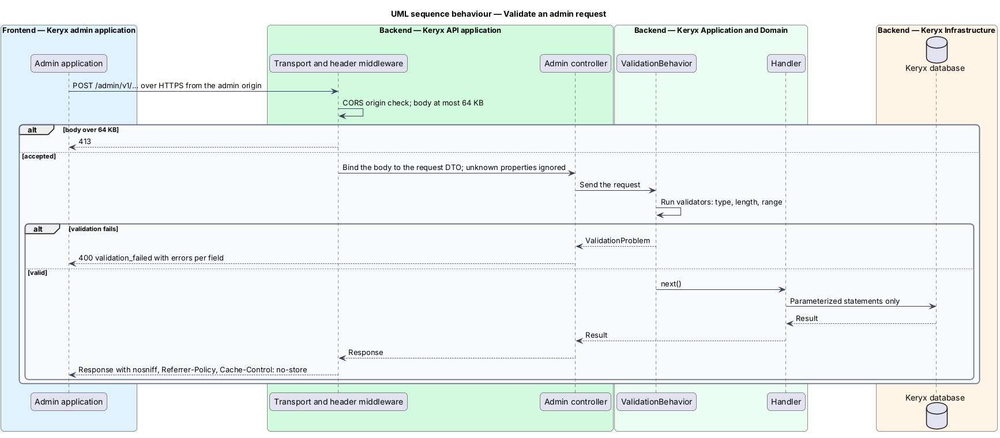

# Secure transport, input and secrets

## Overview

Keryx protects itself, its data, its sources and its consumers against the OWASP Top 10. This feature covers three defences that each endpoint and each screen inherits: transport and browser security, validation of each input, and the handling of secrets. Authentication, authorization and safe outbound requests have their own designs.

The defences are structural. Security headers come from one middleware, validation from one pipeline behaviour, and secrets from configuration that the repository never holds. A new endpoint is covered without code of its own.

## Description

The slice is middleware in the API host, one MediatR behaviour, binding conventions, and build-time settings of the admin application.

- **`HttpsRedirection and HSTS`** — ASP.NET Core middleware in the Keryx API. Redirects a plain HTTP request to HTTPS in a deployed environment and sends `Strict-Transport-Security` with a max-age of at least one year.
- **`SecurityHeadersMiddleware`** — ASP.NET Core middleware in the Keryx API. Adds `X-Content-Type-Options: nosniff` and `Referrer-Policy: strict-origin-when-cross-origin` to each response, and `Cache-Control: no-store` to each admin response that carries data.
- **`CorsPolicies`** — ASP.NET Core CORS in the Keryx API. Allows only the configured admin origin on `/admin/v1`. `/v1` allows no credentials and only `GET`.
- **`RequestSizeLimit`** — ASP.NET Core filter in the Keryx API. Refuses admin bodies over 64 KB with 413.
- **`ValidationBehavior`** — MediatR pipeline behaviour in the Application and Domain layers. Runs each request's validator before its handler. A failure answers `400` with `code` `validation_failed` and one `errors` entry per field, and changes nothing.
- **`Request DTOs`** — C# records in the Application and Domain layers. Expose only the fields an endpoint accepts. A property the endpoint does not define is ignored, so a body cannot set `status`, `id`, `revoked_at` or `key_hash`.
- **`PublicId`** — Domain value object in the Application and Domain layers. Parses an id from a path. A malformed id answers `404` with the resource's `…_not_found` code, never `500`.
- **`Options binding`** — .NET configuration in the Infrastructure layer. Reads connection strings, platform credentials, signing keys and mail credentials from the environment or a secret store. The repository holds none. A platform credential is sent only to that platform's host over HTTPS and appears in no log, span, error or admin response.
- **`DataProtection key store`** — ASP.NET Core Data Protection in the Infrastructure layer. Shares and persists the Data Protection keys outside the container when the API runs on more than one instance. The store is a documented deployment setting; its product is `<TO SUPPLY>`.
- **`Content-Security-Policy`** — Static host header in the Keryx admin application. Allows scripts, styles, fonts and connections only from the application's own origin and the API's origin, with no `unsafe-eval` and no third-party host, and sets `frame-ancestors 'none'`. The build loads no script, style or font from a third-party host. The host that serves the admin application and sets this header is `<TO SUPPLY>`.
- **`ValidationProblem`** — ProblemDetails with `code` `validation_failed` and an `errors` map from field name to messages.

Each search term and filter reaches the database as a query parameter through EF Core and is never concatenated into a query (L2-083).

The admin application binds each value that came from a source or a person as text. It uses no `innerHTML` binding and no `bypassSecurityTrust*` call on such a value (L2-083).

An API key is stored only as a SHA-256 hash and a 12-character prefix (L2-084); see [Create an API key](../../consumer-api/create-api-key/README.md).

## Requirements

The feature realizes the following level-2 (L2) requirements. Each L2 requirement refines a level-1 (L1) requirement, cited by identifier. The acceptance criteria of each requirement are in [`docs/specs/L2.md`](../../../specs/L2.md).

| L2 ID | Refines (L1) | Requirement |
|-------|--------------|-------------|
| [`L2-082`](../../../specs/L2.md#l2-082-transport-and-browser-security) | `L1-020` | **Transport and browser security.** The requirement is defined by its 5 acceptance criteria. |
| [`L2-083`](../../../specs/L2.md#l2-083-input-validation-and-injection) | `L1-020` | **Input validation and injection.** The requirement is defined by its 6 acceptance criteria. |
| [`L2-084`](../../../specs/L2.md#l2-084-secrets) | `L1-020` | **Secrets.** The requirement is defined by its 4 acceptance criteria. |

## Diagrams

### System context

A staff member curates the collection through Keryx. A consuming product reads published records from Keryx. The operator supplies secrets and origins to Keryx.

### Containers

The staff member uses the Keryx admin application. The Keryx admin application calls the Keryx API at `/admin/v1` from the configured origin. The consuming product calls the Keryx API at `/v1,` GET only, no credentials. The Keryx API sends parameterized queries the Keryx database. The operator supplies secrets through the environment the Keryx API.

### Components

A request passes `HttpsRedirection and HSTS`, `CorsPolicies`, `SecurityHeadersMiddleware` and `RequestSizeLimit` in the API host, then `ValidationBehavior` before its handler. `Options binding` and the `DataProtection key store` supply secrets from outside the repository.

### Class structure

`ValidationBehavior` wraps each handler and turns validator failures into a `ValidationProblem`. `PublicId.TryParse` separates a malformed id from a missing record.

### Behaviour — validate an admin request

Each check refuses before the handler runs, so a refused request changes nothing (`L2-083`). Each response leaves with the security headers (`L2-082`).

