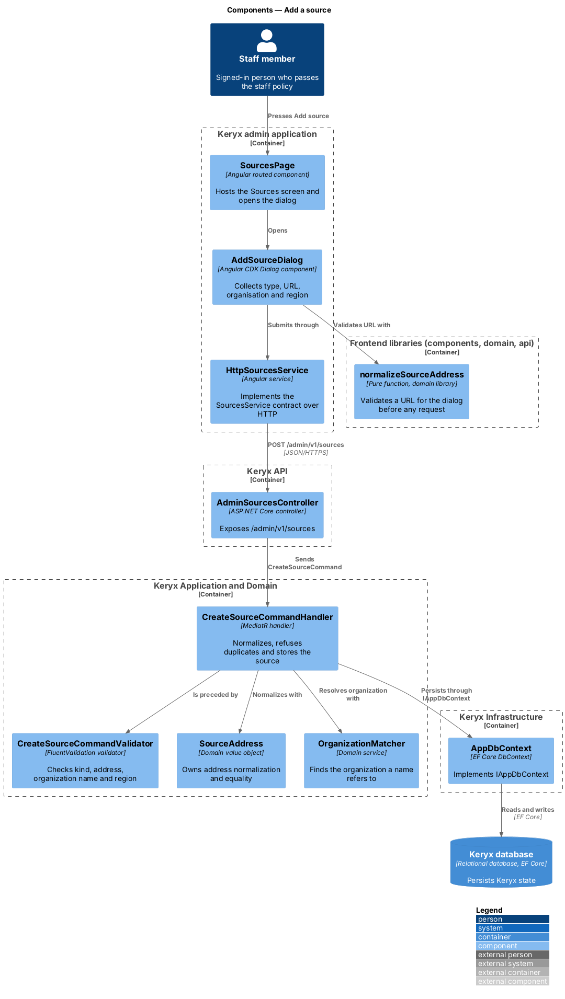
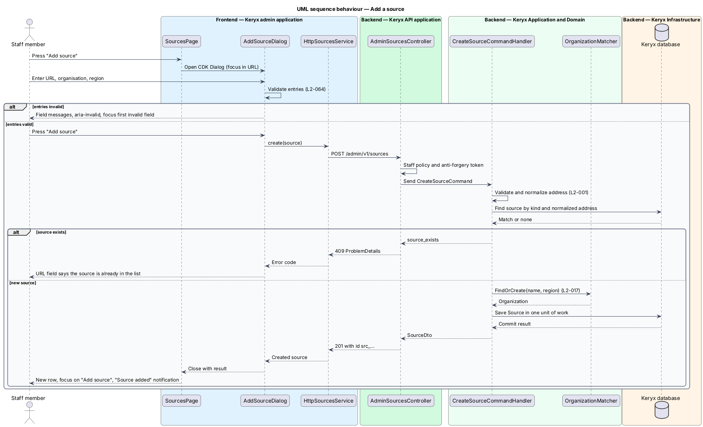

# Add a source

## Overview

Keryx is a news aggregator for everything Christian and fitness. Workers collect what organizations publish, and each place a worker collects from is a *source*. This feature covers how a staff member adds one source to the catalogue, from the Sources screen of the admin application to the stored record.

A source belongs to an organization and a region. Adding a source for an organization name Keryx does not yet know creates that organization; adding one for a known name attaches the source to the existing organization. The admin application creates `rss`, `website`, `instagram` and `eventbrite` sources. A `news_query` source comes from seed data only.

The dialog tests the address before the source is saved, so that a staff member learns whether the address answers and whether its items look relevant. The test fetch itself is designed in [Test-fetch a source](../test-fetch-source/README.md).

> **source** — feed, web page, social account, event organizer or news query that Keryx collects from

> **normalized address** — source address with scheme and host lower-cased, and trailing slash and fragment removed

> **source kind** — one of `rss`, `website`, `instagram`, `eventbrite`, `news_query`

## Description

The slice runs from the Add a source dialog to the `Source` and `Organization` entities. The server validates, normalizes and refuses a duplicate; the dialog shows each refusal by its `code`.

- **`SourcesPage`** — Angular routed component in the Keryx admin application. Hosts the Sources screen and opens the dialog.
- **`AddSourceDialog`** — Angular CDK Dialog component in the Keryx admin application. Collects type, URL, organisation and region. It focuses the URL field on opening, blocks Close, Cancel, Escape and the backdrop while the request is in flight, and sends exactly one request (L2-064).
- **`HttpSourcesService`** — Angular service in the Keryx admin application. Implements the SourcesService contract over HTTP.
- **`normalizeSourceAddress`** — Pure function, domain library in the frontend libraries. Validates a URL for the dialog before any request. The same case table drives the backend `SourceAddress` tests, because the rule is computed in both stacks.
- **`AdminSourcesController`** — ASP.NET Core controller in the Keryx API. Exposes /admin/v1/sources.
- **`CreateSourceCommandValidator`** — FluentValidation validator in the Application and Domain layers. Checks kind, address, organization name (1 to 120 characters) and region. A failure produces `400` with `code` `validation_failed` and one `errors` entry per field. Kind `news_query` produces `kind_not_creatable`.
- **`CreateSourceCommandHandler`** — MediatR handler in the Application and Domain layers. Normalizes the address, refuses a source with the same kind and normalized address with `409` `source_exists`, resolves or creates the organization, and stores the source in one unit of work.
- **`SourceAddress`** — Domain value object in the Application and Domain layers. Owns address normalization and equality.
- **`OrganizationMatcher`** — Domain service in the Application and Domain layers. Finds the organization a name refers to. Names that differ only in case, punctuation, whitespace or a leading "The" match (L2-010).
- **`AppDbContext`** — EF Core DbContext in the Infrastructure layer. Implements IAppDbContext.
- **`CreateSourceCommand`** — MediatR request carrying `Kind`, `Address`, `OrganizationName` and `RegionSlug`.
- **`Source`** — domain entity with a public id prefixed `src_`, a kind, an address, an organization, a region, and the times it was created, last fetched and last succeeded.
- **`Organization`** — domain entity with a public id prefixed `org_`, a name as published, a kind, a region and a public website.
- **`SourcesService / SOURCES_SERVICE`** — contract and injection token in the `api` library; `app.config.ts` binds the token to `HttpSourcesService`.

## Requirements

The feature realizes the following level-2 (L2) requirements. Each L2 requirement refines a level-1 (L1) requirement, cited by identifier. The acceptance criteria of each requirement are in [`docs/specs/L2.md`](../../../specs/L2.md).

| L2 ID | Refines (L1) | Requirement |
|-------|--------------|-------------|
| [`L2-001`](../../../specs/L2.md#l2-001-source-record) | `L1-001` | **Source record.** A source has a kind (`rss`, `website`, `instagram`, `eventbrite`, `news_query`), an address (a URL, or for a news query the query text), the organization it belongs to, a region, a health, and the times it was created, last fetched and last succeeded. |
| [`L2-017`](../../../specs/L2.md#l2-017-organization-record) | `L1-005` | **Organization record.** An organization is a church, ministry, gym, club, network or business that publishes Christian fitness news. It has a name as it publishes it, a kind (`church`, `ministry`, `gym`, `club`, `network`, `business`, `other`), a region, and its public website. |
| [`L2-064`](../../../specs/L2.md#l2-064-add-a-source-dialog) | `L1-014` | **Add a source dialog.** The requirement is defined by its 8 acceptance criteria. |

## Diagrams

### System context

A staff member curates the collection through Keryx. Keryx collects published items from publishing sources.

### Containers

The staff member uses the Keryx admin application. The Keryx admin application calls the Keryx API at `/admin/v1`. The Keryx API reads and writes the Keryx database. The Keryx API fetches the publishing source.

### Components

The dialog validates locally with `normalizeSourceAddress` and submits through `HttpSourcesService`. The controller sends one command; the handler uses `SourceAddress` and `OrganizationMatcher` and persists through `IAppDbContext`.

### Class structure

`CreateSourceCommandHandler` handles `CreateSourceCommand`, builds a `SourceAddress`, and creates a `Source` that refers to one `Organization` and one `Region`.

### Behaviour — add a source

The dialog refuses invalid entries without a request. The handler normalizes the address, refuses a duplicate with `source_exists`, resolves the organization and stores the source; the dialog closes and the page reports the outcome.

