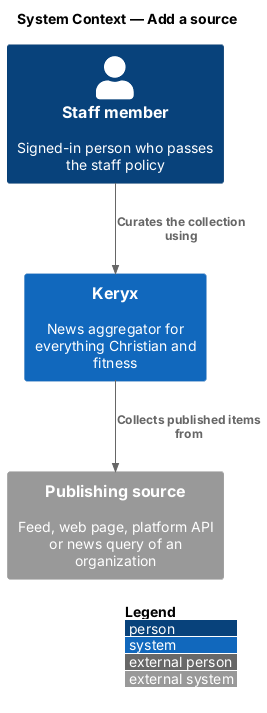
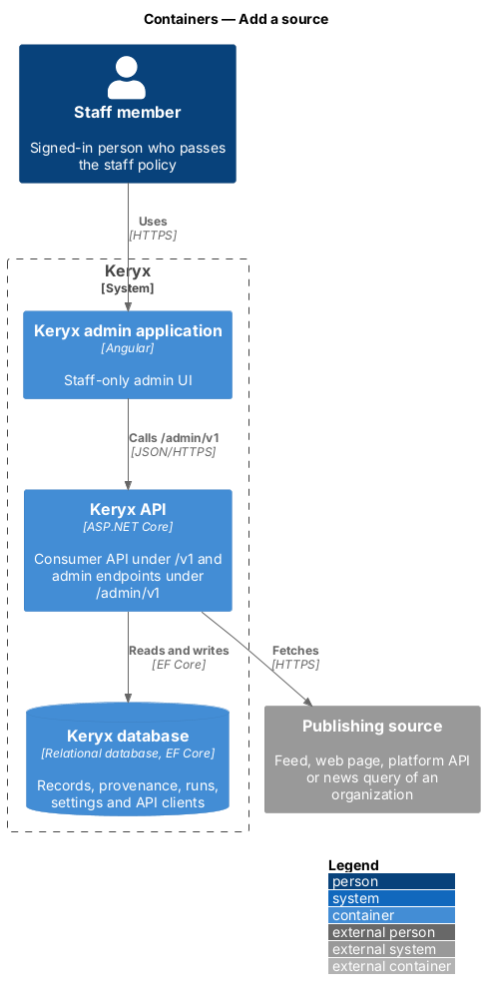
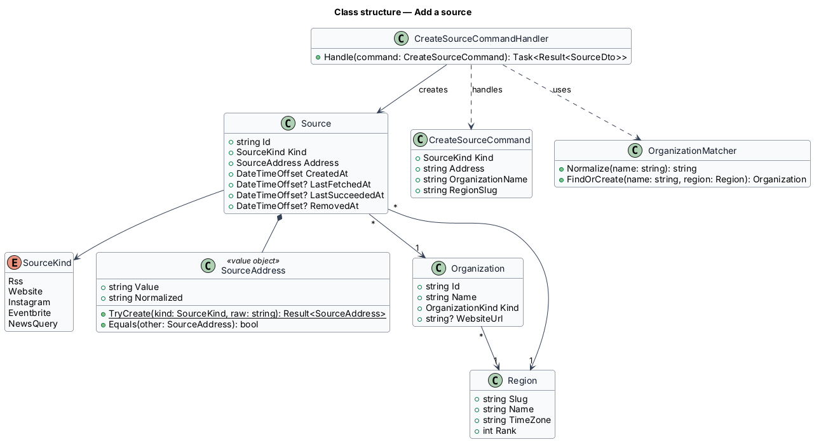
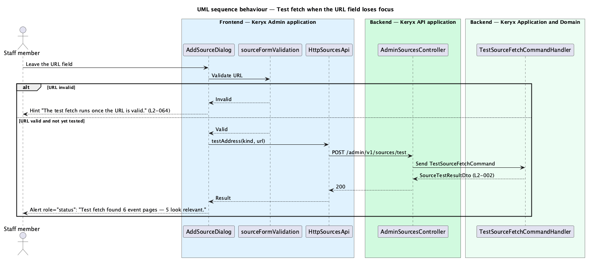
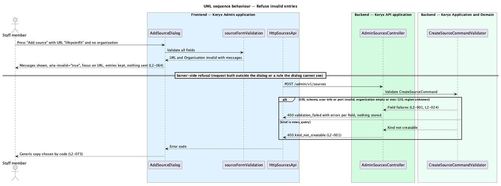

# Add a source

## Overview

Keryx collects Christian and fitness news, events and organizations from *sources*. The
*source catalogue* is the list of sources staff keep: what Keryx checks on every scheduled run.
This feature lets staff add a source to that catalogue from the Sources screen of the admin app.

- **source** — place Keryx collects from, with a kind, an address, the organization it belongs
  to, a region, a health, and the times it was created, last fetched and last succeeded
- **source kind** — one of `rss`, `website`, `instagram`, `eventbrite`, `news_query`
- **address** — URL of a source, or the query text of a `news_query` source
- **normalized address** — address with scheme and host lower-cased, trailing slash and fragment
  removed, used to decide whether two sources are the same
- **region** — entry of the fixed region list (slug, name, time zone), Toronto first

Staff open the "Add a source" dialog, choose a type, and enter a URL, the organization and the
region. When the URL is valid and the field loses focus, the dialog runs one test fetch and shows
what it found, so staff see whether the source works before saving. Saving creates the source,
and the next collection run fetches it. News query sources are not added here: seed data creates
them, and the dialog offers no news query type.

## Description

The feature is a vertical slice from the Add a source dialog to the database.

**Endpoint**

- `POST /admin/v1/sources` — staff policy. Body `kind`, `address`, `organization_name` (1 to
  120 characters) and `region` (a region slug).
  - `201` with the source's `id` and the stored values; a later `GET /admin/v1/sources/{id}`
    returns the same values.
  - `400` `validation_failed` with an `errors` entry per failing field: an address that does not
    start with `http://` or `https://`, that carries a user name or password, or that names a port
    other than 80 or 443; an empty organization name; an unknown region. Nothing is stored.
  - `400` `kind_not_creatable` for kind `news_query`.
  - `409` `source_exists` when an active source has the same kind and normalized address.
  - `413` for a body over 64 KB (L2-083).
  - A host that resolves to a non-public address is refused with `400`, `code`
    `unsafe_address` and an `errors.address` entry (L2-024).
- The test fetch on blur calls `POST /admin/v1/sources/test`, designed in
  [Test a source fetch](../test-source-fetch/README.md).

**Frontend (Keryx Admin)**

- **`SourcesPage`** — owns the "Add source" `btn` in its `page-header`, and in its empty and
  no-results states. It opens `AddSourceDialog` through the CDK `Dialog` service with an injector
  that binds `SOURCES_API` and `NOTIFIER`, and restores focus to the pressing button on close.
- **`AddSourceDialog`** — app dialog, `name.ts` + `name.html` + `name.scss`, `OnPush`, state in
  signals. It renders the `dialog` block titled "Add a source" with the lead "Keryx will check it
  on every scheduled run.", a `choice-grid` of `choice-card` radios (RSS, Website, Instagram,
  Eventbrite; RSS chosen), the URL `input`, the Organisation `input` and the Region `select` in
  `field` blocks, and "Cancel" and "Add source". Focus starts in URL.
- **Test on blur** — when the URL is valid and the field loses focus, the dialog calls
  `testAddress` once and shows the result in an `alert` with `role="status"`, such as "Test fetch
  found 6 event pages — 5 look relevant.". An invalid URL runs no test and the hint reads "The
  test fetch runs once the URL is valid.". The domain helper `testFetchSummary` words every
  result: none relevant is a warning ("…— none look relevant."), nothing to read is "Test fetch
  reached the address but found nothing to read.", and each unreachable `reason` has its own
  sentence (for example "Test fetch timed out. Check the address, or try again later."). A test
  call that fails keeps the hint as it was. After adding, `nothingRelevantNotice` turns the
  "Source added" toast into the warning of `notifications/source-toast/warning.html` when the
  last test of that address found items and none relevant; its "Edit source" action arrives
  with the edit dialog (journey 17).
- **`sourceFormValidation`** — pure helper in the domain library with unit tests. It returns the
  messages "Enter a full URL starting with https://, like https://lifepointfit.ca/events." and
  "Enter the organisation’s name as it publishes it.", and, with no region chosen, "Choose the
  region the organisation is in.". On submit with failures the dialog sends
  nothing, sets `aria-invalid="true"` and `aria-describedby` on each invalid field, moves focus to
  the first, and clears no entry.
- **Busy** — on a valid submit the "Add source" button shows its busy state; `disableClose` and a
  guard on Close and Cancel keep the dialog open until the request ends, and exactly one request
  is sent.
- **Success** — the dialog closes, `SourcesStore` shows the new row, focus returns to "Add
  source", and `Notifier` shows "Source added" with "<organization> will be checked on the next
  run at 12:00 PM." When the last test found nothing relevant, the toast is the warning "Source
  added, but nothing looked relevant" with the action "Edit source". Until runs are scheduled
  (journey 4) there is no next run time, so the sentence ends "…on the next run."; the time joins
  it then, from the shell's next collection.
- **Failure** — the dialog stays open with an `alert` "Keryx couldn’t add the source", "Nothing
  was saved and your entries are still here…" and "Reference req_…" from the response's
  `trace_id`; every entry is kept. On `source_exists` the URL field reads "This source is
  already in the list.", and on `unsafe_address` "Keryx can’t fetch this address: it isn’t on
  the public internet."; focus moves to URL, and the message stays until the URL changes.
- **Narrow viewport** — below 640 px the dialog is a bottom sheet whose actions stay visible above
  the on-screen keyboard (L2-074).
- **Region options** — the dialog lists regions in rank order. Staff read them from
  `GET /admin/v1/regions` (Staff policy), which answers `{ "items": [{ "slug", "name",
  "time_zone" }] }` in rank order, bounded at 200; `GET /v1/regions` is the consumer endpoint
  behind an API key.
- **`SourcesApi`** (`SOURCES_API`) — `createSource(body)` and `testAddress(kind, address)`,
  implemented by `HttpSourcesApi`.

**Backend (Keryx API)**

- **`AdminSourcesController`** — `POST /admin/v1/sources` sends one `CreateSourceCommand` and
  answers `201` with a `Location` of `/admin/v1/sources/{id}`.
- **`CreateSourceCommandValidator`** — FluentValidation rules for kind, address, organization
  length and region existence.
- **`CreateSourceCommandHandler`** — refuses `news_query` with `KindNotCreatableException`,
  normalizes the address to `CanonicalUrl`, refuses a duplicate among active sources with
  `SourceExistsException`, creates the `Source` with `CreatedAt` from `TimeProvider`, and saves it
  with an `AuditEntry` (subject id, `source.added`, source id, time) in one unit of work. A unique
  index on kind and normalized address among active sources turns a concurrent duplicate into
  `source_exists`.
- **`Source`** — domain entity. A new source has health `healthy`, `LastFetchedAt` `null` and
  `ConsecutiveFailures` 0 (L2-004). It stores the organization name as given; whether the handler
  also links an `Organization` record, and by which match, is `<TO SUPPLY>`.
- **`CanonicalUrl`** — value object that lower-cases scheme and host and drops a trailing slash
  and a fragment, so such variants equal the stored address.

## Requirements

The feature realizes the following level-2 (L2) requirements. Each L2 requirement refines a level-1 (L1) requirement, cited by identifier. Their acceptance criteria are in [L2.md](../../../specs/L2.md).

| L2 ID | Refines (L1) | Requirement |
|-------|--------------|-------------|
| `L2-001` | `L1-001` | Source record — A source has a kind (`rss`, `website`, `instagram`, `eventbrite`, `news_query`), an address (a URL, or for a news query the query text), the organization it belongs to, a region, a health, and the times it was created, last fetched and last succeeded. |
| `L2-064` | `L1-014` | Add a source dialog — Staff add a source through a dialog that validates the entry and test-fetches the address before saving. |

## Diagrams

### System context

Staff add a source to Keryx, which test-fetches the new address once and reports its spans to the
OTLP collector.

### Containers

The admin app calls the admin API to test and then create the source; the Worker reads the new
source on its next run.

### Components

`AddSourceDialog` composes the presentation components, validates with `sourceFormValidation` and
calls `HttpSourcesApi`. On the server the controller sends `CreateSourceCommand` to its handler,
which creates the `Source` entity.

### Class structure

`CreateSourceCommandHandler` creates a `Source` with a `CanonicalUrl` address and records an
`AuditEntry`; it raises `SourceExistsException` or `KindNotCreatableException` for the two
refusals the dialog branches on.

### Behaviour — test fetch on blur

A valid URL is tested once when its field loses focus and the result is announced politely; an
invalid URL runs no test.

### Behaviour — add a source

The dialog sends exactly one request while busy. The handler normalizes the address and refuses a
duplicate with `source_exists`, otherwise it saves the source and its audit entry; the dialog then
closes and notifies.

### Behaviour — refuse invalid entries

The dialog refuses invalid entries without a request and moves focus to the first invalid field.
The server applies the same rules and refuses `news_query` with `kind_not_creatable`.

