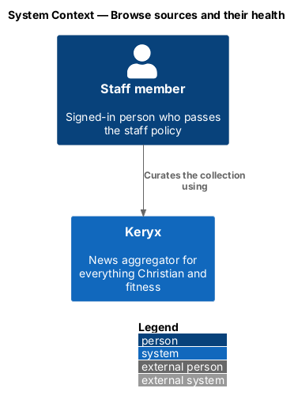
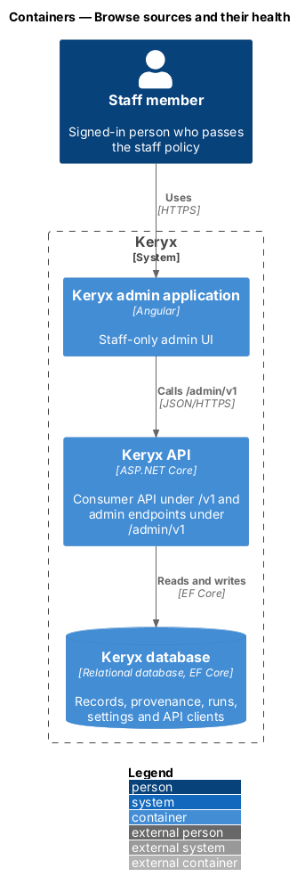
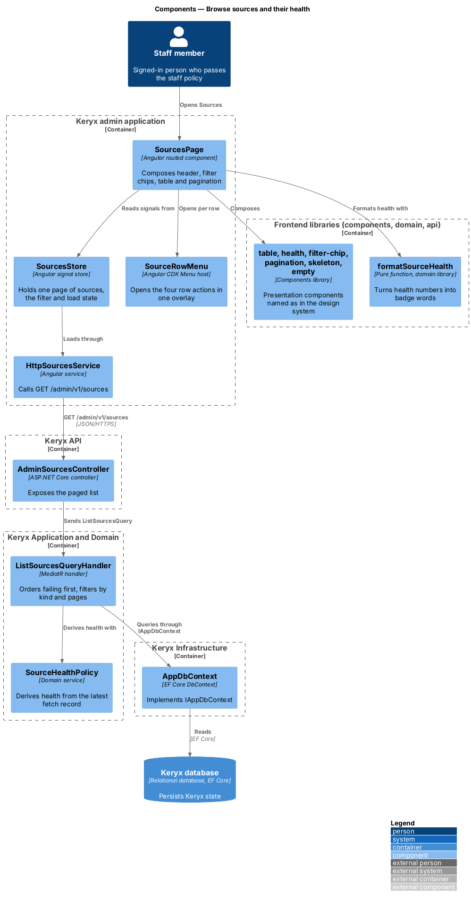
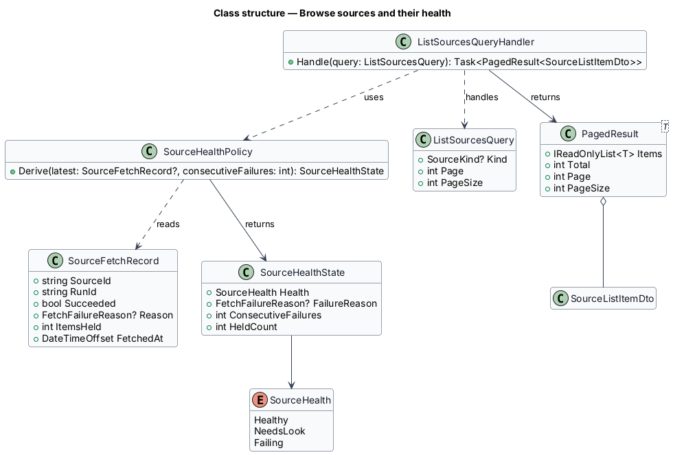
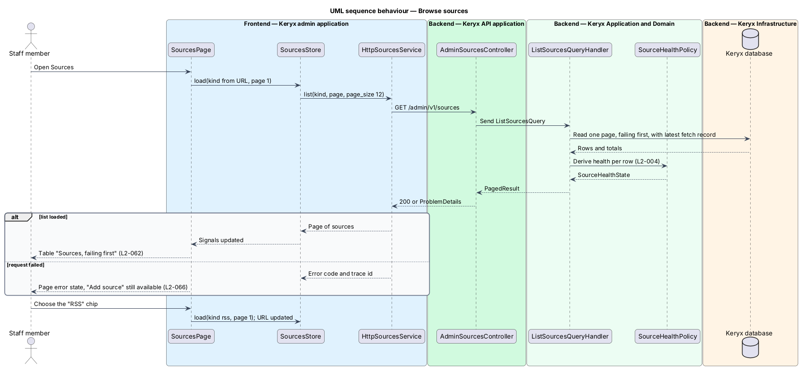

# Browse sources and their health

## Overview

The Sources screen lists each source Keryx collects from, failing sources first. For each source it shows the organization, the kind and address, the health, the region, the articles collected in the last 30 days and the time of the last fetch. A row menu reaches the edit, test and remove actions.

Health is derived from the most recent fetches of a source and is never typed by a person. A source is `failing` when its last fetch failed, `needs_look` when its last fetch succeeded with at least one item held for review, and `healthy` otherwise, including when it has never been fetched.

> **source health** — one of `healthy`, `needs_look`, `failing`, derived from the most recent fetches of a source

> **consecutive failures** — count of fetches that failed in a row, reset to 0 by the next successful fetch

## Description

The slice is a paged, server-ordered list with a kind filter kept in the URL. The server computes health and serves counts as numbers; the admin application formats them into the badge words.

- **`SourcesPage`** — Angular routed component in the Keryx admin application. Composes header, filter chips, table and pagination. It shows skeleton rows when the first response takes longer than 300 ms, the empty state when no source exists, the no-results state for a kind with no sources, and the page error state with "Add source" still available.
- **`SourcesStore`** — Angular signal store in the Keryx admin application. Holds one page of sources, the kind filter and the load state. It is provided on `SourcesPage`, so its state is released when the screen is left, and it aborts an in-flight request on destroy.
- **`SourceRowMenu`** — Angular CDK Menu host in the Keryx admin application. Opens "Edit source", "Test fetch now", "Open &lt;host>" and "Remove source" in one CDK overlay. Arrow keys, Home and End move focus and wrap; Escape closes the menu and returns focus to its button. "Open &lt;host>" exists only for an `http` or `https` address and opens with `rel="noopener noreferrer"`.
- **`HttpSourcesService`** — Angular service in the Keryx admin application. Calls GET /admin/v1/sources.
- **`table, health, filter-chip, pagination, skeleton, empty`** — Components library in the frontend libraries. Presentation components named as in the design system.
- **`formatSourceHealth`** — Pure function, domain library in the frontend libraries. Turns health numbers into badge words.
- **`AdminSourcesController`** — ASP.NET Core controller in the Keryx API. Exposes the paged list.
- **`ListSourcesQueryHandler`** — MediatR handler in the Application and Domain layers. Orders failing sources first, then those needing a look, then healthy, and by name within each group. It filters by kind, pages, and returns `items`, `total`, `page`, `page_size`, `failing` and `needs_look` as numbers.
- **`SourceHealthPolicy`** — Domain service in the Application and Domain layers. Derives `health`, `failure_reason`, `consecutive_failures` and `held_count` from the latest `SourceFetchRecord` of a source.
- **`AppDbContext`** — EF Core DbContext in the Infrastructure layer. Implements IAppDbContext.
- **`SourceListItemDto`** — DTO with `id`, `organization`, `kind`, `address`, `health`, `failure_reason`, `consecutive_failures`, `held_count`, `region`, `articles_30d` and `last_fetched_at`.
- **`SourceFetchRecord`** — per-run result of one source: succeeded or failed, reason, items held; written by the collection pipeline.

## Requirements

The feature realizes the following level-2 (L2) requirements. Each L2 requirement refines a level-1 (L1) requirement, cited by identifier. The acceptance criteria of each requirement are in [`docs/specs/L2.md`](../../../specs/L2.md).

| L2 ID | Refines (L1) | Requirement |
|-------|--------------|-------------|
| [`L2-004`](../../../specs/L2.md#l2-004-source-health) | `L1-001` | **Source health.** A source's health is `healthy`, `needs_look` or `failing`, derived from its most recent fetches, never typed by a person. |
| [`L2-062`](../../../specs/L2.md#l2-062-sources-list) | `L1-014` | **Sources list.** The requirement is defined by its 7 acceptance criteria. |
| [`L2-063`](../../../specs/L2.md#l2-063-source-row-menu) | `L1-014` | **Source row menu.** The requirement is defined by its 5 acceptance criteria. |
| [`L2-066`](../../../specs/L2.md#l2-066-sources-loading-empty-and-error) | `L1-014` | **Sources loading, empty and error.** The requirement is defined by its 3 acceptance criteria. |

## Diagrams

### System context

A staff member curates the collection through Keryx.

### Containers

The staff member uses the Keryx admin application. The Keryx admin application calls the Keryx API at `/admin/v1`. The Keryx API reads and writes the Keryx database.

### Components

`SourcesPage` renders from `SourcesStore`, which loads through `HttpSourcesService`. `ListSourcesQueryHandler` reads sources with their latest fetch record and applies `SourceHealthPolicy`.

### Class structure

`SourceHealthPolicy` maps a `SourceFetchRecord` to a `SourceHealth`; `ListSourcesQueryHandler` returns a `PagedResult` of `SourceListItemDto`.

### Behaviour — browse sources

The store asks for one page; the handler orders and pages in the database and derives health per row (`L2-004`). Choosing a filter chip writes the kind to the URL and reloads from page 1.

