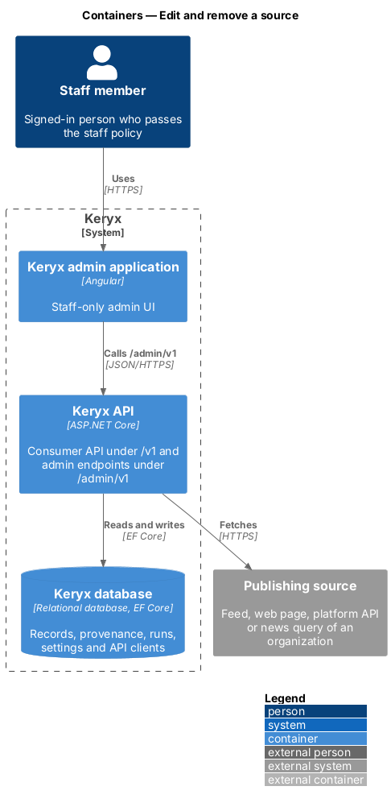
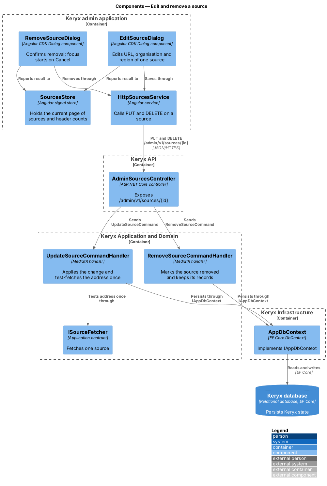
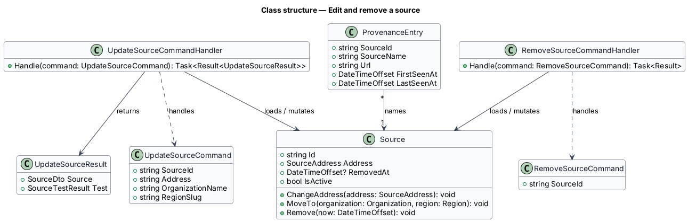
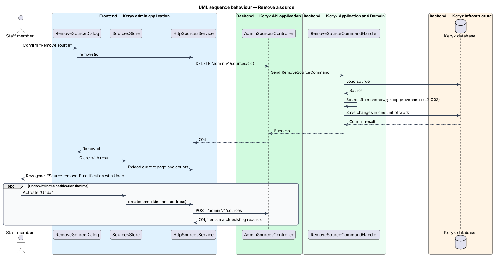

# Edit and remove a source

## Overview

A source changes over time: an organization moves its feed, or stops publishing. This feature covers the two dialogs that change an existing source. The Edit source dialog changes the address, organization or region. The Remove source dialog stops Keryx collecting from the source.

An edit applies from the next run, and saving tests the address once. Removal is a soft state change on the source: the source is no longer fetched or listed, and each article, event and organization collected from it stays stored and served with its provenance unchanged. Adding the same kind and address again creates a source whose items match their existing records.

Both dialogs open from a source row menu on the Sources screen. The Edit source dialog also opens from an issue on the Runs screen.

## Description

The slice has two commands. Both answer `404` with `code` `source_not_found` for an unknown id, and the edit answers `409` with `code` `source_exists` when the change would equal another source.

- **`EditSourceDialog`** — Angular CDK Dialog component in the Keryx admin application. Edits URL, organisation and region of one source. For a failing source it shows an alert with the time and reason of the last failed fetch. Its busy, invalid, failed and success behaviour is that of the Add a source dialog.
- **`RemoveSourceDialog`** — Angular CDK Dialog component in the Keryx admin application. Confirms removal. Focus starts on "Cancel", never on the destructive button, and the text gives the number of articles that stay in the database and in the API.
- **`SourcesStore`** — Angular signal store in the Keryx admin application. Holds the current page of sources and header counts. It is provided on `SourcesPage`, reloads after a save or a removal, and backs the "Undo" action of the removal notification by adding the source again.
- **`HttpSourcesService`** — Angular service in the Keryx admin application. Calls PUT and DELETE on a source.
- **`AdminSourcesController`** — ASP.NET Core controller in the Keryx API. Exposes /admin/v1/sources/{id}.
- **`UpdateSourceCommandHandler`** — MediatR handler in the Application and Domain layers. Applies the change and test-fetches the address once.
- **`RemoveSourceCommandHandler`** — MediatR handler in the Application and Domain layers. Sets `RemovedAt` on the source and keeps each provenance entry that names it. A removed source is excluded from collection and from every list.
- **`ISourceFetcher`** — Application contract in the Application and Domain layers. Fetches one source.
- **`AppDbContext`** — EF Core DbContext in the Infrastructure layer. Implements IAppDbContext.
- **`UpdateSourceCommand`** — MediatR request carrying the source id and the new address, organization name and region.
- **`RemoveSourceCommand`** — MediatR request carrying the source id.
- **`UpdateSourceResult`** — DTO with the saved source and the `SourceTestResult` of the save-time test.

## Requirements

The feature realizes the following level-2 (L2) requirements. Each L2 requirement refines a level-1 (L1) requirement, cited by identifier. The acceptance criteria of each requirement are in [`docs/specs/L2.md`](../../../specs/L2.md).

| L2 ID | Refines (L1) | Requirement |
|-------|--------------|-------------|
| [`L2-003`](../../../specs/L2.md#l2-003-edit-and-remove-a-source) | `L1-001` | **Edit and remove a source.** The requirement is defined by its 5 acceptance criteria. |
| [`L2-065`](../../../specs/L2.md#l2-065-edit-and-remove-source-dialogs) | `L1-014` | **Edit and remove source dialogs.** The requirement is defined by its 6 acceptance criteria. |

## Diagrams

### System context

A staff member curates the collection through Keryx. Keryx collects published items from publishing sources.

### Containers

The staff member uses the Keryx admin application. The Keryx admin application calls the Keryx API at `/admin/v1`. The Keryx API reads and writes the Keryx database. The Keryx API fetches the publishing source.

### Components

Each dialog submits through `HttpSourcesService` and `SourcesStore` reloads the list. The controller sends one command per request; `UpdateSourceCommandHandler` also calls `ISourceFetcher` for the save-time test.

### Class structure

The two handlers load one `Source`. `Source.ChangeAddress` and `Source.Remove` own the state changes; `ProvenanceEntry` keeps naming a removed source.

### Behaviour — edit a source

The handler refuses a change that equals another source, saves the change, tests the new address once and returns both the source and the test result.

### Behaviour — remove a source

Removal marks the source and deletes nothing collected from it. The notification's "Undo" action adds the source back through the create endpoint.

