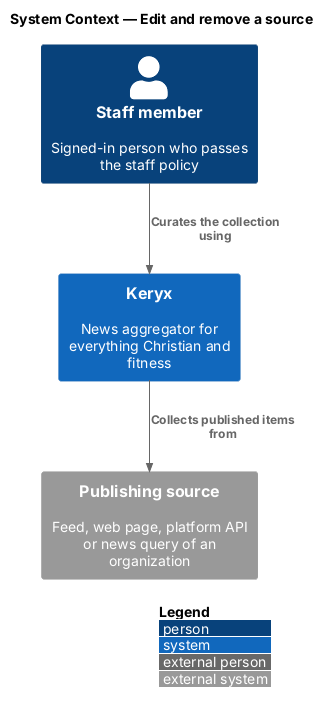
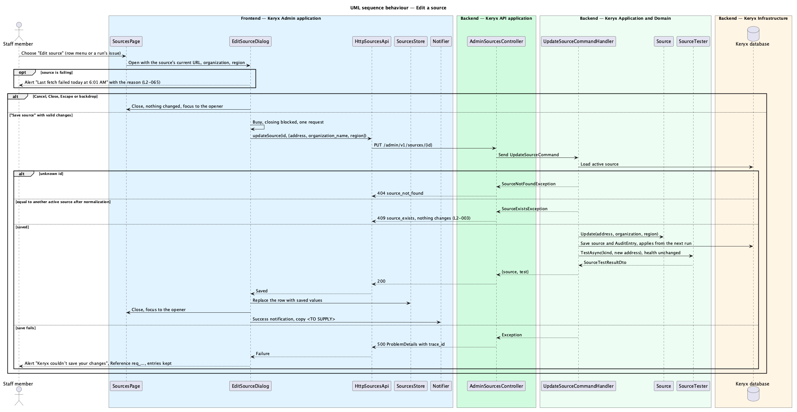
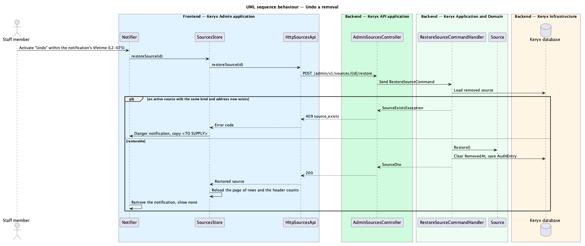

# Edit and remove a source

## Overview

Keryx collects from a catalogue of *sources*, each a feed, page, platform account or news query
that belongs to an organization and a region. Sources change: a church moves its blog, a club
renames itself, a feed stops being useful. This feature lets staff change a source's address,
organization and region, and remove a source that should no longer be checked.

- **active source** — source that has not been removed and that collection runs fetch
- **removal** — staff action that stops Keryx checking a source while keeping everything already
  collected from it
- **provenance** — record of where a fact came from: the source, its URL, and when it was first
  and last seen
- **undo** — reversal of a removal from the "Source removed" notification, which makes the same
  source active again

Removal never deletes collected records. Every article, event and organization collected from a
removed source stays stored and served with its provenance unchanged. A source added again later
with the same kind and address is a new source; the items it yields match their existing records
through stable identity (L2-009), so no duplicate appears.

Staff reach "Edit source" from a row menu on the Sources screen or from a source's issue on the
Runs screen, and "Remove source" from the row menu. Both open dialogs; nothing is edited inline.

## Description

The feature is a vertical slice from the two dialogs to the database.

**Endpoints**

- `GET /admin/v1/sources/{id}` — the source with `kind`, `address`, `organization_name`,
  `region`, `health`, `failure_reason`, `consecutive_failures`, `last_fetched_at` and the number of
  articles collected from it (field name `article_count` is this design's; the remove dialog reads
  it).
- `PUT /admin/v1/sources/{id}` — body `address`, `organization_name`, `region`. `200` with
  `source` (the saved values) and `test` (the `SourceTestResultDto` of one test fetch of the saved
  address). `400` `validation_failed` per field; `409` `source_exists` when the change would equal
  another active source, with nothing changed. The kind is not editable (L2-003).
- `DELETE /admin/v1/sources/{id}` — `204`. The source is no longer fetched or listed.
- `POST /admin/v1/sources/{id}/restore` — the Undo of a removal; `200` with the source, or `409`
  `source_exists` when an active source with the same kind and address was added meanwhile. The
  specs name no endpoint for Undo, so this path is this design's proposal; journey 17 confirmed
  it. A restore is used rather than a new create because `news_query` sources are
  removable but not creatable (`kind_not_creatable`).
- Every one of these answers `404` `source_not_found` for an unknown or malformed id, requires the
  staff policy, and (except `GET`) writes an `AuditEntry` on success (L2-085).

**Frontend (Keryx Admin)**

- **`EditSourceDialog`** — CDK Dialog titled "Edit source" with the lead "Changes apply from the
  next scheduled run.", holding the current URL, Organisation and Region in `field` blocks and the
  hint "Keryx tests the address again when you save.". For a failing source it shows an `alert`
  "Last fetch failed today at 6:01 AM" with the reason. "Save source" follows the busy, success,
  invalid and failed behaviour of the Add a source dialog: one request while busy, the
  `sourceFormValidation` messages, and on failure the `alert` "Keryx couldn’t save your changes"
  with "Reference req_…" and every entry kept. `source_exists` marks the URL field. The success
  notification copy for an edit is `<TO SUPPLY>`; no source-toast mock covers it.
  - As built (journey 17): the success notification is "Source saved", with the test fetch's
    sentence (`testFetchSummary`) and "Changes apply from the next scheduled run.", in the test's
    tone (`sourceSavedNotice`). The Type fieldset shows only the source's kind, checked, since the
    kind is not editable; the mocks were corrected to match. A news query's field is labelled
    "Query" and needs only its text, at most 2,048 characters. The alert text is
    `lastFetchFailure`: "GET <address> → <reason>. Check the address below.". The dialog reads
    the source from the row it was opened on (`EditSourceData`), so it needs no `GET` of its own.
    After a save, `SourcesStore.refresh()` reads the shown page again in place rather than
    `replaceRow`. The `PUT` answer has no region name, and keeping the rows keeps focus on the
    row's menu button.
- **Opening from Runs** — `RunsPage` opens the same `EditSourceDialog` for an issue's source and
  binds `SOURCES_API` in the dialog's injector; on save it refreshes its own data.
  - As built (journey 17): `sources/edit-source.ts` opens the dialog from anywhere.
    - `openEditSource(injector, source)` binds `SOURCES_API` in the dialog's injector, words the
      last-fetch alert from `ScheduleStore`'s clock and zone, and says "Source saved".
    - `editSourceById(injector, id, name)` reads `GET /admin/v1/sources/{id}` first, for a Runs
      issue (its `subject_id`), the retry notification's "Edit source" (the one source still
      failing, superseding ADR 0012), and the "Source added, but nothing looked relevant"
      warning, which now has "Edit source".
    - A source removed meanwhile gives "Source not found" / "<name> was removed meanwhile.". A
      failed read gives "Keryx couldn’t open the source" / "Try again in a moment. Reference …",
      with "Try again".
    - An issue's button reads "Edit source", named "Edit source for <source>"; a stage's issue has
      none. Saved from Runs, the run is read again in place, so focus returns to the button.
- **`RemoveSourceDialog`** — CDK Dialog titled "Remove Redeemed Run Club Toronto?" (the
  organization name) that says "Keryx stops checking redeemedrun.ca/feed." and "The 31 articles
  already collected from this source stay in the database and in the API…". Focus starts on
  "Cancel"; "Remove source" is a danger `btn`. On success the dialog closes, `SourcesStore` drops
  the row and reloads the header counts, and `Notifier` shows the info toast "Source removed" /
  "Redeemed Run Club Toronto is no longer checked. Its articles stay in Keryx." with "Undo". On
  failure the dialog shows its failed state ("Keryx couldn’t remove the source", "Nothing
  changed. Try again in a moment.", reference), the source stays listed, and a danger toast
  "Keryx couldn’t remove the source" offers "Try again".
  - As built (journey 17): Sources reads `GET /admin/v1/sources/{id}` before opening the
    dialog, for `article_count`. A source removed meanwhile gives "Source not found" and a reload;
    if the read fails, the dialog says "The articles already collected…" without the number
    (`removeSourceText`, which also words 1 and 0). The dialog calls `SourcesStore.remove`, which
    raises both notifications ("<name> is still being checked." on failure) and reads the page
    again in place. Undo calls `SourcesStore.restore`. When it fails, the danger notification
    "Keryx couldn’t add the source back" says "<name> was added again meanwhile, so it is listed
    already." for `source_exists`, and otherwise "Nothing changed. Try again in a moment." with
    "Try again". After a removal, focus goes to the table's caption; the description is plain text,
    as the revoke dialog's is.
- **Closing** — Cancel, Close, Escape or the backdrop close either dialog without change and
  return focus to the control that opened it; while a request is in flight none of them closes
  it (L2-074).
- **`SourcesStore`** — `replaceRow(source)`, `removeRow(id)` and `restoreSource(id)`; after a
  removal or a restore it reloads the current page and the header counts from
  `GET /admin/v1/sources`.
- **`SourcesApi`** (`SOURCES_API`) — `getSource`, `updateSource`, `removeSource` and
  `restoreSource`, implemented by `HttpSourcesApi`.

**Backend (Keryx API)**

- **`AdminSourcesController`** — one action per endpoint, each sending one MediatR request
  (`GetSourceQuery`, `UpdateSourceCommand`, `RemoveSourceCommand`, `RestoreSourceCommand`).
- **`UpdateSourceCommandValidator`** — the address, organization and region rules of L2-001 and
  L2-024, as for create.
- **`UpdateSourceCommandHandler`** — loads the active source, normalizes the new address to
  `CanonicalUrl`, refuses a collision with `source_exists`, calls `Source.Update`, and saves the
  change and an `AuditEntry` in one unit of work. It then calls `SourceTester` once and returns
  the result beside the saved source. The test leaves the stored health unchanged, as a test
  fetch does under L2-002; whether a save should instead reset health is `<TO SUPPLY>`.
  - As built (journey 17): a save keeps the stored health; the next run sets it from the new
    address. The response is `SourceSaved` (`source`, `test`). The validator shares the create
    rules (`SourceFieldRules`); a news query's address is its query text, so it need only be
    given (up to 2048 characters) and its test is `refused` without a request. Collision
    compares `CanonicalUrl.Normalize` of the new address against the other sources of the same
    kind, so the source's own address in another spelling is no collision. The `AuditEntry`
    arrives with journey 24 (staff actions are audited), which adds it to every staff action.
- **`RemoveSourceCommandHandler`** — calls `Source.Remove(now)`, which sets `RemovedAt` from
  `TimeProvider`. The row stays so every `Provenance` that references it keeps resolving. Active
  sources exclude removed ones in the run's source list, in `GET /admin/v1/sources`, in
  `GET /v1/sources`, and in the uniqueness check on kind and normalized address.
- **`RestoreSourceCommandHandler`** — calls `Source.Restore()` unless an active duplicate exists.
- **Open issues** — what happens to a removed source's open issues (L2-020) is `<TO SUPPLY>`.
  - As built (journey 17): removing a source closes every issue it raised, open or muted, since
    no run will raise or clear them again and they would count on Overview and in alerts
    forever. Undo leaves them closed; the next run raises any that still apply.
- **As built (journey 17)** — "active" is a global query filter on `Source`
  (`RemovedAt == null`), so every fetch, list, count and duplicate check leaves a removed source
  out without each query saying so; the lookups that name a source for a run's issues and an
  article's first source use `IgnoreQueryFilters()`, so a removed source still names what it
  raised or yielded. The unique index on kind and normalized address is filtered to active
  sources (`"RemovedAt" IS NULL`, migration `SourceRemoval`). A removed source answers
  `404 source_not_found` to read, edit, test and remove; only restore finds it.
  `GET /admin/v1/sources/{id}` (and the edit and restore responses) add `failure_reason`,
  `consecutive_failures` and `article_count`: the articles with a provenance entry for the
  source. The restore path `POST /admin/v1/sources/{id}/restore` is confirmed.

## Requirements

The feature realizes the following level-2 (L2) requirements. Each L2 requirement refines a level-1 (L1) requirement, cited by identifier. Their acceptance criteria are in [L2.md](../../../specs/L2.md).

| L2 ID | Refines (L1) | Requirement |
|-------|--------------|-------------|
| `L2-003` | `L1-001` | Edit and remove a source — Staff must be able to change a source's address, organization and region, and remove a source, without losing what was already collected from it. |
| `L2-065` | `L1-014` | Edit and remove source dialogs — Staff edit a source, or remove it after confirming, through dialogs reached from the list or from a run's issue. |

## Diagrams

### System context

Staff edit, remove and restore sources in Keryx. Consuming products keep reading the articles
collected from a removed source.

### Containers

The admin app calls the admin API, which updates or marks the source removed in the database; the
Worker fetches only active sources from its next run.

### Components

The two dialogs call `HttpSourcesApi`; the controller sends one command per action to its
handler, and each handler acts on the `Source` entity.

### Class structure

`Source` exposes `Update`, `Remove` and `Restore`. `Provenance` keeps referencing a removed source,
which is why removal is a mark rather than a delete.

### Behaviour — edit a source

The dialog sends one request; the handler refuses a collision with `source_exists`, saves the
change, then test-fetches the saved address and returns both.

### Behaviour — remove a source

The dialog opens on "Cancel". A confirmed removal marks the source removed, leaves its records
untouched, and is reported with "Undo"; a failure keeps the source listed and raises a danger
notification.

### Behaviour — undo a removal

"Undo" restores the same source unless an active duplicate now exists, and the notification is
replaced by none.

