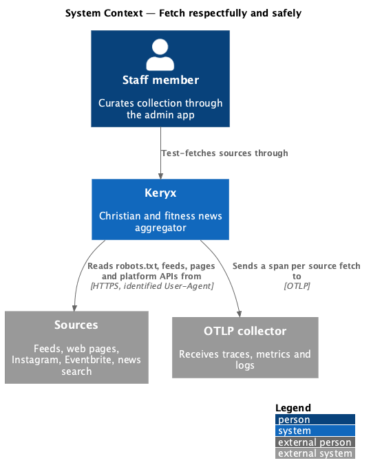
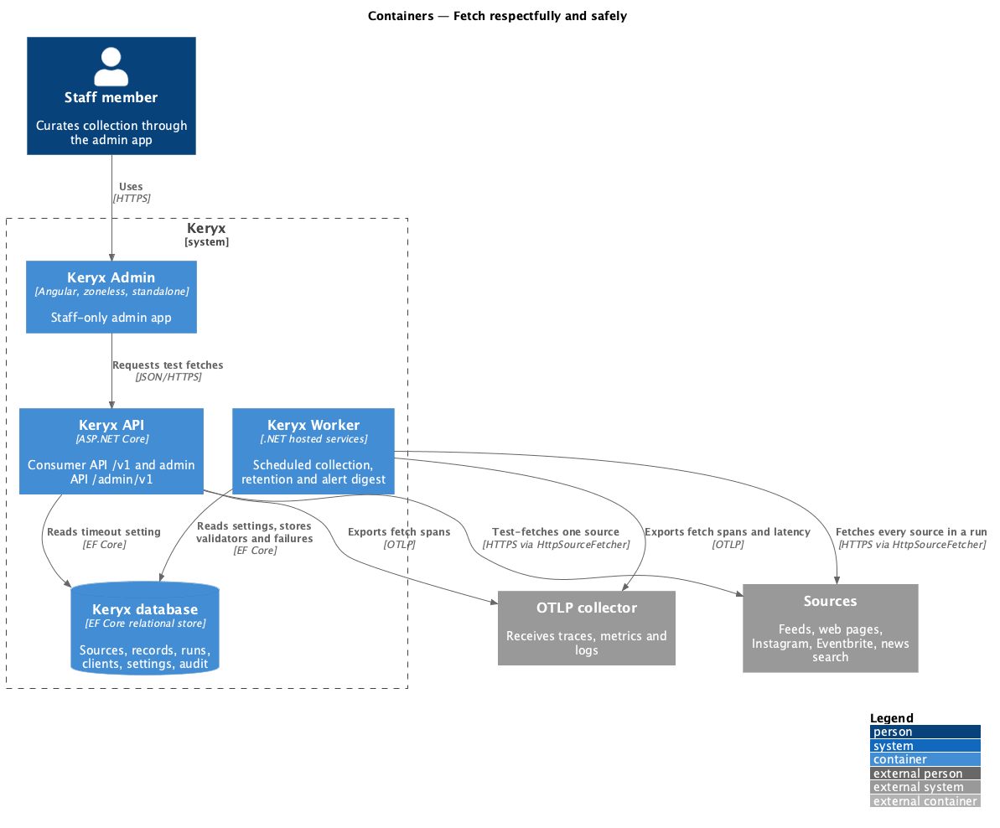
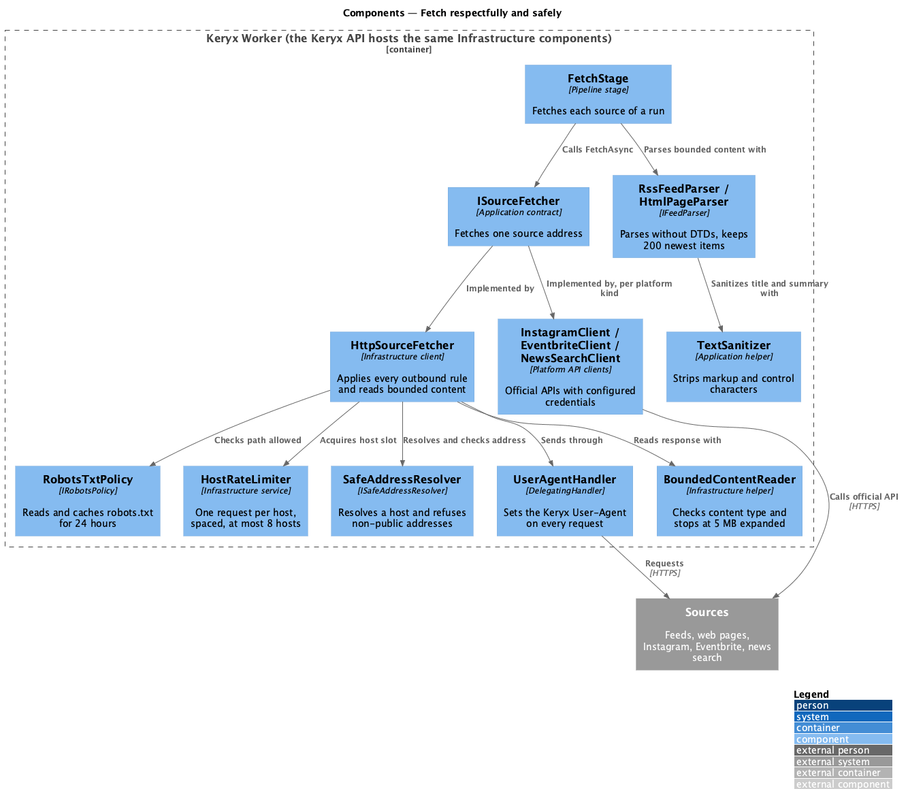
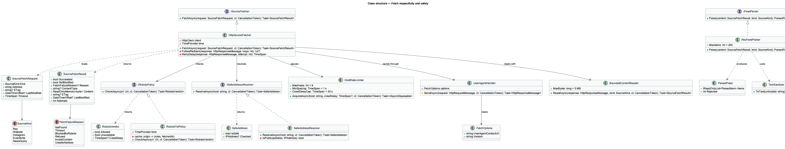
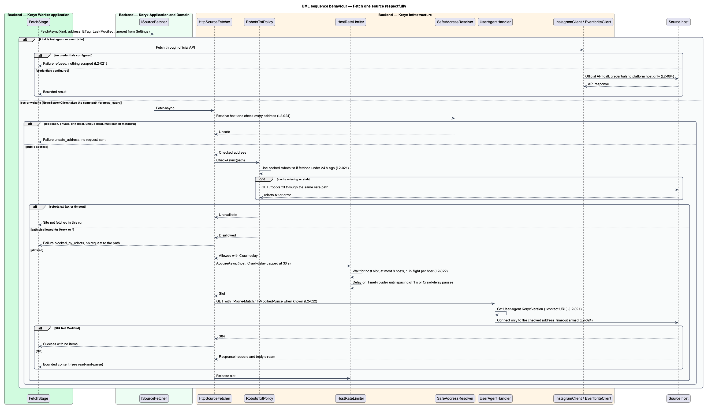
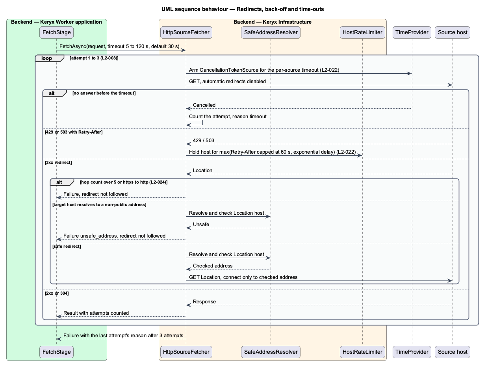
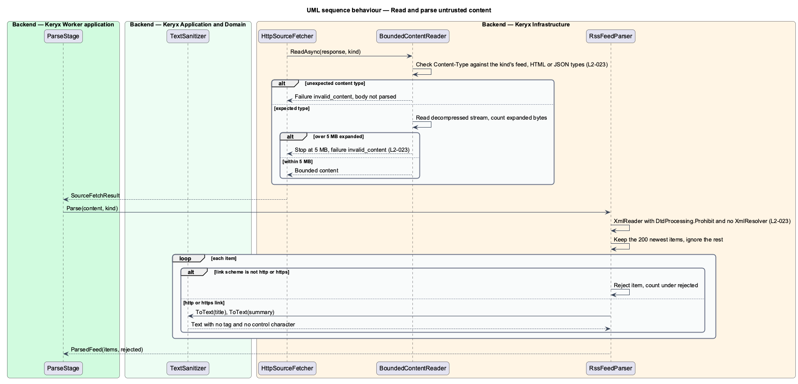

# Fetch respectfully and safely

## Overview

Keryx collects what Christian and fitness organizations publish in Toronto, the Greater Toronto
Area and beyond. Every collection run and every staff test fetch reads from a *source*: a feed,
a web page, an Instagram account, an Eventbrite organizer or a news query. This feature defines
how Keryx makes each of those outbound reads. It has no screen of its own. The test fetch of the
sources subsystem and the fetch stage of the collection pipeline both rely on it.

The feature carries two duties. The first is good citizenship towards each source: Keryx obeys
`robots.txt` and each platform's terms, names itself on every request, spaces and serializes its
requests to one host, backs off when asked, and times out every call. The second is defence
against what comes back: everything fetched is untrusted, so it is bounded, type-checked, never
executed, and never allowed to steer a request to a private or internal address.

- **outbound read** — one HTTPS request Keryx sends to a source host, including the `robots.txt`
  request and each redirect hop
- **host slot** — exclusive permission to send one outbound read to one host at a time
- **checked address** — IP address of a host that the resolver has confirmed as public and that
  the connection is then pinned to
- **conditional request** — request carrying `If-None-Match` or `If-Modified-Since` from the
  `ETag` or `Last-Modified` of the previous successful fetch
- **failure reason** — value from the fixed list `not_found`, `timeout`, `blocked_by_robots`,
  `refused`, `invalid_content`, `unsafe_address` that a failed fetch reports

The rules apply in the same way in the Keryx Worker, which fetches every source in a run, and in
the Keryx API, which test-fetches one source for staff. Both containers host the same
Infrastructure components.

## Description

The feature is a backend slice. It sits behind the Application contract `ISourceFetcher`, so no
handler or stage opens its own connection.

- **`ISourceFetcher`** — Application contract with `FetchAsync(SourceFetchRequest, CancellationToken)`.
  The request carries the `SourceKind`, the address, the previous `ETag` and `Last-Modified`, and
  the per-source timeout. The result is a `SourceFetchResult`: success, not-modified or a
  `FetchFailureReason`, the bounded content and its type, the new validators and the attempt count.
- **`HttpSourceFetcher`** — Infrastructure implementation for `rss` and `website`.
  It refuses an address with a user name, a password or a port other than 80 or 443. It then
  resolves the host, checks `robots.txt`, acquires a host slot, sends a conditional request when
  validators exist, follows redirects itself, retries, and hands the response to
  `BoundedContentReader`. Automatic redirects are off on its `HttpClient`.
- **`SafeAddressResolver`** (`ISafeAddressResolver`) — resolves a host through DNS and refuses it
  when any resolved address is loopback, link-local, private (RFC 1918), unique-local,
  multicast or a cloud-metadata address. IPv4-mapped IPv6 addresses are checked as IPv4. A
  refused host yields `unsafe_address` and no request. Further reserved ranges, such as
  carrier-grade NAT, are `<TO SUPPLY>`.
- **Pinned connection** — the named `HttpClient` uses a `SocketsHttpHandler` whose
  `ConnectCallback` connects only to the checked address, so a host that resolves differently at
  connect time (DNS rebinding) cannot redirect the socket. TLS still validates the host name.
- **Redirect handling** — `HttpSourceFetcher` follows at most 5 redirects. It resolves and checks
  each `Location` host before connecting. It refuses a redirect from `https` to `http`. A
  redirect to a non-public address fails with `unsafe_address`. An over-long chain or a
  downgrade fails with `refused`, and so does a redirect to a scheme other than `http(s)`. The
  hops of a redirect belong to their fetch: each hop's origin has its `robots.txt` checked, but
  hops are not spaced from one another.
- **`RobotsTxtPolicy`** (`IRobotsPolicy`) — fetches `/robots.txt` for an origin through the same
  safe path, parses the group for Keryx's user-agent token and the `*` group, and caches the
  result for 24 hours by the time read from `TimeProvider`. A disallowed path yields
  `blocked_by_robots` with no request to the path. A `robots.txt` answer of 5xx or a timeout
  means the site is not fetched in this run, with reason `refused` (5xx) or `timeout`. A `4xx`
  `robots.txt` allows everything. A `Crawl-delay` is returned to the caller, capped at 30
  seconds. The cache is per process: the API and the Worker each read `robots.txt` once a day.
  The `robots.txt` request is not spaced from the fetch that needed it.
- **`HostRateLimiter`** — keeps at most 1 request in flight per host and at least 1 second
  between successive requests to it, or the `Crawl-delay` when longer. It admits at most 8 hosts
  concurrently. It waits on `TimeProvider`, so tests advance `FakeTimeProvider` and never sleep.
  The limiter is per process; an API test fetch and a Worker run are not coordinated, which at
  worst adds one request to a host in a second.
- **Back-off and retry** — a source is attempted up to 3 times in total (L2-008). After `429` or
  `503` with `Retry-After`, the next attempt waits at least that long, capped at 60 seconds, and
  exponentially longer on each further attempt. Without `Retry-After` the waits are 1 then 2
  seconds. A timeout, a `5xx` and a connection error are retried; any other status is not.
- **Time-outs** — each attempt arms a `CancellationTokenSource` on `TimeProvider` with the
  per-source timeout from `Settings` (5 to 120 seconds, default 30). Expiry cancels the call and
  counts it as an attempt with reason `timeout`. No outbound call is made without a timeout.
- **`UserAgentHandler`** — `DelegatingHandler` that sets a `User-Agent` naming Keryx, its version
  and the contact URL from `FetchOptions.UserAgentContactUrl` on every outbound request. The
  setting is documented under `tools/deploy/` (L2-096).
- **`BoundedContentReader`** — checks `Content-Type` against the feed, HTML or JSON types the
  source's kind expects, and does not parse an unexpected type. It reads the decompressed stream
  and stops at 5 MB of expanded content. Both cases fail with `invalid_content`. The accepted types are:
  `rss` `application/rss+xml`, `application/atom+xml`, `application/rdf+xml`, `application/xml`,
  `text/xml`; `website` `text/html`, `application/xhtml+xml`; `instagram` and `eventbrite`
  `application/json`. A response with no `Content-Type` is not parsed.
- **`RssFeedParser` and `HtmlPageParser`** (`IFeedParser`) — parse with
  `DtdProcessing.Prohibit` and no `XmlResolver`, so no DTD is processed and no entity is resolved.
  A feed with more than 200 items keeps the 200 newest. An item whose link is not `http` or
  `https` (`javascript:`, `data:`, `file:`) is rejected and counted under `rejected`.
- **`TextSanitizer`** — strips markup from a title or summary to plain text and removes control
  characters, so a stored value contains no tag.
- **`InstagramClient`, `EventbriteClient`** — read only through each platform's official API with
  credentials from configuration. Credentials go only to that platform's host over HTTPS and
  never appear in a log, span or error (L2-084). With no credentials configured, the source fails
  with `refused` and no scraping is attempted.
- **`NewsSearchClient`** — reads a `news_query` source from the news search provider, which is
  `<TO SUPPLY>`. It sends its requests through the same named `HttpClient`, so the
  `User-Agent`, the pinned connection, the host slot and the timeout apply to it as well.
- **HTTP status mapping** — a `404` yields `not_found`, and a `304` counts as a successful fetch
  with no items. A `410` is `not_found`; `401`, `403`, another `4xx` and a `5xx` after the last
  attempt are `refused`; a connection to a non-public address is `unsafe_address`.
- **Telemetry** — each fetch is a span carrying the source's id, never its URL's query, and the
  Worker records fetch latency (L2-094). No log line holds fetched content.

The feature exposes no endpoint of its own. Its failure reasons reach staff through
`POST /admin/v1/sources/test`, `POST /admin/v1/sources/{id}/test` and the health served by
`GET /admin/v1/sources`.

## Requirements

The feature realizes the following level-2 (L2) requirements. Each L2 requirement refines a level-1 (L1) requirement, cited by identifier. Their acceptance criteria are in [L2.md](../../../specs/L2.md).

| L2 ID | Refines (L1) | Requirement |
|-------|--------------|-------------|
| `L2-021` | `L1-007` | Robots, terms and identification — Keryx must obey each site's `robots.txt` and each platform's terms, and identify itself on every request. |
| `L2-022` | `L1-007` | Rate limiting, back-off and time-outs — Keryx must never overload a source: requests to one host are serialized and spaced, retries back off, and every call has a time-out. |
| `L2-023` | `L1-007` | Fetched content is untrusted — Everything fetched is untrusted input: it is bounded in size and count, checked against the type expected, and never executed. |
| `L2-024` | `L1-007` | No requests to private or internal addresses — No request is ever sent to a loopback, private, link-local or cloud-metadata address, whether reached directly, by redirect or by DNS rebinding. |

## Diagrams

### System context

Keryx reads from external sources on behalf of staff test fetches and scheduled collection, and
reports each fetch to the OTLP collector.

### Containers

Both the Keryx API (test fetch) and the Keryx Worker (collection) send outbound reads to sources
through the same Infrastructure client; the database supplies the timeout setting and keeps
validators and failures.

### Components

`FetchStage` calls the `ISourceFetcher` contract. `HttpSourceFetcher` applies the address check,
the robots check, the host slot, the identified request and the bounded read, while the platform
clients use official APIs only.

### Class structure

`HttpSourceFetcher` realizes `ISourceFetcher` and depends on `IRobotsPolicy`, `HostRateLimiter`,
`ISafeAddressResolver`, `UserAgentHandler` and `BoundedContentReader`. A failed
`SourceFetchResult` carries one `FetchFailureReason`.

### Behaviour — fetch one source

The fetcher checks the address before anything else, then `robots.txt`, then waits for a host
slot, and sends an identified, conditional request pinned to the checked address. Platform kinds
take the official API path or fail with `refused`.

### Behaviour — redirects, back-off and time-outs

Each attempt runs under the per-source timeout from `TimeProvider`. Redirects are followed by
hand with an address check per hop, and `429` or `503` hold the host for the `Retry-After` delay.

### Behaviour — read and parse untrusted content

The reader checks the content type and stops at 5 MB of expanded content. The parser refuses DTDs,
keeps the 200 newest items, rejects non-web links and sanitizes text before it is stored.

