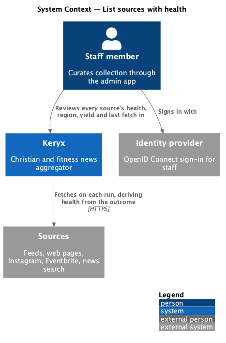
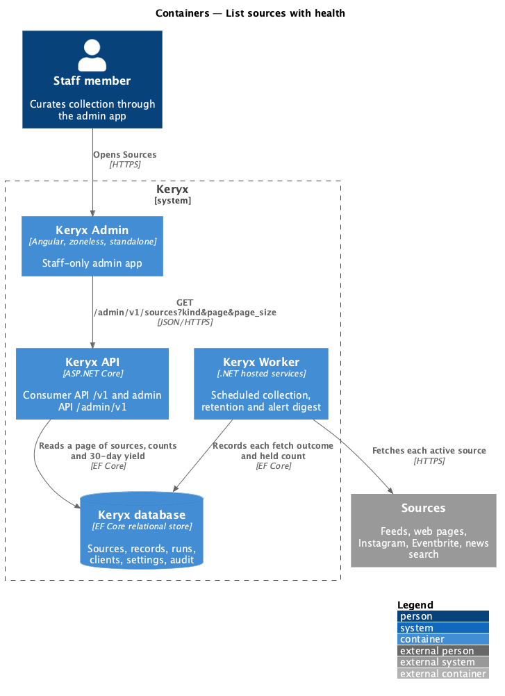
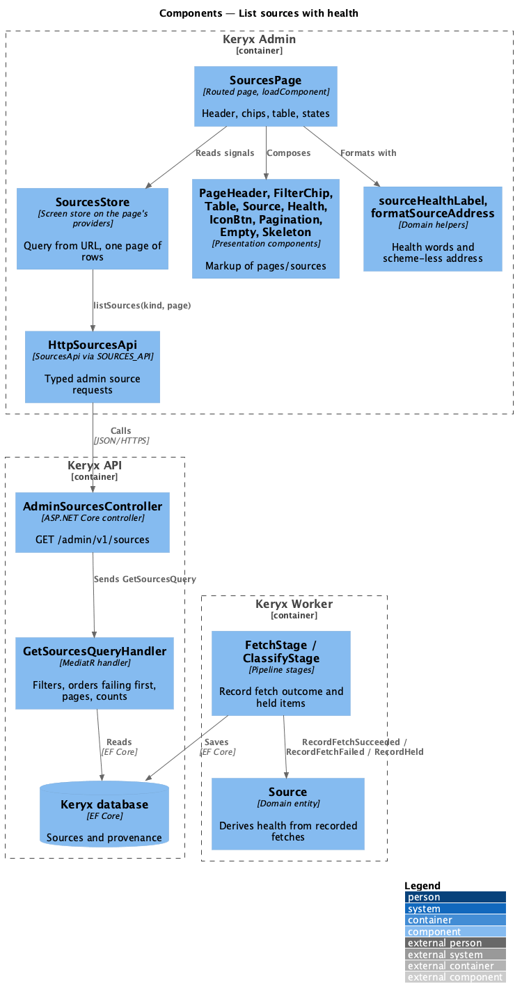
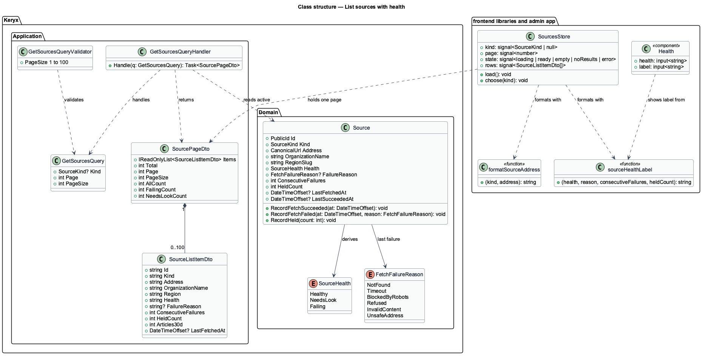
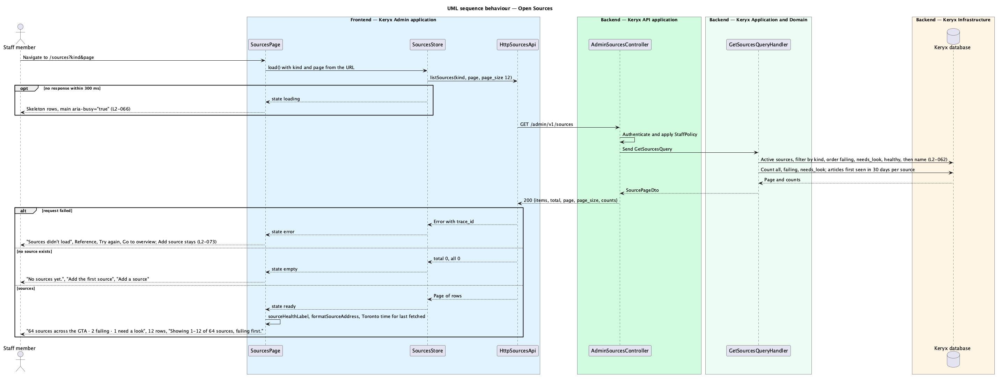
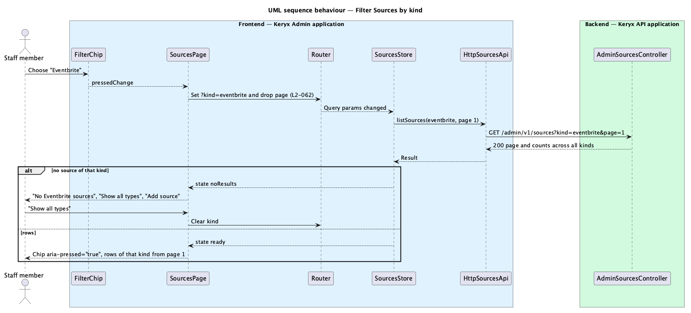
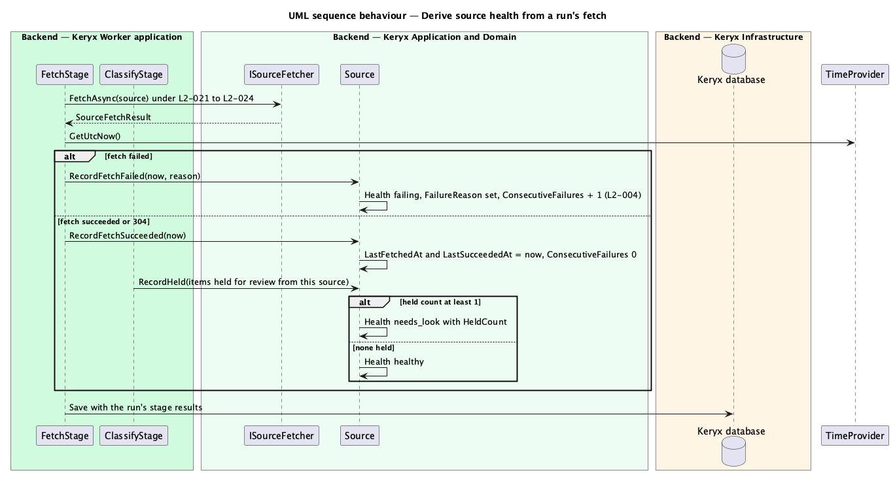

# List sources with health

## Overview

Keryx collects from a catalogue of *sources*: RSS feeds, website pages, Instagram accounts,
Eventbrite organizers and news queries, each belonging to an organization and a region. The
Sources screen of the admin app is where staff see that catalogue: every source with its health,
region, yield and last fetch, failing sources first, filterable by kind. Add, edit, test and
remove start from this screen; those actions are designed in sibling features.

- **health** — state of a source derived from its most recent fetch, one of `healthy`,
  `needs_look` or `failing`, never typed by a person
- **failing** — health of a source whose last fetch failed, with its failure reason and the number
  of consecutive failures
- **needs a look** — health of a source whose last fetch succeeded but held at least one item for
  staff review
- **yield** — number of articles collected from a source in the last 30 days ("Articles · 30d")
- **kind filter** — choice among All, RSS, Website, Instagram, Eventbrite and News query that
  limits the list to one kind and is kept in the URL

Health is computed by the collection run, not by the screen. The Keryx Worker records each
source's fetch outcome and held count on the `Source` entity, which derives its health; the
screen only reads and words it. The screen has designed loading, empty, no-results and error
states.

## Description

The feature is a vertical slice from the Sources screen to the database, plus the domain rule
that derives health during a run.

**Endpoint**

- `GET /admin/v1/sources` — staff policy. Query `kind` (one of the five kinds, optional), `page`
  and `page_size` (1 to 100; the screen sends 12). Outside the range the response is `400`
  `invalid_page`, as for the other admin lists (L2-048). An unknown `kind` is `400`
  `validation_failed` with an `errors.kind` entry.
- Response `200`: `items`, `total`, `page`, `page_size` as numbers, and header counts across all
  active sources whatever the filter (`all_count`, `failing_count`, `needs_look_count`; the names
  are this design's). Each item has `id`, `kind`, `address`, `organization_name`, `region` (the slug),
  `region_name`, `health`, `failure_reason` (L2-002 list or `null`), `consecutive_failures`, `held_count`,
  `articles_30d` and `last_fetched_at` (`null` when never fetched), numbers as numbers.
- Order: `failing`, then `needs_look`, then `healthy`; within each group by organization name.
  Removed sources are excluded.

**Frontend (Keryx Admin)**

- **`SourcesPage`** — routed by `loadComponent`, `OnPush`. It composes `PageHeader` ("Sources",
  the summary line and the "Add source" `btn`), a `filter-chips` group of `FilterChip`, and a
  `Table` captioned "Sources, failing first" (visually hidden) with the columns Source, Health,
  Region, "Articles · 30d", Last fetched and Actions. Below the table a `table-footer` reads
  "Showing 1–12 of 64 sources, failing first." beside a `Pagination` with Previous and Next.
- **Row cells** — the `Source` component shows the organization name and "kind: address" with a
  kind icon; `Health` renders the `health` block (modifiers `health--danger`, `health--warning`)
  with words, so colour never carries the state alone; `IconBtn` "Actions for <name>" opens the
  row `Menu` (see [Test a source fetch](../test-source-fetch/README.md)). The last fetch reads
  "Today, 6:01 AM" in Toronto time.
- **`SourcesStore`** — provided on `SourcesPage`. It derives `kind` and `page` from the URL query
  parameters, loads one page at a time, and exposes `state` (`loading`, `ready`, `empty`,
  `noResults`, `error`), `rows`, `counts` and `range` as signals. It holds one page only and
  cancels a stale request when the query changes (`takeUntilDestroyed` / `switchMap`).
- **Kind chips** — choosing a chip marks it `aria-pressed="true"`, writes `?kind=` to the URL,
  and reloads from page 1. A kind with no source shows the `empty--compact` no-results state "No
  Eventbrite sources" / "None of the 64 sources is an Eventbrite organiser. Show every type, or add
  one." with "Show all types" and "Add source".
- **`sourceHealthLabel`** — domain helper with unit tests producing "Healthy", "Needs a look: 6
  held for review", "Failing: 404 Not Found" and "Failing: Timeout · 4 runs". The label for each
  other reason and the count at which " · N runs" appears are `<TO SUPPLY>`; the mock shows it for
  4 runs and omits it for the 404 example.
- **`formatSourceAddress`** — domain helper that shows a URL without its scheme
  ("redeemedrun.ca/feed") and a news query's text as given. Both are bound as text, never HTML.
- **Loading** — when the first response takes over 300 ms, 12 `skeleton` rows shaped like the
  table appear and the main region carries `aria-busy="true"` (L2-073).
- **Empty** — with no source, the header reads "No sources yet." and the `empty--card` block
  shows "Add the first source", the explanation of what a source is, and "Add a source".
- **Error** — a failed list request shows the page error state: "Sources didn't load", the shared
  sentence, "Reference req_…" from the response's `trace_id`, "Try again" and "Go to overview".
  "Add source" in the header stays available.
- **Narrow viewport** — below 768 px each source is a stacked row with its name, address, health
  and actions, with no horizontal page scroll.

**Backend**

- **`AdminSourcesController`** — sends one `GetSourcesQuery`.
- **`GetSourcesQueryValidator`** and **`GetSourcesQueryHandler`** — validate the paging and kind,
  then read active sources ordered by stored `Health` rank and organization name, page by
  `page` and `page_size`, count the header groups, and count articles first seen from each
  source in the last 30 days (by `Provenance`, relative to `TimeProvider`).
- **`Source`** — domain entity that stores `Health`, `FailureReason`, `ConsecutiveFailures`,
  `HeldCount`, `LastFetchedAt` and `LastSucceededAt`. Only its methods change them:
  `RecordFetchFailed(at, reason)` sets `failing` and adds 1 to `ConsecutiveFailures`;
  `RecordFetchSucceeded(at)` sets both times and resets `ConsecutiveFailures` to 0; `RecordHeld(count)`
  sets `needs_look` when the count is at least 1 and `healthy` otherwise. A source never fetched
  is `healthy` with `LastFetchedAt` `null`. No endpoint accepts a health value.
- **`FetchStage` and `ClassifyStage`** — collection stages in the Keryx Worker that call those
  methods after a source's final attempt (L2-008) and after classification. The stages are
  designed in the collection subsystem.

## Requirements

The feature realizes the following level-2 (L2) requirements. Each L2 requirement refines a level-1 (L1) requirement, cited by identifier. Their acceptance criteria are in [L2.md](../../../specs/L2.md).

| L2 ID | Refines (L1) | Requirement |
|-------|--------------|-------------|
| `L2-004` | `L1-001` | Source health — A source's health is `healthy`, `needs_look` or `failing`, derived from its most recent fetches, never typed by a person. |
| `L2-062` | `L1-014` | Sources list — Sources lists every source with its health, region, yield and last fetch, failing first, and can be filtered by kind. |
| `L2-066` | `L1-014` | Sources loading, empty and error — Sources has designed loading, empty and error states. |

## Diagrams

### System context

Staff read the source catalogue in Keryx; Keryx derives each source's health from fetching it.

### Containers

The admin app reads one page of sources from the admin API. The Worker writes each fetch outcome
to the database, where the API reads it.

### Components

`SourcesPage` composes presentation components and formats with domain helpers, `SourcesStore`
loads one page through `HttpSourcesApi`, and the query handler reads the database. In the Worker
the stages record outcomes on `Source`.

### Class structure

`GetSourcesQueryHandler` returns a `SourcePageDto` of at most 100 `SourceListItemDto` rows.
`Source` derives `SourceHealth` from its recorded fetches, and the frontend words it with
`sourceHealthLabel`.

### Behaviour — open Sources

The store loads one page; skeletons appear only after 300 ms. The response selects the error,
empty or ready state.

### Behaviour — filter by kind

A chip writes the kind to the URL and reloads from page 1; a kind with no source shows the
no-results state, which offers a way back to All.

### Behaviour — derive health

After a source's final attempt the fetch stage records success or failure, and classification
records the held count; `Source` derives its health from them.

