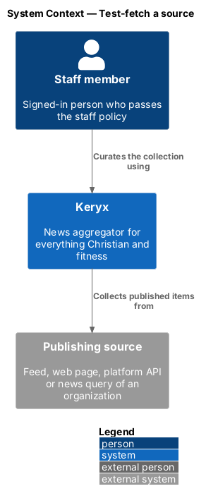
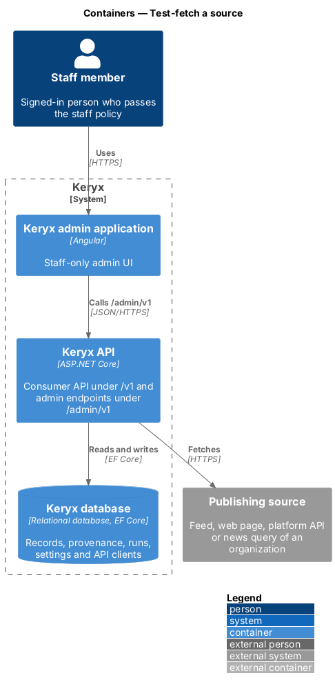
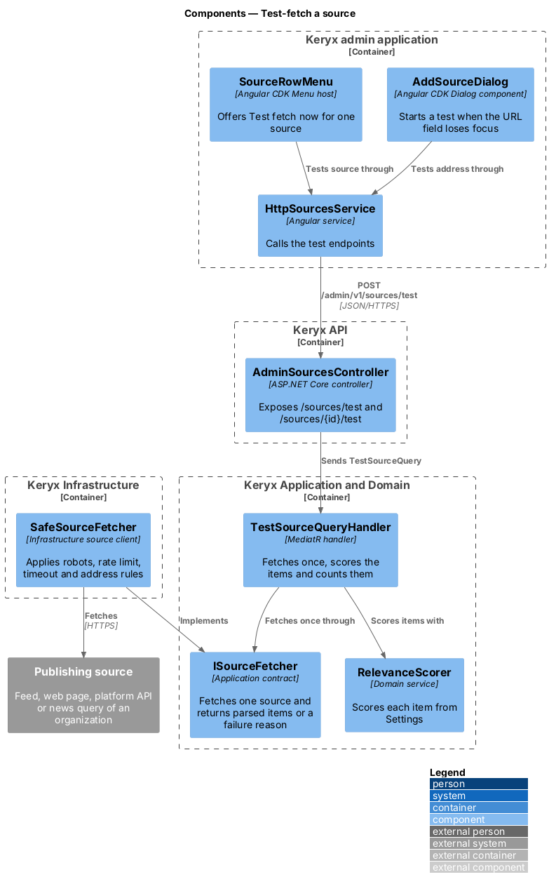
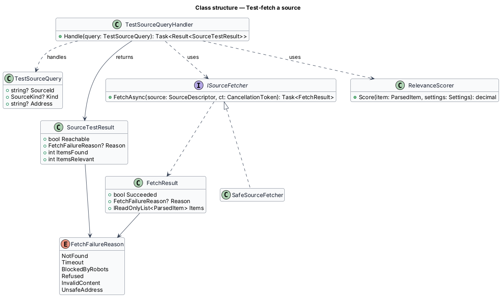
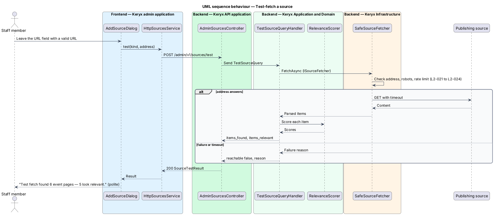

# Test-fetch a source

## Overview

A *test fetch* is one fetch of a source address outside a run. It tells a staff member whether the address answers and whether what it returns looks relevant. It stores no article, event, organization or run, and it does not change the stored health of an existing source.

Three places start a test fetch: the Add a source dialog when its URL field loses focus with a valid URL, the Edit source dialog on save, and the "Test fetch now" item of a source row menu. A test fetch obeys every fetching rule of a collection run: robots, rate limits, time-outs and safe addresses ([Fetch safely and respectfully](../../collection/fetch-safely/README.md)).

> **test fetch** — single fetch of a source address, outside a run, that stores no record

## Description

The slice reuses the collection pipeline's fetch, parse and classify steps behind their contracts and discards the result after counting it.

- **`AddSourceDialog`** — Angular CDK Dialog component in the Keryx admin application. Starts a test when the URL field loses focus with a valid URL. It shows the result under the field in a polite live region and runs no test for an invalid URL.
- **`SourceRowMenu`** — Angular CDK Menu host in the Keryx admin application. Offers Test fetch now for one source.
- **`HttpSourcesService`** — Angular service in the Keryx admin application. Calls the test endpoints.
- **`AdminSourcesController`** — ASP.NET Core controller in the Keryx API. Exposes /sources/test and /sources/{id}/test.
- **`TestSourceQueryHandler`** — MediatR handler in the Application and Domain layers. Fetches once through `ISourceFetcher`, scores the items with `RelevanceScorer` and returns `items_found` and `items_relevant` as numbers. It writes nothing. An item counts as relevant when its score is at or above the publish threshold in Settings.
- **`ISourceFetcher`** — Application contract in the Application and Domain layers. Fetches one source and returns parsed items or a failure reason from the fixed list `not_found`, `timeout`, `blocked_by_robots`, `refused`, `invalid_content`, `unsafe_address`.
- **`RelevanceScorer`** — Domain service in the Application and Domain layers. Scores each item from Settings.
- **`SafeSourceFetcher`** — Infrastructure source client in the Infrastructure layer. Applies robots, rate limit, timeout and address rules.
- **`TestSourceQuery`** — MediatR request carrying either a kind and an address, or the id of an existing source.
- **`SourceTestResult`** — DTO with `reachable`, `reason`, `items_found` and `items_relevant`.
- **`FetchFailureReason`** — enumeration of the six failure reasons shared with source health.

## Requirements

The feature realizes the following level-2 (L2) requirements. Each L2 requirement refines a level-1 (L1) requirement, cited by identifier. The acceptance criteria of each requirement are in [`docs/specs/L2.md`](../../../specs/L2.md).

| L2 ID | Refines (L1) | Requirement |
|-------|--------------|-------------|
| [`L2-002`](../../../specs/L2.md#l2-002-source-test-fetch) | `L1-001` | **Source test fetch.** A source can be fetched once, outside a run, to tell staff whether it works and whether what it returns looks relevant. A test fetch stores no records. |

## Diagrams

### System context

A staff member curates the collection through Keryx. Keryx collects published items from publishing sources.

### Containers

The staff member uses the Keryx admin application. The Keryx admin application calls the Keryx API at `/admin/v1`. The Keryx API reads and writes the Keryx database. The Keryx API fetches the publishing source.

### Components

Both entry points call `HttpSourcesService`. `TestSourceQueryHandler` depends on the `ISourceFetcher` contract, which `SafeSourceFetcher` implements in the Infrastructure layer, and on `RelevanceScorer`.

### Class structure

`TestSourceQueryHandler` depends on the `ISourceFetcher` contract and returns a `SourceTestResult`; `SafeSourceFetcher` realizes the contract.

### Behaviour — test-fetch a source

The handler fetches once under the rules of `L2-021` to `L2-024`. An unreachable address still answers `200`, with `reachable: false` and a reason; nothing is stored in either branch.

