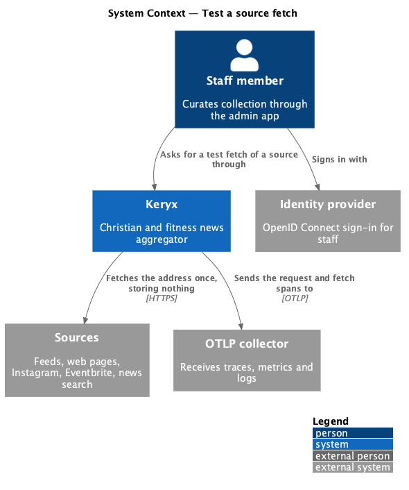
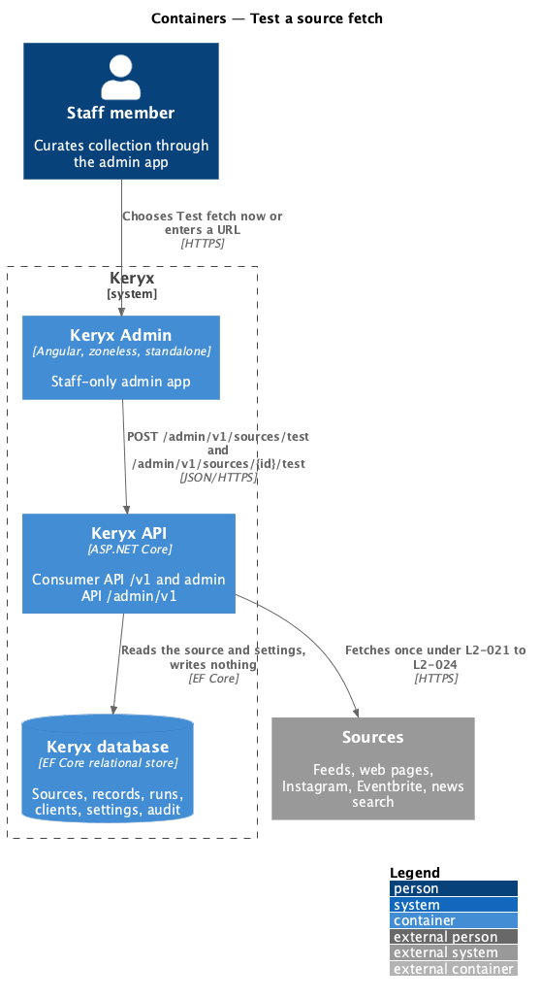
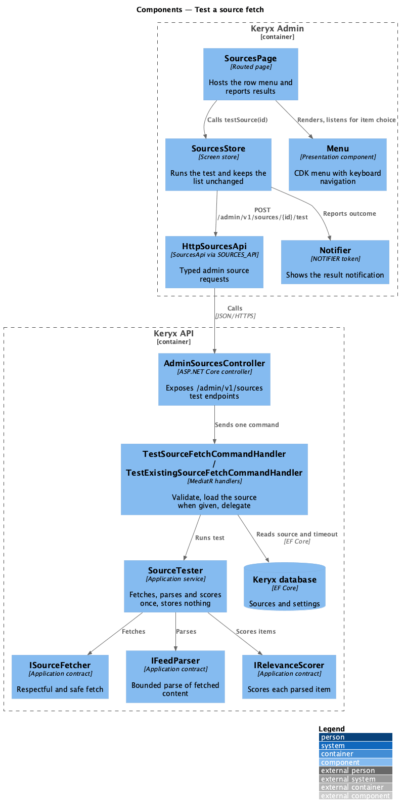
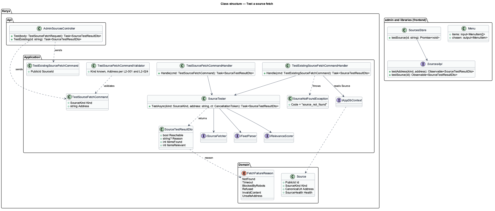
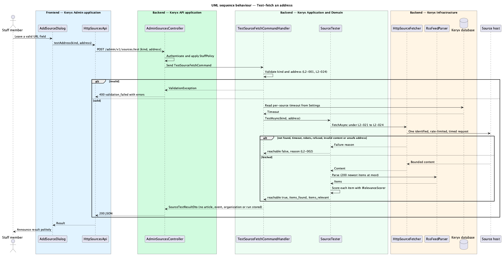
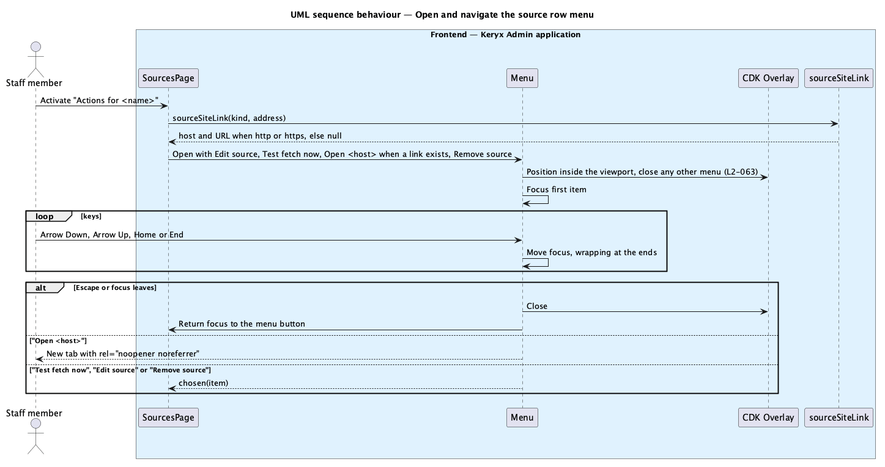
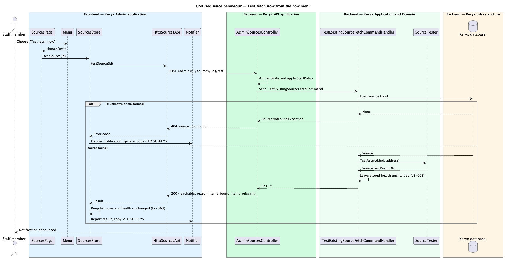

# Test a source fetch

## Overview

A *source* is a place Keryx collects from: an RSS feed, a website page, an Instagram account, an
Eventbrite organizer or a news query, belonging to an organization and a region. Collection runs
read every source on a schedule. Staff also need to know, before or between runs, whether one
source works and whether what it returns looks relevant. This feature answers that question.

- **test fetch** — single fetch of one source address outside a run that reports reachability
  and counts and stores no records
- **row menu** — menu opened from the "Actions for <name>" button on a row of the Sources screen
- **relevant item** — parsed item whose relevance score passes the threshold the test applies

A test fetch is reached two ways. The Add a source dialog tests a new address when its URL field
loses focus (designed in [Add a source](../add-source/README.md)). The row menu on the Sources
screen offers "Test fetch now" for a source already in the list, and reports the result through a
notification. Saving an edited source also runs a test fetch (designed in
[Edit and remove a source](../edit-and-remove-source/README.md)).

A test fetch obeys every outbound rule of
[Fetch respectfully and safely](../fetch-respectfully-and-safely/README.md): `robots.txt`, host
rate limits, the per-source timeout and the private-address refusal. It never changes the stored
health of a source; only collection runs derive health.

## Description

The feature is a vertical slice from the Sources screen and the Add a source dialog to the
outbound fetch.

**Endpoints**

- `POST /admin/v1/sources/test` — body `kind` and `address`. Answers `200` with `reachable`
  (boolean), `reason` (one of `not_found`, `timeout`, `blocked_by_robots`, `refused`,
  `invalid_content`, `unsafe_address`, or `null`), `items_found` and `items_relevant` as numbers.
  An unreachable address is still `200`, with `reachable: false` and a `reason`. A malformed body
  answers `400` with `code` `validation_failed` and an `errors` entry per field.
- `POST /admin/v1/sources/{id}/test` — no body. Answers the same `200` shape for an existing
  source. An unknown or malformed id answers `404` with `code` `source_not_found`.
- Both require the staff policy, store no article, event, organization or run, and write no
  audit entry because they change no state.

**Frontend (Keryx Admin)**

- **`SourcesPage`** — routed page (`loadComponent`) that renders one row menu per source and
  passes the chosen item to `SourcesStore`.
- **`Menu`** — presentation component in the components library, block `menu` with
  `menu__item` and `menu__divider` as in `pages/sources/menu.html`. It is built on the CDK menu
  and overlay. It opens with focus on the first item, moves with Arrow Down, Arrow Up, Home and
  End and wraps, closes on Escape or focus loss with focus back on its `icon-btn` trigger, stays
  inside the viewport, and allows one open menu at a time.
- **`sourceSiteLink`** — pure helper in the domain library. It returns the host and URL of an
  `http` or `https` address and `null` otherwise, so a news query source has no "Open <host>"
  item. The link opens in a new tab with `rel="noopener noreferrer"` and the visually hidden
  text "(opens in a new tab)".
- **`SourcesStore`** — screen store provided on `SourcesPage`. Its `testSource(id)` calls the API
  and hands the outcome to `Notifier`. It does not touch the rows, so the listed health stays
  unchanged.
- **`SourcesApi`** (`SOURCES_API`) — contract in the api library with `testAddress(kind, address)`
  and `testSource(id)` returning `SourceTestResultDto`; `HttpSourcesApi` implements it and is
  bound in `app.config.ts`.
- **`Notifier`** (`NOTIFIER`) — shows the result as a `toast`. The source-toast mocks hold no
  test-result state, so its titles and copy for reachable, unreachable and `source_not_found`
  outcomes are `<TO SUPPLY>`.

**Backend (Keryx API)**

- **`AdminSourcesController`** — exposes both endpoints, checks nothing and sends one command.
- **`TestSourceFetchCommand`** and **`TestSourceFetchCommandValidator`** — carry `kind` and
  `address`; the validator applies the address rules of L2-001 and L2-024 (scheme `http` or
  `https`, no user name or password, port 80 or 443).
- **`TestExistingSourceFetchCommand`** — carries the source `PublicId`. Its handler loads the
  `Source` through `IAppDbContext` and throws `SourceNotFoundException` (`source_not_found`)
  when none matches.
- **`SourceTester`** — Application service shared by both handlers and by the create and update
  handlers. It reads the per-source timeout from `Settings`, calls `ISourceFetcher`, parses with
  `IFeedParser`, scores each item with `IRelevanceScorer`, and returns `SourceTestResultDto`. It
  writes nothing. An item counts under `items_relevant` when its score reaches the publish threshold
  in `Settings`, so the number says how much a run would publish.
- **Platform kinds** — an `instagram` or `eventbrite` test with no platform credentials
  configured returns `reachable: false` with `reason` `refused`. L2-021 says the add-source test
  then reports the kind as unavailable; no extra field is served: the screen
  reads `refused` for a platform kind as "kind unavailable", since only the missing credentials
  refuse a platform test before any request.
- **Telemetry** — the request span records the route template and the fetch span records the
  source id, never the address's query (L2-094).

## Requirements

The feature realizes the following level-2 (L2) requirements. Each L2 requirement refines a level-1 (L1) requirement, cited by identifier. Their acceptance criteria are in [L2.md](../../../specs/L2.md).

| L2 ID | Refines (L1) | Requirement |
|-------|--------------|-------------|
| `L2-002` | `L1-001` | Source test fetch — A source can be fetched once, outside a run, to tell staff whether it works and whether what it returns looks relevant. A test fetch stores no records. |
| `L2-063` | `L1-014` | Source row menu — Each source row has a menu of its actions that follows the WAI-ARIA menu pattern. |

## Diagrams

### System context

Staff ask Keryx for a test fetch; Keryx reads the source once and reports to the OTLP collector.

### Containers

The admin app calls the admin API, which reads the source and settings from the database, writes
nothing, and fetches the source once.

### Components

The page and its store call `HttpSourcesApi`; on the server two handlers share `SourceTester`,
which composes the fetch, parse and score contracts.

### Class structure

Both commands lead to `SourceTester`, which returns `SourceTestResultDto`. Only the existing-source
handler reads a `Source` and can raise `source_not_found`.

### Behaviour — test-fetch an address

A validated address is fetched once under the outbound rules; an unreachable address still
answers `200` with `reachable: false` and a reason from the fixed list.

### Behaviour — open and navigate the row menu

The menu opens in a CDK overlay with focus on its first item, wraps under the arrow keys, and
returns focus to its button when it closes. "Open <host>" appears only for a web address.

### Behaviour — test fetch now

"Test fetch now" tests the saved source and reports through a notification; the stored and
listed health stay unchanged.

