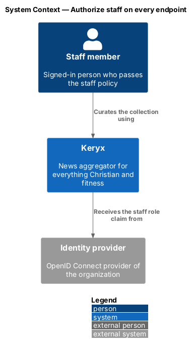
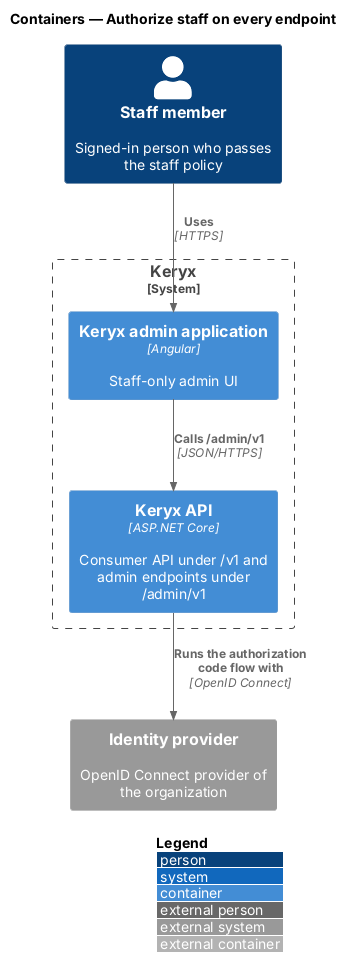
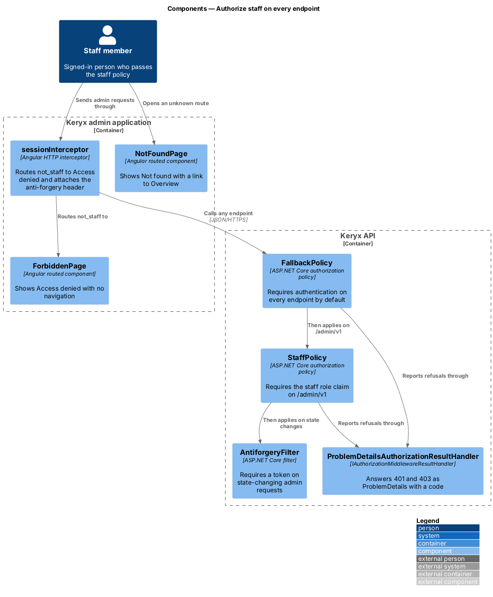
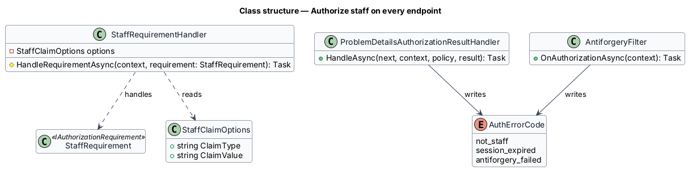
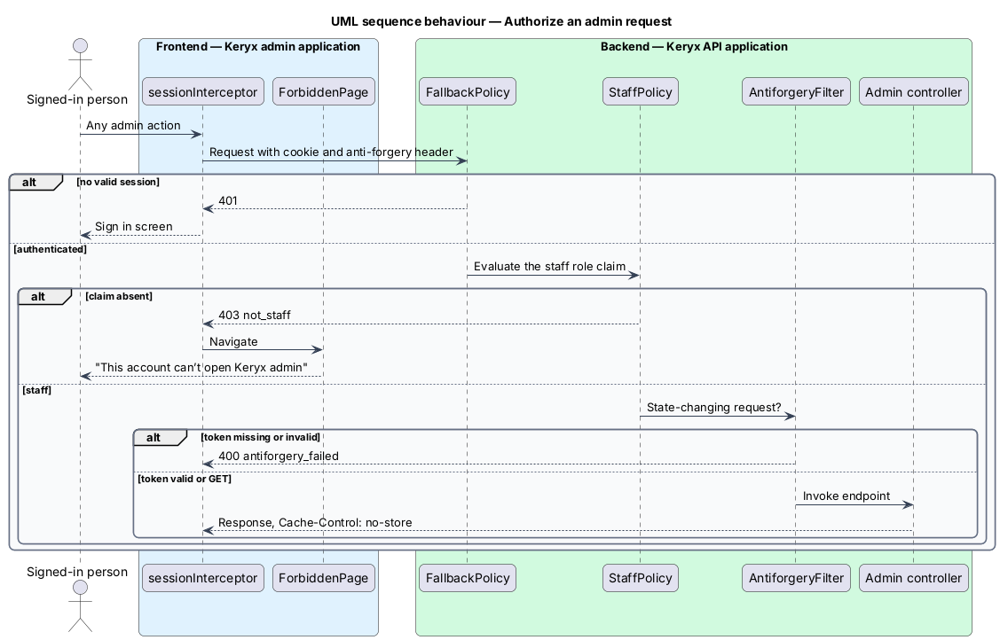

# Authorize staff on every endpoint

## Overview

Authentication alone does not open Keryx. Each endpoint requires authentication unless it is explicitly anonymous, and each admin endpoint requires the *staff policy*: the person carries the staff role claim issued by the identity provider. A signed-in person who is not staff is refused.

Five endpoints are anonymous: sign-in, the sign-in callback, sign-out, health and the OpenAPI document. An admin endpoint that changes state also requires an anti-forgery token, because the session is a cookie.

The admin application has two screens for the refusals: Access denied, with no navigation and the action "Sign in with a different account", and Not found, with a link to Overview.

> **staff policy** — authorization policy that requires an authenticated session carrying the staff role claim

## Description

The slice is configuration of the API host's authorization, plus two screens and one guard in the admin application.

- **`FallbackPolicy`** — ASP.NET Core authorization policy in the Keryx API. Requires authentication on every endpoint by default. An endpoint is anonymous only through an explicit `[AllowAnonymous]`.
- **`StaffPolicy`** — ASP.NET Core authorization policy in the Keryx API. Requires the staff role claim on `/admin/v1`. The claim type and value come from configuration. A person without it gets `403` with `code` `not_staff`.
- **`ProblemDetailsAuthorizationResultHandler`** — IAuthorizationMiddlewareResultHandler in the Keryx API. Answers 401 and 403 as ProblemDetails with a code.
- **`AntiforgeryFilter`** — ASP.NET Core filter in the Keryx API. Requires an anti-forgery token on each `/admin/v1` request that changes state; a request without it is refused with `400` and `code` `antiforgery_failed`.
- **`sessionInterceptor`** — Angular HTTP interceptor in the Keryx admin application. Routes not_staff to Access denied and attaches the anti-forgery header.
- **`ForbiddenPage`** — Angular routed component in the Keryx admin application. Shows "This account can’t open Keryx admin" with no navigation and the action "Sign in with a different account".
- **`NotFoundPage`** — Angular routed component in the Keryx admin application. Is the wildcard route; a signed-in person who opens a route that does not exist sees it.
- **`AuthErrorCode`** — the codes `not_staff`, `session_expired` and `antiforgery_failed` that the admin application branches on.

## Requirements

The feature realizes the following level-2 (L2) requirements. Each L2 requirement refines a level-1 (L1) requirement, cited by identifier. The acceptance criteria of each requirement are in [`docs/specs/L2.md`](../../../specs/L2.md).

| L2 ID | Refines (L1) | Requirement |
|-------|--------------|-------------|
| [`L2-040`](../../../specs/L2.md#l2-040-staff-authorization) | `L1-010` | **Staff authorization.** The requirement is defined by its 4 acceptance criteria. |

## Diagrams

### System context

A staff member curates the collection through Keryx. Keryx receives the staff role claim from the identity provider.

### Containers

The staff member uses the Keryx admin application. The Keryx admin application calls the Keryx API at `/admin/v1`. The Keryx API runs the authorization code flow with the identity provider.

### Components

`FallbackPolicy` covers every endpoint and `StaffPolicy` covers the `/admin/v1` route group; `ProblemDetailsAuthorizationResultHandler` shapes the refusals that `sessionInterceptor` routes to `ForbiddenPage`.

### Class structure

`StaffRequirement` is satisfied by `StaffRequirementHandler` from the configured claim. The result handler maps each failure to an `AuthErrorCode`.

### Behaviour — authorize an admin request

The checks run in a fixed order: authentication, staff claim, anti-forgery token. Each refusal carries a `code` the admin application branches on (`L2-040`).

