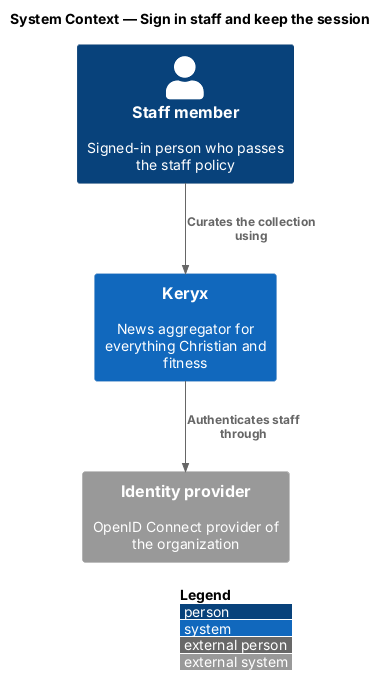
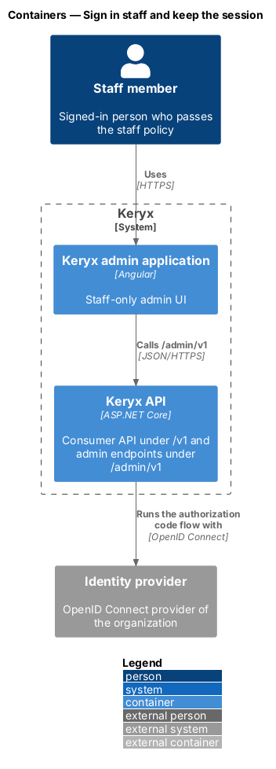
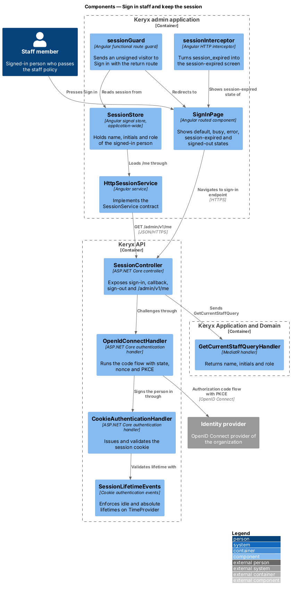
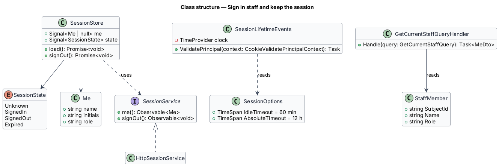
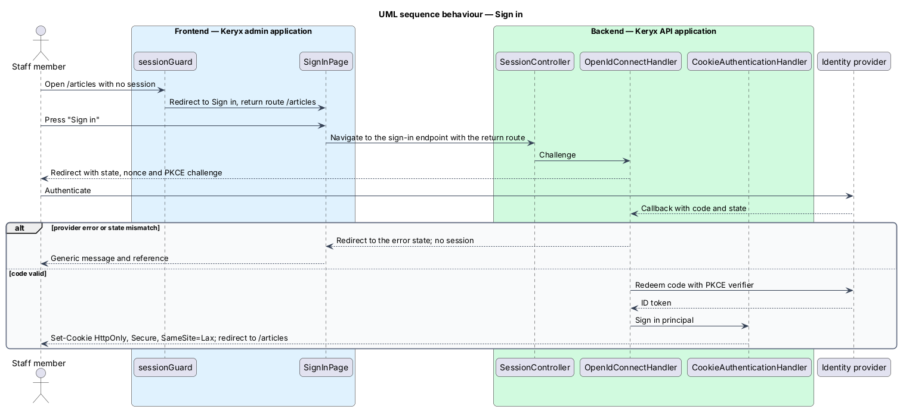
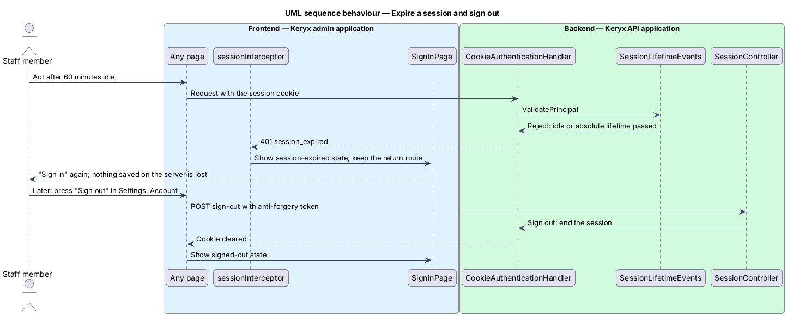

# Sign in staff and keep the session

## Overview

Only signed-in staff use the admin application. Staff sign in through the organization's identity provider with OpenID Connect, using the authorization code flow with PKCE. Keryx stores no staff password.

The API host runs the flow and holds the session in a cookie that is `HttpOnly`, `Secure` and `SameSite=Lax`. The admin application never sees a token and keeps nothing in `localStorage` or `sessionStorage`. A session ends after 60 minutes idle or 12 hours in total, both configurable, or when the staff member signs out from the Account section of Settings.

A person who opens an admin route without a session is sent to the Sign in screen and, after signing in, arrives at the route they asked for when that route is a path inside the application, otherwise at Overview.

> **session** — server-issued, cookie-held proof that a person has signed in through the identity provider

> **return route** — path inside the admin application to open after sign-in

## Description

The slice is the cookie and OpenID Connect schemes of the API host, a session controller, and the guard, store and Sign in screen of the admin application.

- **`sessionGuard`** — Angular functional route guard in the Keryx admin application. Sends an unsigned visitor to Sign in with the return route. It accepts a return route only when it is a path inside the application.
- **`SignInPage`** — Angular routed component in the Keryx admin application. Shows default, busy, error, session-expired and signed-out states. "Sign in" shows its busy state and navigates the browser to the sign-in endpoint. The error state shows a generic message and a reference.
- **`SessionStore`** — Angular signal store, application-wide in the Keryx admin application. Holds name, initials and role of the signed-in person.
- **`sessionInterceptor`** — Angular HTTP interceptor in the Keryx admin application. Turns a `401` with `code` `session_expired` on any request into the session-expired state of the Sign in screen, and keeps the route to return to.
- **`HttpSessionService`** — Angular service in the Keryx admin application. Implements the SessionService contract.
- **`SessionController`** — ASP.NET Core controller in the Keryx API. Exposes sign-in, the callback, sign-out and `GET /admin/v1/me`. Sign-out ends the session on the server and clears the cookie. Each admin response carries `Cache-Control: no-store`, so Back shows no admin data after sign-out.
- **`OpenIdConnectHandler`** — ASP.NET Core authentication handler in the Keryx API. Runs the code flow with `state`, `nonce` and a PKCE challenge. A provider error or a mismatched `state` creates no session and redirects to the Sign in screen's error state.
- **`CookieAuthenticationHandler`** — ASP.NET Core authentication handler in the Keryx API. Issues and validates the session cookie.
- **`SessionLifetimeEvents`** — Cookie authentication events in the Keryx API. Enforces the idle lifetime (60 minutes) and the absolute lifetime (12 hours) on `TimeProvider`; an expired session answers `401` with `code` `session_expired`.
- **`GetCurrentStaffQueryHandler`** — MediatR handler in the Application and Domain layers. Returns name, initials and role.
- **`StaffMember`** — entity with the provider's subject id, the name and the role; the only staff data Keryx keeps besides the alert address.
- **`MeDto`** — `name`, `initials` and `role`.

## Requirements

The feature realizes the following level-2 (L2) requirements. Each L2 requirement refines a level-1 (L1) requirement, cited by identifier. The acceptance criteria of each requirement are in [`docs/specs/L2.md`](../../../specs/L2.md).

| L2 ID | Refines (L1) | Requirement |
|-------|--------------|-------------|
| [`L2-039`](../../../specs/L2.md#l2-039-staff-sign-in) | `L1-010` | **Staff sign-in.** Staff sign in through the organization's identity provider with OpenID Connect (authorization code flow with PKCE). Keryx stores no staff password. Mocks: `pages/sign-in/default.html`, `busy.html`, `error.html`. |
| [`L2-041`](../../../specs/L2.md#l2-041-session-lifetime-and-sign-out) | `L1-010` | **Session lifetime and sign-out.** The requirement is defined by its 4 acceptance criteria. |

## Diagrams

### System context

A staff member curates the collection through Keryx. Keryx authenticates staff through the identity provider.

### Containers

The staff member uses the Keryx admin application. The Keryx admin application calls the Keryx API at `/admin/v1`. The Keryx API runs the authorization code flow with the identity provider.

### Components

`sessionGuard` and `sessionInterceptor` protect each route and request. `SessionController` delegates the flow to `OpenIdConnectHandler` and the session to `CookieAuthenticationHandler` with `SessionLifetimeEvents`.

### Class structure

`SessionStore` exposes the signed-in `Me` as a signal. `SessionLifetimeEvents` holds the two lifetimes from configuration.

### Behaviour — sign in

The API host runs the whole flow; the browser only follows redirects. A failed callback creates no session (`L2-039`).

### Behaviour — expire a session and sign out

`SessionLifetimeEvents` rejects an idle or old session with `session_expired`; the interceptor shows the Sign in screen and keeps the route (`L2-041`).

